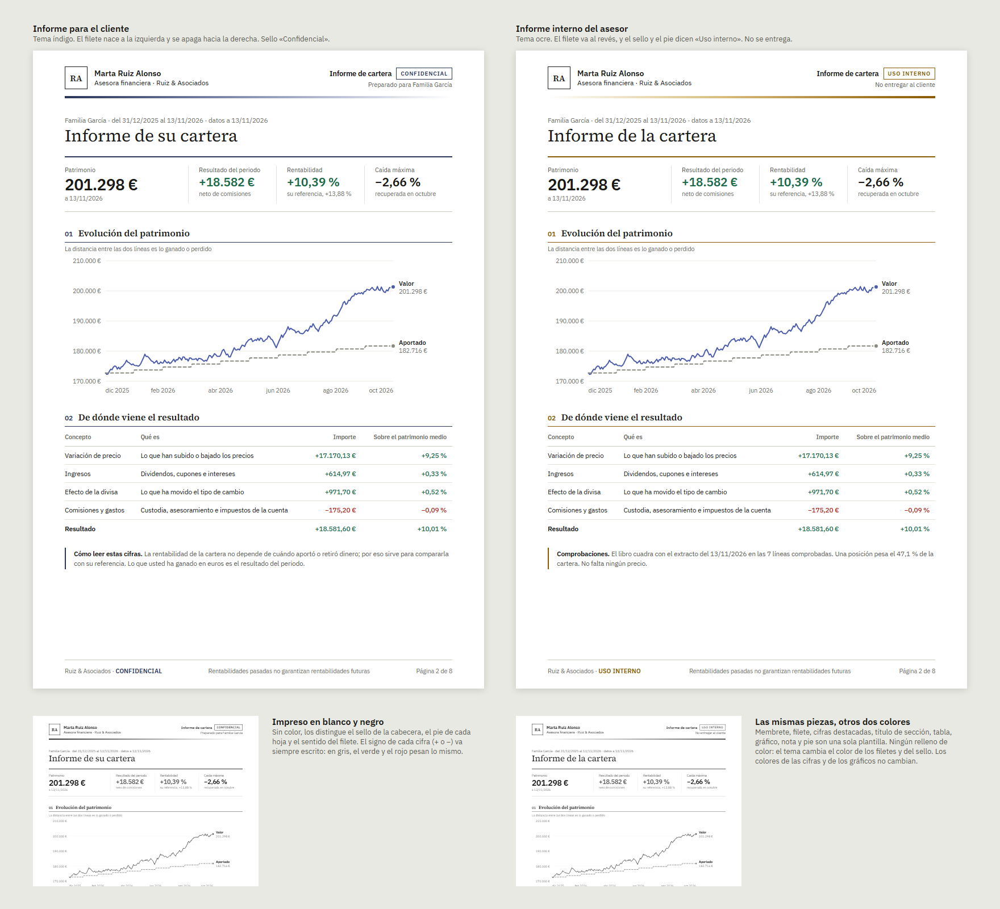
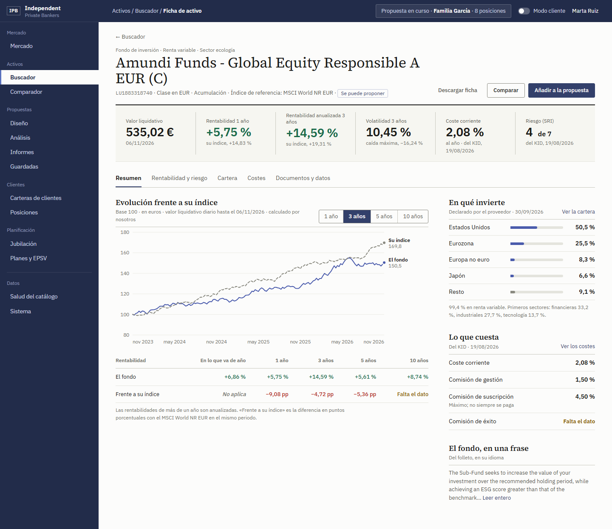
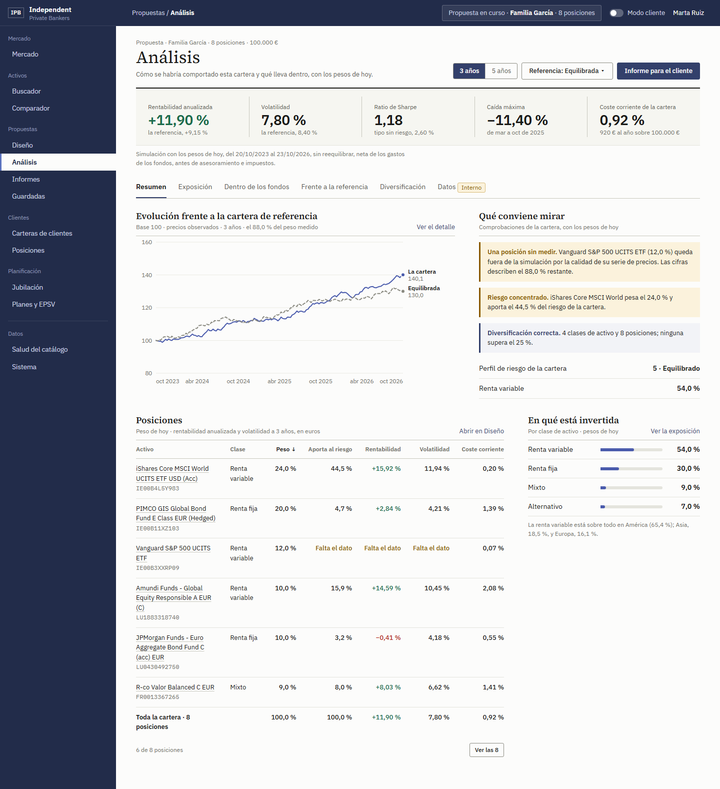
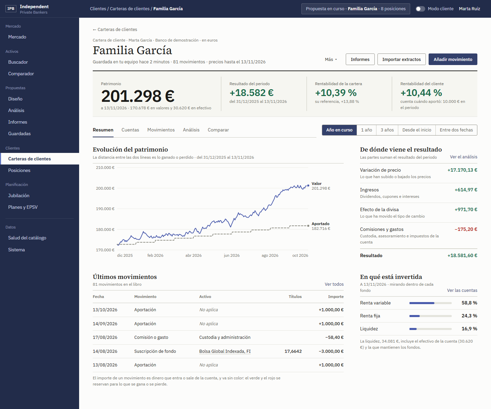

# Sistema de diseño

*13-11-2026. Propuesta de la dirección del frontend, a partir de la auditoría (`AUDITORIA.md` y `anexos/`).
**Aprobada por Óscar el 13-11-2026, con un cambio:** la cabecera de los informes no lleva ningún color sólido
(«No me gusta un color sólido»). Entre cuatro alternativas sin relleno eligió **el filete degradado**; lo demás,
aprobado tal como estaba. El apartado 8 y la maqueta de informes ya recogen el cambio. Las maquetas están en
`maquetas/` y se regeneran con `node scripts/capturaMaquetas.mjs` desde `3-BDB-ACTIVOS_app`.*

*Revisado el 14-11-2026 por la tarde: Óscar pidió más color, recuperar gráficos y datos que el rediseño había quitado y
el aspecto de los informes de antes. Lo que cambia está en el **apartado 12**, que manda sobre los apartados 0, 4, 7 y 8
en lo que los contradiga.*

*Y el 15-11-2026, el aspecto: de los dos diseños que se podían probar en la aplicación, Óscar se quedó con el «Nuevo»
—lienzo gris, cada bloque una tarjeta, azul de marca, letra un punto mayor, títulos en Manrope— y se retiró el otro. Lo
que cambia está en el **apartado 13**, que manda sobre el 2 y el 4, y sobre el 12 en los valores de color.*

*Y el 17-11-2026, la dirección: entre tres direcciones visuales, Óscar eligió la A, «Banca privada, puesta al día»
—lienzo marfil, marco marino con latón, serifa solo en lo que titula o contesta una pantalla, colores de clase
propios—, y el 18-11 aprobó migrarla al código en una rama aparte. Lo que cambia está en el **apartado 14**, que manda
sobre el 12 y el 13 en todo lo que es aspecto. Los apartados 0, 2, 4 y 7 conservan valores que ya no se pintan: el
valor de hoy es el de `src/styles/tokens.css`. El 8 describe los informes, que no entran en la dirección A: lo vigente
sobre el aspecto del papel está en «Los informes» del apartado 12, salvo los colores que copia de la pantalla, que
están en el 13 y en el 14.3; y sus valores, en `src/reports/plantilla/tema.ts`.*

## 0. Lo aprobado, en una pantalla

1. **La dirección: «Informe vivo».** La pantalla se lee como un buen informe de banca privada que además se
   puede manejar: papel, tinta, un solo azul, filetes finos, cifras en columna. Se **conserva el lenguaje visual
   que elegiste el 2 de noviembre** (papel cálido, índigo, serifa en los títulos) y se **rehace lo que la
   auditoría midió que falla**: la estructura, la jerarquía y la coherencia.
2. **Primero la respuesta; el detalle, a un clic.** Cada pantalla abre con una banda de tres a seis cifras que
   contestan su pregunta, y reparte el resto en pestañas. Hoy Análisis mide 6.724 px de alto y la ficha de un fondo
   3.780, con la evolución al final.
3. **Un menú que distingue las dos carteras.** «Carteras» se parte en **Propuestas** (la cartera que se diseña
   para proponer) y **Clientes** (la cartera real de cada cliente). No desaparece ningún destino.
4. **Colores con un significado fijo en toda la app y en todos los informes:** índigo, acción y marca; **verde,
   lo que se gana; rojo, lo que se pierde**; ocre, lo que pide la atención del asesor (avisos, datos que faltan,
   uso interno). La terracota se retira: estaba a un paso del rojo. *Ampliado el 14-11-2026 (apartado 12): cada clase de
   activo y cada zona tienen además su color, y verde y rojo dicen también si una diferencia mejora o empeora.*
5. **Una sola manera de escribir cada cifra**, en pantalla y en papel: `1.234,56 €`, `+10,39 %`, `24,0 %`,
   `13/11/2026`, y una sola palabra por concepto.
6. **Un solo diseño de informe con dos temas de color:** índigo para lo que se entrega al cliente y ocre para lo
   interno del asesor, **sin ningún relleno de color**: el color va en un filete degradado bajo el membrete del
   asesor, en los filetes y en un sello. Los informes llevan la identidad del asesor, no un sello de entidad.

Las decisiones, ya tomadas, están en el apartado 11.

## 1. Lo que hay hoy: qué funciona y qué no

Evaluado sin apego, con lo medido en la auditoría.

**Lo que funciona y se conserva**

- **Una identidad propia y adecuada.** Papel cálido, tinta, índigo, serifa en los títulos y cifras en una grotesca
  de números tabulares: se parece a un documento de banca privada y no a un cuadro de mando genérico.
- **La honradez del dato.** Cada bloque dice de dónde sale su cifra y de cuándo es; lo que falta se dice («Falta
  el dato», «No aplica») y no se pinta un cero.
- **La base técnica.** Ni un color escrito a mano fuera de `tokens.css`; todo el texto supera 4,5:1 de contraste;
  en 84 capturas no hay un solo desborde ni un error de consola; las piezas `Panel`, `TablaDeDatos`,
  `EuroAmountInput` y los diálogos están bien hechas y probadas.

**Lo que no funciona, con su medida**

| Problema | Medida |
|---|---|
| Las pantallas lo enseñan todo a la vez | Análisis, 6.724 px de alto; Buscador, 6.000 (100 filas por página); análisis del gestor, 4.433; ficha de un ETF, 4.187. En la ficha, la evolución es el último bloque |
| Todo pesa lo mismo | Catorce secciones iguales en la ficha; seis paneles sin orden en «Comprobar»; la frontera eficiente sale tres veces en Diseño con tres ventanas distintas |
| Dos objetos que se llaman «cartera» | La que se diseña y la real de un cliente comparten grupo en el menú, y la barra superior enseña la «Cartera activa» de Diseño también dentro del Gestor. Hay tres puertas para un extracto y dos para el informe de cliente, que no daban el mismo PDF |
| Colores que cambian de significado | Verde y rojo para el signo solo en el Gestor; el rojo queda a 1,17:1 de la terracota de «falta el dato»; la cartera cambia de color de un gráfico a otro |
| Formatos y palabras distintos para lo mismo | 132 funciones de formato; siete formas de escribir una fecha y siete de decir que falta un dato; «caída máxima», «máxima caída» y «mayor caída» para la misma cifra |
| Piezas que cada pantalla escribe a mano | El campo de formulario, 87 veces; el aviso, 167, con 36 clases; el selector, 56; 45 tablas fuera de la pieza común; 421 medidas en píxeles sueltas; 19 tamaños de letra; 21 puntos de corte |
| Seis diseños de informe | Seis maquetas de papel, cinco familias tipográficas, tres maneras de numerar la página y ocho de escribir un dato que falta; un sello de entidad impreso en 10 de los 15 PDF |

## 2. La dirección visual y por qué

### «Informe vivo»

**La pantalla es un informe que se puede manejar, y el informe en papel es la misma pantalla impresa.** Un asesor
trabaja con dos públicos: él mismo, todos los días, y su cliente, delante de la pantalla o con un papel en la mano.
Las dos cosas tienen que ser el mismo producto. De ahí salen todas las decisiones:

- **Papel y tinta.** Fondo blanco cálido, texto casi negro, filetes finos entre filas. El blanco sobre gris con
  tarjetas redondeadas y sombras es el aire de cualquier panel de administración; aquí no hay tarjetas.
- **Un solo azul.** El índigo es la marca: la acción principal, lo seleccionado, la línea de la cartera en todos
  los gráficos y el color del informe de cliente.
- **El color solo dice cosas.** Verde y rojo, el signo de un resultado. Ocre, lo que pide la atención del asesor.
  Nada más lleva color.
- **Dos voces tipográficas, las que ya tienes autoalojadas.** Source Serif 4 en los títulos, que es lo que da el
  tono de documento, e IBM Plex Sans en todo lo que se compara, con números tabulares. Las mismas dos en el papel:
  se retiran Fraunces, Roboto Flex, Newsreader e Instrument Sans de los informes.
- **Jerarquía de informe.** Como en un buen informe: un titular, las cifras que lo sostienen, y después las
  secciones. Es lo que hoy ya hace bien el Resumen del Gestor de carteras, y es el patrón que se extiende.
- **Controles un poco más amables.** Botones y campos con 3 px de radio; lo que flota (diálogos, menús), 6 px.
  Las tablas y los filetes siguen rectos. Es el único cambio de «piel».

### Por qué esta y no otra

- **Por qué no se sustituye el lenguaje visual.** Lo elegiste hace once días entre cuatro direcciones, es
  distintivo, es accesible y está medido. Lo que la auditoría encuentra roto no es el aspecto de un botón: es que
  hay demasiado en cada pantalla, sin orden, y con reglas distintas en cada sitio. Tirar el aspecto costaría
  semanas y no arreglaría nada de eso.
- **Por qué no se deja como está.** Tres de sus cinco principios chocan con lo que pide un producto que se enseña
  a un cliente, y se cambian a propósito:

| Principio de hoy | Principio nuevo | Motivo |
|---|---|---|
| «Todo a la vista. Nada se despliega» | **Primero la respuesta; el detalle, a un clic** | Con todo a la vista nadie encuentra lo importante: la pantalla más usada mide siete alturas de monitor |
| «No hay verde de bien ni rojo de mal» | **Verde y rojo para el signo de un resultado, en toda la app** | Es la convención que cualquier cliente lee sin que se la expliquen, y ya estaba en el Gestor. Solo en resultados y rentabilidades; nunca para opinar sobre un activo |
| «Ni una barra» | **Un gráfico solo si explica algo** | Una barra que repite la cifra que tiene al lado sigue prohibida. Una fila de barras que compara las partes de un todo sí explica algo |

- **Se mantienen** los otros dos («nada se afirma sin decir quién lo dice y desde cuándo» y «lo que separa las
  filas es un filete») y todas las reglas del dato: lo que falta se dice, y «no aplica» y «falta» no se pintan
  igual.
- **Qué tienen en común los mejores productos de datos financieros** —las fichas de fondos, las plataformas de
  informes de patrimonio, los terminales de mercado— y que esta dirección adopta: una cifra titular por pantalla,
  números alineados a la derecha con las mismas cifras decimales, la misma serie con el mismo color en todas
  partes, y densidad en las tablas pero no en la página.

## 3. Arquitectura de información

### El menú

No se quita ningún destino ni cambia ninguna dirección: se reagrupan y se renombran.

| Hoy | Propuesto | Motivo |
|---|---|---|
| **Mercado** › Mercado | Igual | |
| **Activos** › Buscador, Comparador | Igual | |
| **Carteras** › Diseño de cartera, Análisis, Informes, Carteras guardadas | **Propuestas** › Diseño, Análisis, Informes, Guardadas | Son cuatro pasos sobre un mismo objeto: la cartera que se diseña para proponérsela a un cliente. El grupo lo dice y las entradas se acortan |
| **Carteras** › Gestor de carteras, Posiciones | **Clientes** › Carteras de clientes, Posiciones | Es el otro objeto: la cartera real de un cliente, con sus movimientos. Hoy los dos comparten grupo y se distinguen por un nombre que no lo explica |
| **Planificación** › Jubilación, Planes y EPSV | Igual | |
| **Datos** › Salud del catálogo, Sistema | Igual, solo para administración | |

Con el menú:

- **La barra superior** deja de decir «Cartera activa» y dice **«Propuesta en curso · nombre · n posiciones»**: se
  entiende de qué cartera habla aunque se esté dentro de la cartera de un cliente (hallazgo DIR-04).
- **Las entradas del menú son enlaces**, no botones: se pueden abrir en otra pestaña (MAR-09).
- **«Añadir a cartera»** pasa a decir **«Añadir a la propuesta»** en el Buscador, la ficha y el Comparador.

### La anatomía de una pantalla

Todas las pantallas se montan con las mismas cinco partes, en este orden:

1. **Cabecera:** una línea de contexto, el título (serifa) y, a la derecha, las acciones: una principal, hasta dos
   secundarias y el resto en «Más».
2. **La respuesta:** una banda con tres a seis cifras que contestan la pregunta de la pantalla, cada una con su
   apunte (de cuándo es, con qué se compara). Una sola puede ir en grande.
3. **Pestañas**, cuando hay más de tres bloques: cada pestaña es una pregunta. La pestaña va en la dirección, para
   poder volver a ella y compartirla.
4. **Bloques:** título, procedencia y contenido; el enlace «Ver…» de cada bloque lleva a la pestaña con su detalle.
   Las tablas enseñan 25 filas y paginan.
5. **Notas y método**, al pie.

### Qué cambia en cada pantalla

| Pantalla | Qué responde primero | Qué pasa con el resto |
|---|---|---|
| **Mercado** | Los tipos del día | Sus cuatro pestañas se quedan; la pestaña va en la dirección |
| **Buscador** | La lista filtrada | 25 filas por página en vez de 100; filtros en una fila; el estado se conserva al ir a la ficha y volver |
| **Ficha de activo** | Valor liquidativo, rentabilidad a 1 y 3 años, volatilidad, coste corriente y riesgo, **y la evolución frente a su índice** | Cinco pestañas: Resumen · Rentabilidad y riesgo · Cartera · Costes · Documentos y datos. Hoy son catorce secciones seguidas. Maqueta: `maquetas/ficha.png` |
| **Comparador** | La tabla comparada | Las mismas cifras, decimales y colores que la ficha; entra el coste corriente (ACT-09) |
| **Diseño** | Nombre, capital, perfil y suma de pesos | Los datos de la cartera se separan de las herramientas de edición; la frontera eficiente sale en un solo sitio (Optimizar); «Añadir dinero» pasa a ser una acción. Pasos: Componer · Comprobar · Optimizar · Simular |
| **Análisis** | Rentabilidad, volatilidad, Sharpe, caída máxima y coste, frente a la referencia | Seis pestañas: Resumen · Exposición · Dentro de los fondos · Frente a la referencia · Diversificación · Datos (interna). Hoy es una página de 6.724 px. Maqueta: `maquetas/analisis.png` |
| **Informes** | Qué documentos se pueden entregar y qué les falta | Cada documento marcado con su destinatario y su color (cliente o interno); una sola puerta para el informe de cliente |
| **Guardadas** | Qué carteras tengo | Se añaden buscar, duplicar y renombrar (DIS-12) |
| **Carteras de clientes** | Patrimonio, resultado y rentabilidad del periodo | El Resumen ya responde primero y casi no cambia. La pestaña Análisis (4.433 px, diez bloques) se reparte en cuatro: Rentabilidad · Composición · Ingresos y costes · Comprobaciones. Maqueta: `maquetas/cartera-de-cliente.png` |
| **Posiciones** | Qué hay en el extracto | Sin cambio de estructura |
| **Jubilación** | Lo que le queda al cliente al mes | Ya responde primero; solo adopta los tokens y las piezas |
| **Planes y EPSV** | La lista filtrada | 25 filas por página |
| **Salud del catálogo, Sistema** | El estado de los datos | Solo adoptan los tokens y las piezas |

## 4. Tokens

Variables CSS en un único sitio, `src/styles/tokens.css`. La propuesta completa, lista para copiar, es el bloque
`:root` de `maquetas/sistema.css`. Cada token nuevo sustituye a los que dice la última columna; la migración se
hace pantalla a pantalla y el censo de CSS vigila que los viejos desaparezcan.

### Color

| Token | Valor | Contraste sobre el papel | Para qué | Sustituye a |
|---|---|---|---|---|
| `--papel` | `#fcfcfb` | — | El lienzo y las superficies | `--canvas`, `--surface`, `--ficha-papel` |
| `--banda` | `#f6f6f1` | — | La banda de la respuesta, la fila bajo el cursor | `--surface-sunken`, `--ficha-realce` |
| `--banda-fuerte` | `#f3f3ee` | — | La cabecera fija y el grupo de una tabla | `--line-soft`, `--ficha-banda` |
| `--filete` | `#e4e4dd` | — | La línea entre filas | `--line`, `--ficha-filete` |
| `--filete-fuerte` | `#c8c8be` | — | La línea bajo un título o una cabecera de tabla | `--line-strong`, `--ficha-filete-fuerte` |
| `--borde-control` | `#8e8e85` | 3,22:1 | El borde de un campo o un botón | `--line-field` |
| `--tinta` | `#1a1a18` | 16,98:1 | Texto y cifras | `--ink`, `--ficha-tinta` |
| `--tinta-2` | `#56564f` | 7,20:1 | Rótulos, texto secundario | `--ink-secondary`, `--ficha-tinta-2` |
| `--tinta-3` | `#6f6f68` | 4,93:1 | Procedencia, encabezados de tabla | `--ink-tertiary`, `--ficha-tinta-3` |
| `--marca` | `#33406b` | 9,80:1 | Acción principal, selección, enlaces | `--accent`, `--positive`, `--info`, `--ficha-marca` |
| `--marca-fuerte` | `#2a355a` | 11,96:1 | Al pasar el ratón; el color del informe de cliente | `--accent-hover` |
| `--marca-suave` · `--marca-tenue` | `#e6e8f0` · `#f2f3f7` | — | Lo seleccionado · el fondo de una nota. `--marca-suave` se retiró el 18-11-2026: la fila elegida va en `--banda-fuerte` (apartado 14.2) | `--accent-quiet`, `--surface-hover` |
| `--marco` | `#222c4a` | — | El menú y la barra superior | `--rail-bg` |
| **`--sube`** | `#1b6b4a` | 6,30:1 | **Un resultado positivo** | `--cifra-sube` |
| **`--baja`** | `#b3261e` | 6,37:1 | **Un resultado negativo**; también el error y la acción destructiva | `--cifra-baja` |
| `--sube-suave` · `--baja-suave` | `#e4f1ea` · `#fae6e4` | 5,56 y 5,45:1 con su tinta | La casilla de un mes en la tabla de rentabilidades | — |
| **`--aviso`** | `#8a5a00` | 5,77:1 | **Lo que pide la atención del asesor:** aviso, dato que falta, uso interno | `--warning`, `--negative` (terracota), `--ficha-baja` |
| `--aviso-suave` · `--aviso-linea` | `#fbf2dc` · `#d9bd7c` | 5,32:1 con su tinta | El fondo y el borde de un aviso | `--negative-soft`, `--negative-line` |

**Las reglas del color**

- **Verde y rojo** van solo en magnitudes que pueden ser positivas o negativas y dicen si se gana o se pierde:
  resultado, rentabilidad, diferencia con la referencia, contribución. **No llevan color:** un peso, una
  volatilidad, una caída máxima (siempre es negativa), un coste, ni el importe de un movimiento (una aportación no
  es una ganancia).
- El signo va **siempre escrito** (`+` o `−`): el color lo refuerza y no lo sustituye. Impresos en gris, el verde y
  el rojo pesan lo mismo.
- Un cero no lleva color ni signo.
- **Ocre** es la atención del asesor. En pantalla marca un aviso, un dato que falta y lo que solo ve el asesor
  (la etiqueta «Interno» de lo que se oculta en Modo cliente). En papel es el color del informe interno. Un aviso
  lleva siempre su palabra, nunca solo el color.
- Se retiran la terracota (`#8c3a2b`) y los diez tokens `--ficha-*`, que eran copias de otros.

### Tipografía

`--fuente-titulos`: Source Serif 4 (400 en el título de página, 600 en los títulos de bloque). `--fuente`: IBM Plex
Sans, con `tabular-nums` en toda columna de cifras. `--fuente-codigo`: IBM Plex Mono, solo para el ISIN.

| Token | Tamaño | Uso |
|---|---|---|
| `--texto-xs` | 12 px | Procedencia, apunte bajo una cifra, encabezado de tabla |
| `--texto-sm` | 13 px | Celda de tabla, rótulo, botón |
| `--texto-md` | 14 px | Texto base |
| `--texto-lg` | 16 px | Cifra de fila, entradilla |
| `--titulo-sm` | 18 px | Título de bloque (serifa 600) |
| `--titulo-md` | 22 px | Título de diálogo o de subvista (serifa 600) |
| `--cifra-lg` | 28 px | Cifra destacada de la respuesta (600, tabular) |
| `--titulo-lg` | 34 px | Título de página (serifa 400) |
| `--cifra-xl` | 48 px | La cifra que contesta la pantalla. Una por pantalla |

Nueve tamaños en lugar de diecinueve. Nada que lleve información por debajo de 12 px.

### Espaciado, geometría, elevación y movimiento

| Grupo | Tokens |
|---|---|
| Espaciado | Se conserva la escala que la app ya usa en todas sus hojas, `--s-1` a `--s-12` (2, 4, 6, 8, 12, 16, 20, 24, 32, 40, 48 y 64 px): funciona y cambiarla movería cada pantalla sin ganar nada. Lo que desaparece son las 421 medidas sueltas. (Las maquetas usan una escala reducida, `--e-*`, solo para dibujarse) |
| Radios | `--radio-control` 3 px (botones, campos, distintivos) · `--radio-flotante` 6 px (diálogos, menús, notas emergentes). Tablas, bloques y filetes, rectos |
| Controles y filas | `--alto-control` 34 px · `--alto-fila` 40 px. En pantalla táctil, 44 px |
| Sombras | Solo lo que flota: `--sombra-flotante` y `--sombra-dialogo` |
| Movimiento | `--dur-rapida` 120 ms · `--dur` 180 ms · `--curva`. Solo en lo que aparece o cambia de estado; los datos no se animan. Se respeta «reducir movimiento» |
| Anchos | Tres disposiciones: tableta (de 768 a 1.024 px, los dos inclusive), portátil (hasta 1.439) y escritorio (desde 1.440); el contenido tiene un ancho máximo de 1.560 px, que crece en monitores grandes. Ver «Los cortes de ancho», debajo |
| Foco | Un contorno de 2 px en índigo, visible sin excepción, también con contraste forzado |

**Los cortes de ancho, como quedaron al aplicarlo (14-11-2026).** Había 22 anchos distintos en las hojas y parejas a un
píxel (`1023px` en unas y `1024px` en otras), así que a 1.024 px exactos el menú era el de tableta y medio contenido,
el de escritorio. Dos reglas:

- **Un corte se escribe de una sola manera:** «por debajo de N» es `max-width: (N − 0,02)px` y «desde N»,
  `min-width: Npx`. Dos hojas que hablan del mismo corte no pueden discrepar en un píxel.
- **La tableta llega hasta 1.024 px inclusive.** Esta propuesta decía «hasta 1.023»; se cambió porque un iPad apaisado
  mide 1.024 y es una tableta, con dedo y con el menú estrecho.

No quedan tres cortes, sino **trece**: los tres de disposición (768, 1.025 y 1.440) y diez de una pieza concreta (la
barra superior, que pliega sus rótulos; una rejilla que pasa de dos columnas a una). *Son doce desde el 16-11-2026,
cuando salió el de 1.280 con la decisión A-172.* Cada uno está declarado con su
motivo en `tests/cortesDeAncho.test.ts`, que falla si una hoja escribe otro. Reducirlos más pide que esas piezas se
midan a sí mismas y no a la ventana: es una mejora posterior.

## 5. Piezas comunes

Una pieza por papel, en `src/components/ui/` y `src/components/tabla/`. Las pantallas no escriben estas cosas a
mano. «Nueva» es una pieza que hoy no existe y cada pantalla reimplementa.

| Pieza | Para qué | Variantes y estados | Estado |
|---|---|---|---|
| **Botón** | Lanzar una acción | Principal, secundario, discreto, de peligro; normal y pequeño; desactivado y «trabajando» (se anuncia) | Existe; se completa |
| **Campo** | Rótulo + control + pista + error, enlazados para el lector de pantalla | Texto, importe, porcentaje, fecha, selector; con error | **Nueva** (hoy escrita a mano 87 veces) |
| **Selector, casilla y opción** | Elegir un valor | Con su rótulo; foco visible | **Nuevas** como pieza |
| **Opciones segmentadas** | Elegir un modo o un periodo | Grupo de opciones con flechas del teclado | Existe; se corrige |
| **Pestañas** | Repartir una pantalla en preguntas | Con su panel; la pestaña elegida va en la dirección | Existe; se completa |
| **Cabecera de página** | Contexto, título y acciones | Con «volver» | Existe |
| **Respuesta** | La banda de cifras que contesta la pantalla | De tres a seis cifras; una principal | Evoluciona de `KpiStrip` |
| **Bloque** (`Panel`) | Título, procedencia, acciones y contenido | Plegable para el detalle largo | Existe; se añade «plegable» |
| **Cifra** | Escribir una cifra con su formato y su color | Con signo, con color de signo, con ausencia | **Nueva**: un solo sitio decide formato y color |
| **Ausencia** | Decir que un dato no está | «Falta el dato», «No aplica», «Sin pedir» | Existe |
| **Tabla de datos** | Tablas de cifras | Orden, filtro, grupos, total al pie, 25 filas por página, cabecera fija, fila que se abre con el teclado | Existe; pasa a ser la única (hoy hay 45 tablas fuera) |
| **Aviso** | Decir algo que el asesor debe saber | Aviso (ocre), nota (índigo), error (rojo); con acción | **Nueva** (hoy 167 usos con 36 clases) |
| **Distintivo** | Una etiqueta corta de estado | Neutro, afirmativo, «Interno» | **Nueva** como pieza (hoy 19 clases) |
| **Diálogo y confirmación** | Pedir datos o confirmar | Pequeño, medio, grande; el fondo queda inerte | Existe; se corrige el foco |
| **Menú de acciones** | Las acciones secundarias | Con teclado completo | Existe; se corrige |
| **Nota emergente** | Explicar un término | Con teclado y en tableta (hoy `title=`, que no funciona en ninguno de los dos) | **Nueva** |
| **Mensaje efímero** | Confirmar que algo se ha hecho | «Guardado», «Copiado» | **Nueva** |
| **Estados** | Carga, vacío y error | Esqueleto de carga; vacío con su acción; error con «Reintentar» y con el mensaje en lenguaje llano | Existen; se añade el esqueleto |
| **Barra de parte** | Comparar las partes de un todo | Rótulo, barra y cifra | **Nueva** (hoy cuatro variantes) |
| **Gráficos** | Línea, área, barras, mapa y matriz | Ver el apartado 7 | Existen; se unifican |

Cada pieza lleva su contrato de accesibilidad (nombre, teclado, foco, anuncio) y su prueba.

Tres reglas de las piezas que se fijaron al aplicar el diseño (14-11-2026):

- **El nombre accesible de un control empieza por lo que se lee en él.** Cuando hace falta decir de qué fila habla,
  el nombre es el rótulo y después el objeto: «Añadir a la propuesta: Amundi Funds…», «Más acciones de Familia
  García». Quien usa la voz dicta lo que ve, y el control tiene que responder (WCAG 2.5.3).
- **Una nota de «aquí no hay nada» dentro de un bloque va a la izquierda**, como el resto del bloque. Centrado, entre
  dos filetes, solo el vacío de una página entera, con su acción.
- **Un distintivo mide lo que dice**, también dentro de una columna que estira a sus hijos.

Y estas, de la fase de cierre (14-11-2026):

- **Los títulos bajan de uno en uno.** El de la pantalla es el único `h1`; el de cada bloque, `h2`; lo que va dentro
  de un bloque, `h3`. El título de un diálogo es `h2`, porque un diálogo se lee aparte. Lo decide la pieza (`Panel`,
  con `nivel`; el estado vacío; el diálogo) y no la pantalla, y el aspecto de un título lo da su clase, nunca su
  etiqueta: cambiar el nivel no cambia lo que se ve. Hasta el cierre el bloque era `h3` y entre el `h1` y él no había
  nada, en 35 de 48 pantallas (MAR-32); el recorrido de capturas cuenta desde ahora los saltos de nivel.
- **Un documento escrito en Markdown entra por debajo del bloque que lo contiene.** El informe de estrategia y la
  lectura de una propuesta los escribe un modelo: su título más alto, lleve las almohadillas que lleve, toma el nivel
  siguiente al del bloque, y los demás bajan de uno en uno. Ningún título de prosa es más pequeño que su texto. Las
  secciones del informe de estrategia salían a 9 px bajo párrafos de 14 (ACT-26).
- **Ninguna letra a la vista baja de 12 px**, que es el menor tamaño del sistema. El recorrido de capturas lo mide.
- **Una cifra no se parte; una frase, sí.** Entre un número y su unidad va un espacio duro, y eso basta para que una
  cifra no se corte: un valor no necesita prohibir el salto de línea. En una fila de la ficha, el valor que es una
  frase se parte, alineado a la derecha, y deja al rótulo al menos un cuarto de la fila (ACT-27).
- **Un enlace suelto se puede tocar con el dedo.** Un enlace dentro de una frase mide lo que su línea; uno que va solo
  en su línea (una lista de fuentes) mide al menos 24 px de alto (ACT-28).
- **Una cifra cabe en su casilla.** En la banda de respuesta, un dato no se estrecha por debajo de lo que mide su
  cifra, que no se parte: si no caben todos en una fila, la banda dobla. El relleno lateral de cada dato baja con el
  ancho de la pantalla, de 24 px a 12 (`--respuesta-relleno`). Antes, en una tableta, «350,69 USD» cruzaba el filete
  y tocaba la cifra de al lado (MAR-33). El recorrido de capturas mide las cifras que se salen de su casilla.
- **En una tabla, una frase larga tiene su ancho de lectura.** Una columna de prosa (`prosa`: un motivo, una lista de
  avisos) no baja de 45 caracteres; con ella y con la del nombre, una tabla que no cabe desplaza dentro de su marco
  en vez de partir cada celda en diez líneas (PLA-26).
- **En una tabla, el nombre no se queda sin sitio.** El título de una columna se parte en dos líneas («Volatilidad /
  3 años») para dejar el ancho al nombre, y la columna del nombre de un activo se declara como tal (`nombre`) y no
  baja de un ancho mínimo; si la tabla no cabe, desplaza dentro de su marco. Al pasar las pantallas a la tabla común
  los títulos no se partían, y en «Planes y EPSV» cada plan ocupaba de cuatro a siete líneas. El recorrido de capturas
  mide las «tablas apretadas» (fila mediana de 96 px o más).
- **Una tabla ancha ocupa todo el ancho.** En el resumen de Análisis, la tabla de posiciones (ocho columnas) va a todo
  el ancho por debajo de 1.800 px y el reparto por clase, debajo. La maqueta los ponía lado a lado, con siete columnas
  más estrechas.
- **Un aviso es siempre la pieza `Aviso`.** La clase `notice`, que cada pantalla escribía a mano, ya no existe. Queda
  una nota compacta «de módulo» (filete y texto, sin fondo) en 25 sitios, que es deuda conocida.
- **Lo que se descarga se llama igual en toda la aplicación:** «Documento - De quién - fecha», con tildes
  («Informe de costes - Familia García - 2026-11-14.pdf»). Una sola función pone el nombre y otra descarga
  (`src/core/descargaDeFicheros.ts`).

## 6. Formato y vocabulario

### Las reglas de formato

Un solo módulo, `src/core/formato`, que usan la pantalla, los gráficos y los informes. Recibe siempre fracciones
(0,1039 es un 10,39 %) y nunca escribe «NaN», «N/D» ni un cero negativo.

| Qué | Cómo se escribe | Ejemplo |
|---|---|---|
| Importe en euros, en tabla o detalle | Dos decimales, punto de millar siempre, espacio duro antes de «€» | `1.234,56 €` |
| Importe en euros, cifra titular | Sin decimales | `201.298 €` |
| Importe grande | En millones, con un decimal | `2.304,3 M€` |
| Importe en otra divisa | El código de la divisa detrás | `1.234,56 USD` |
| Rentabilidad y diferencia con la referencia | **Dos decimales, siempre con signo**, con color de signo | `+10,39 %` · `−4,72 pp` |
| Volatilidad, caída máxima, coste | Dos decimales, sin color | `7,80 %` · `−11,40 %` · `2,08 %` |
| Peso y reparto | **Un decimal** | `24,0 %` |
| Ratio (Sharpe, beta) | Dos decimales | `1,18` |
| Precio y valor liquidativo | De dos a cuatro decimales, los que tenga | `535,02 €` |
| Títulos y participaciones | Hasta seis decimales, sin ceros de relleno | `17,6642` |
| Fecha | Día, mes y año con barras, en tablas, formularios, procedencias y periodos | `13/11/2026` |
| Fecha en la portada o en una frase de un informe | Con el mes escrito | `13 de noviembre de 2026` |
| Fecha en el eje de un gráfico | Mes abreviado y año | `nov 2026` |
| Fecha y hora | La fecha y la hora con dos puntos | `13/11/2026 14:30` |
| Periodo | «del … al …» | `del 31/12/2025 al 13/11/2026` |
| Signo menos | El tipográfico | `−` (no el guion) |
| Dato que no está | La pieza Ausencia, con sus palabras | «Falta el dato» · «No aplica» |
| Cifra escrita por el usuario | Un solo lector: coma decimal, punto de millar opcional, y enseña cómo la ha leído | `12.500` se lee doce mil quinientos |

El Excel y los CSV que exporta el programa llevan las cifras como números, con el mismo formato de celda; los CSV,
con punto y coma y coma decimal, que es lo que abre bien una hoja de cálculo en español.

Lo que se fijó al pasar toda la aplicación a este formato (14-11-2026):

- **Una diferencia entre dos porcentajes va en «pp» y con dos decimales, también dentro de una frase** («B rindió
  1,74 pp más al año que A»): la misma cifra no se escribe con un decimal en la frase y con dos en la tabla de al
  lado. Sustituye a la regla del 10-11-2026, que daba un decimal a las frases de una portada.
- **El importe grande va siempre en millones**, también por encima del billón (`3.500.000,0 M USD`): la «B» que se
  usaba se confunde con el *billion* inglés, que son mil millones.
- **El código de una divisa se escribe como llega.** «GBp» son peniques: en mayúsculas diría un precio cien veces
  mayor.
- **El valor de la participación de un plan lleva los cinco decimales de su proveedor**, arriba y en la tabla. Es la
  excepción a «de dos a cuatro decimales».
- **El plan de una propuesta de cambio escribe lo que se mueve con dos decimales** («5,00 % de la cartera»): lista
  cambios desde una centésima de punto, y con un decimal dos pasos distintos se leerían iguales.
- **Los repartos de la ficha van con un decimal**, como todo peso. Una fila que a un decimal es cero no sale.
- **La cifra de una crisis pasada va en tinta**, sin color, en pantalla y en todos los informes: es una medida de
  riesgo, como la caída máxima.
- **Lo que falta, en una hoja de Excel, es una celda vacía.** Con un texto dentro, la columna deja de ser de números y
  la suma y el filtro la tratan mal. En pantalla y en papel, «Falta el dato».
- **«Producto» dice si algo es un fondo, un ETF o una acción**, y «Clase de activo», si es renta variable, renta
  fija o mixto. Ninguna de las dos se llama «Tipo» ni «Tipo de activo».
- **Una media por peso se llama «media»**: «Coste corriente medio», «Retrocesión media». «Ponderado» se queda para
  explicar cómo se calcula.

### El vocabulario: una palabra por concepto

Sale del glosario que ya existe (`src/core/glosarioDePantalla.ts`) y de lo que hoy es mayoritario en la app. La
tabla completa, con los recuentos, está en `anexos/FORMATO_Y_VOCABULARIO.md`.

| Concepto | Se dice | Deja de decirse |
|---|---|---|
| Lo que se busca, se compara y se compra | Activo | instrumento, vehículo, producto |
| La cartera que se diseña para proponer | Propuesta | cartera activa, borrador (salvo el del generador) |
| La cartera real de un cliente | Cartera de cliente | cartera real, rendimiento |
| Línea de una cartera | Posición | línea |
| Proporción en la cartera | Peso | asignación, ponderación |
| Lo que se gana en porcentaje | Rentabilidad | retorno, rendimiento, *performance* |
| Media anual de varios años | Rentabilidad anualizada | rentabilidad anual, CAGR, TAE |
| Desde el 1 de enero | En lo que va de año | YTD, año en curso |
| Lo que se gana en euros | Resultado (realizado o latente) | plusvalía, beneficio, ganancia |
| Cuánto se mueve | Volatilidad | riesgo, desviación |
| La peor caída desde un máximo | Caída máxima | máxima caída, mayor caída, *drawdown* |
| Con qué índice se compara un fondo | Índice de referencia | *benchmark* |
| Con qué cartera tipo se compara una cartera | Cartera de referencia | perfil de referencia, *benchmark* |
| Lo que cuesta un fondo al año | Coste corriente | gastos corrientes, TER, OCF |
| Lo que cobra el banco o el asesor | Comisión | gasto |
| Lo que vale la cartera | Patrimonio | valoración, valor de la cartera |
| Un asiento del libro | Movimiento | apunte, transacción |
| El precio de un fondo | Valor liquidativo | VL, NAV, precio por título |
| Diferencia entre dos porcentajes | Puntos porcentuales, «pp» | p.p., puntos |
| La moneda | Divisa | moneda |
| El documento en PDF | Informe (para el cliente, interno del asesor, de costes) | reporte, documento |
| Bajar un fichero | Descargar | generar, exportar |
| Sacar de una lista | Quitar | |
| Destruir del todo | Eliminar | borrar |
| Para quién es el informe | Cliente | inversor, partícipe |

**«Propuesta» y «cartera» no compiten.** «Propuesta» es el objeto que se diseña, se guarda y se entrega, y nombra
sus acciones: «Propuesta en curso», «Propuestas guardadas», «Guardar la propuesta», «Nueva propuesta», «Añadir a la
propuesta». «Cartera» sigue siendo la palabra para lo que hay dentro cuando se mide o se describe: «el peso en la
cartera», «la cartera rinde un 11,90 %», «cartera de referencia». La de un cliente es siempre «cartera de cliente».

Las siglas que el cliente no conoce se escriben enteras la primera vez o llevan nota emergente (SRI, TIR). Los
botones dicen lo que hacen con un verbo en infinitivo («Añadir movimiento», «Descargar el informe»). El tratamiento
es de tú al asesor y de usted al cliente en los informes, como ya ocurre.

## 7. Gráficos

Un gráfico aparece solo si explica algo que una cifra no explica. Todos salen de las mismas piezas
(`src/charts/oaa/`), con una sola paleta y el formato del apartado 6.

- **La cartera es siempre índigo** (`--serie-1`), en todos los gráficos y en los dos temas de informe.
- **La referencia es siempre gris y a trazos** (`--serie-referencia`): no es una serie más, es con qué se compara.
  *Desde el 14-11-2026 (apartado 12) es tostada y a trazos; el gris queda para «Otros» y lo que no entra en un reparto,
  y las demás series son cian, rosa, verde y violeta.*
- **Las demás series**, en orden fijo y sin reciclar: tostado, cian, rosa, ocre y violeta. La paleta no usa el
  verde ni el rojo del signo. Más de seis categorías se agrupan en «Otros» (gris) o se enseñan como filas con su
  cifra, no como una tarta de diez colores.
- **Validada** con el validador de la habilidad de gráficos sobre el papel `#fcfcfb`: banda de luminosidad, croma,
  separación entre vecinas para la visión normal y contraste, en verde; un aviso (cian y rosa quedan a 6,7 en
  deuteranopía), que obliga a leyenda y etiqueta directa, y las dos son regla.
- **Verde y rojo** en un gráfico solo cuando la marca es un resultado (la tabla de rentabilidades por meses, las
  barras de contribución).
- **Anatomía:** líneas de 2 px; rejilla y ejes apagados; el eje empieza en una cifra redonda; etiqueta directa al
  final de cada línea con su nombre y su último valor; leyenda cuando hay dos series o más; título que dice qué se
  ve y procedencia que dice de dónde sale y de cuándo es; nota emergente al pasar con las cifras del punto, en
  español; tabla alternativa para el lector de pantalla.
- **Un solo eje.** Nunca dos escalas en un gráfico: dos magnitudes distintas, dos gráficos o base 100.

Cinco reglas que salieron de mirar las pantallas ya rediseñadas en el navegador (14-11-2026), cada una con su prueba:

- **Las marcas del eje vertical las pone el sistema, no la librería** (`src/charts/oaa/ejeVertical.ts`): pasos de 1,
  2, 2,5 o 5, hasta siete marcas, y cada una se escribe con los decimales que necesita. En automático, la curva de
  tipos se leía «2,5 · 2,8 · 3,2 · 3,5 · 3,9» y el cono iba de 65 en 65.
- **El color y el número siguen a la serie, no a cuántas se dibujan** (`puesto`): si de tres activos el segundo no
  tiene serie, el tercero sigue siendo el 3 y sigue llevando su color en todos los bloques de la pantalla.
- **La etiqueta del final de una línea no corta un nombre por la mitad:** si no cabe, pierde antes el paréntesis
  («Parte medida (88 %)» es «Parte medida»), que está entero en la leyenda. Una línea sola lleva solo su último
  valor: el título ya dice de quién es.
- **Los nombres de los puntos de un mapa no se pisan** (`src/charts/oaa/etiquetasDelMapa.ts`): cada uno va a la
  derecha de su punto y, si ahí pisa otro nombre u otro punto, a la izquierda, encima o debajo. La cartera elige
  sitio la primera.
- **Un gráfico que no se ve no se dibuja:** dentro de una pestaña oculta espera a que se enseñe. Dibujarlo sin sitio
  dejaba un aviso en la consola en cada medida.

| Serie | Token | Valor |
|---|---|---|
| La cartera, el activo principal | `--serie-1` | `#4a5bac` |
| Segunda a sexta serie | `--serie-2` a `--serie-6` | `#894b21` · `#0a97c1` · `#b75b97` · `#8b5b00` · `#7046b5` |
| La referencia y «Otros» | `--serie-referencia` | `#8a8a80` |

## 8. Informes

### El inventario de hoy

El programa genera **15 documentos en PDF** y 9 exportaciones de datos (el detalle, en
`anexos/INVENTARIO_DE_INFORMES.md`). Salen de seis maquetas de papel distintas.

| Para el cliente | Internos del asesor | Con las dos salidas |
|---|---|---|
| Informe de cliente (propuesta) · Comparativa de carteras · Informe de costes (propuesta) · Propuesta de cambio · Seguimiento periódico · Su ingreso en la jubilación · Informe del cliente (cartera de cliente) · Informe de costes (cartera de cliente) | Informe interno del asesor (propuesta) · Propuesta de mejora · Rendimiento de cartera real · Informe del asesor (cartera de cliente) | Comparativa de activos · Ficha de activo · Informe de estrategia |

### Una sola plantilla

*Desde el 14-11-2026 por la tarde, la plantilla tiene el aspecto del papel de cliente de antes, y lo que sigue en este
apartado sobre el filete degradado, el índigo y el ocre y las tipografías de pantalla ya no describe lo que se imprime.
Lo vigente está en el apartado 12, «Los informes».*

Todos los informes salen de las mismas piezas, en `src/reports/plantilla/`. La base es la arquitectura por
secciones que ya tiene el Gestor de carteras (cada sección es un módulo que se registra), que es la mejor de las
seis.

| Pieza | Qué lleva |
|---|---|
| **Hoja** | A4 vertical; apaisada solo para las tablas que no caben. Márgenes de 15 mm a los lados. Papel blanco y **ningún relleno de color** en ninguna pieza |
| **Cabecera** | Arriba de cada hoja, sobre blanco: a la izquierda, **el membrete del asesor** (logotipo, nombre y entidad, escritos una vez en Ajustes); a la derecha, qué documento es, para quién y un sello de contorno. Debajo, **el filete degradado**: una línea de 1 mm que nace en el color del informe y se apaga |
| **Título y contexto** | Cliente o cartera, periodo y fecha de los datos; el título, en serifa |
| **Cifras destacadas** | Las mismas cifras que la respuesta de la pantalla, sin relleno: un filete del color del tema arriba y uno gris abajo |
| **Título de sección** | Numerado, con un filete del color del tema |
| **Tabla** | Cabecera que se repite al saltar de hoja, cifras a la derecha con números tabulares, fila de total con filete; las filas se reparten por su alto medido y nunca se cortan |
| **Gráfico** | Las mismas piezas y la misma paleta que la pantalla |
| **Nota y aviso** | Un filete del color del tema a la izquierda, sin relleno; el aviso lleva su palabra |
| **Pie** | La entidad del asesor y el sello («Confidencial» o «Uso interno») · la advertencia legal · **«Página x de y»** en todos |

Las cifras de un informe **se leen del mismo cálculo que la pantalla**; un informe no recalcula. Tipografías: las
dos de la pantalla. Formato y vocabulario: los del apartado 6.

### Dos temas de color

La diferencia entre un informe para el cliente y uno interno es **solo un tema**: las mismas piezas con otros
dos colores. Los colores de las cifras positivas y negativas y los de los gráficos no cambian.

| | Informe para el cliente | Informe interno del asesor |
|---|---|---|
| Color | **Índigo** (`#2a355a`) | **Ocre** (`#8a5a00`) |
| Filete degradado de la cabecera | Nace en índigo a la izquierda y se apaga hacia la derecha | Al revés: nace en ocre a la derecha y se apaga hacia la izquierda |
| Filetes de las cifras, de las secciones, del total y de las notas | Índigo | Ocre |
| Sello, en la cabecera y en el pie de cada hoja | «CONFIDENCIAL», con «Preparado para…» | «USO INTERNO», con «No entregar al cliente» |
| Rellenos de color | Ninguno | Ninguno |
| Impreso en gris | Se distingue por el sello, el pie y el sentido del filete | Igual |

**Por qué estos dos.** El índigo es el color de la app: lo que el cliente recibe lleva la cara del producto. El
ocre es, en toda la app, el color de «esto es para el asesor»: los avisos, lo que falta y la etiqueta «Interno»
de lo que se oculta en Modo cliente; en papel dice lo mismo. En color son inconfundibles.

**Lo que hay que saber de la elección.** Sin relleno, el color ocupa poco y en una impresora en blanco y negro
los dos filetes son grises: el filete degradado es, de las cuatro alternativas que se enseñaron
(`maquetas/cabeceras.png`), la que menos se distingue en gris. Por eso el sello va en la cabecera **y en el pie de
todas las hojas**, y el filete del interno va en sentido contrario: son las tres señales que quedan sin color.

### Lo que se fijó en los informes al cerrar (14-11-2026)

- **La misma cifra se escribe igual en la frase y en la tabla.** En un documento para el cliente, la unidad va entera
  la primera vez, con su abreviatura, y abreviada después: «B rindió 1,74 puntos porcentuales (pp) más al año que A,
  osciló 2,32 pp más».
- **Ninguna letra baja de 6 pt.** En el informe interno, con más de 16 posiciones la matriz de correlaciones lleva
  solo el tono de cada casilla, con su escala, y al lado van las diez parejas más correlacionadas a tamaño normal.
- **Dos series que se comparan no se distinguen solo por el color:** en la comparativa de propuestas, B va a trazos
  largos, en el gráfico y en su leyenda.
- **El informe interno se llama «Informe interno del asesor»** en la pantalla, en su cabecera, en su título y en su
  fichero.
- **La lógica no vive en el informe.** Lo que un informe calcula o decide (la exposición, la geografía, la palabra que
  califica una correlación) está en `src/core`, con su prueba; el informe lo importa y lo pinta.

### Lo que se comprueba en cada informe al unificar

Cada uno de los 15 se genera con datos de muestra y se abre página a página: cifras iguales a las de la pantalla,
ninguna página cortada ni vacía, cabecera de tabla repetida, «Página x de y» correcta, y lectura en color y en
gris. Queda una prueba por documento.

## 9. Maquetas

Tres pantallas clave y la pareja de informes. Son HTML estático dibujado con los tokens propuestos; las cifras son
las de la cartera de muestra y la de demostración.

### Ficha de un fondo

Antes: catorce secciones seguidas, 3.780 px, la evolución al final (`capturas/antes/1440-05-ficha-fondo.jpg`).
Después: lo esencial en una banda, la evolución frente a su índice lo primero y el resto en cinco pestañas.

### Análisis de una propuesta

Antes: una página de 6.724 px (`capturas/antes/1440-13-analisis.jpg`). Después: cinco cifras que contestan «cómo
va esta cartera», lo que conviene mirar, y seis pestañas con el detalle.

### Cartera de un cliente

Antes: `capturas/antes/1440-17-gestor-resumen.jpg`. Es la pantalla que mejor estaba; adopta la banda, el menú
nuevo y la regla del color (los importes de los movimientos, sin color).

## 10. Cómo se aplicaría

Por secciones, cada una con sus pruebas en verde, su revisión en el navegador en tres anchos y su commit.

| Paso | Qué | Notas |
|---|---|---|
| 1 | Tokens nuevos, base y marco (menú, barra superior) | Los tokens viejos conviven hasta que su pantalla migra |
| 2 | Piezas comunes: Campo, Aviso, Distintivo, Respuesta, Cifra, Pestañas, Tabla, estados | Con sus pruebas de accesibilidad |
| 3 | El módulo único de formato y el vocabulario | Primero en pantalla; el papel, en el paso 9 |
| 4 | Activos: Buscador, ficha y Comparador | |
| 5 | Propuestas: Diseño, Análisis, Informes y Guardadas | |
| 6 | Clientes: Carteras de clientes y Posiciones | |
| 7 | Planificación: Jubilación y Planes y EPSV | |
| 8 | Mercado y Datos | |
| 9 | Informes: la plantilla única, con la cabecera de filete degradado, y los 15 documentos, uno a uno | Cada PDF, revisado página a página |
| 10 | Capturas de después, pasada de accesibilidad y limpieza de lo que sobra | |

**Lo que no cambia:** las direcciones de las pantallas, lo que hace cada función, el servidor, las reglas del
dato, el ancho mínimo de 768 px, el Modo cliente y dónde se guardan las carteras de clientes (en ficheros de tu
equipo).

## 11. Las decisiones

Tomadas por Óscar el 13-11-2026.

| # | Decisión | Qué decidió |
|---|---|---|
| 1 | La dirección «Informe vivo»: conservar el lenguaje visual y rehacer la estructura (apartados 2 y 3) | **Aprobada** |
| 2 | El menú: «Carteras» se parte en **Propuestas** y **Clientes**; «Gestor de carteras» pasa a llamarse **«Carteras de clientes»**, y «Cartera activa», **«Propuesta en curso»** | **Aprobado** |
| 3 | El color: verde y rojo para el signo de los resultados en toda la app; ocre para avisos e «interno»; se retira la terracota (apartado 4) | **Aprobado** |
| 4 | El formato: rentabilidades y riesgo con dos decimales, pesos con uno, fechas `13/11/2026`, «pp» (apartado 6). Cambia cómo se imprimen algunas cifras en los PDF | **Aprobado** |
| 5 | Los informes: una plantilla, papel blanco, las dos tipografías de la pantalla, índigo para el cliente y ocre para lo interno (apartado 8) | **Aprobado con un cambio:** la cabecera no lleva color sólido. Se le enseñaron cuatro sin relleno (filete doble, título en color, rayado fino y filete degradado) y eligió **el filete degradado** |
| 6 | La identidad en los informes: se imprime la del asesor (nombre, entidad y logotipo, escritos una vez en Ajustes) y **desaparece el sello «Independent Private Bankers»** de los PDF. El nombre que lleva la app en el menú y en el acceso no se toca | **Aprobado** |

**Siguen abiertas** tres decisiones que salen de la auditoría y no del diseño (`AUDITORIA.md`, «Lo que necesita una
decisión de Óscar»): si un activo con el dato en mal estado bloquea el botón de añadir (ACT-01), el control en el
servidor al guardar una propuesta desde dos sitios (DIS-03) y cuándo se retira «Análisis rápido de extractos»
(GES-09). Ninguna bloquea la aplicación del diseño.

## 12. El color, revisado (14-11-2026, tras el cierre)

Con el rediseño ya aplicado, Óscar lo miró en la aplicación y dijo: «le faltan colores en general, y en el mapa de
distribución geográfica, imprescindibles. ¿Están todos los datos que salían antes? Dale más vida, más impacto visual, y
los informes anteriores eran mucho más bonitos, recupéralos. El stylebox así es horroroso. ¿Y la matriz de
solapamiento?». Este apartado recoge lo que cambia. **Manda sobre los apartados 0, 4, 7 y 8 en lo que los contradiga.**

La dirección «Informe vivo» se queda en lo que arregló —la respuesta primero, las pestañas, una sola manera de escribir
cada cifra, las piezas comunes—. Lo que se revisa es la austeridad: una sola tinta en casi todo, los repartos como
filas de texto, los gráficos en índigo y gris.

### Las reglas nuevas

1. **El color nombra categorías, y es el mismo en toda la aplicación.** Cada clase de activo tiene su color
   (`src/core/coloresDeClase.ts`), y lo lleva en el aro del reparto, en las barras de «En qué está invertida», en el
   punto que la acompaña en una tabla (`ClaseConColor`) y en la ficha. El color sigue a la clase, nunca al puesto que
   ocupa en un reparto.

   | Clase | Color | Valor |
   |---|---|---|
   | Renta variable | índigo | `#4a5bac` |
   | Renta fija | tostado | `#894b21` |
   | Monetario y liquidez | cian | `#0a97c1` |
   | Alternativo | rosa | `#b75b97` |
   | Mixto | verde | `#529420` |
   | Activos reales (materias primas, inmobiliario) | dorado | `#c99a2e` |
   | Otros, sin clasificar | gris | `#8a8a80` |

   Y cada zona del mapa: América índigo, Europa / O. Medio / África tostado, Asia verde (`core/regionTaxonomy.ts`), en el
   mapa, en su leyenda y en las barras de «Regiones» de la ficha.

2. **Verde y rojo dicen «a favor» y «en contra».** Siguen siendo el signo de un resultado, y vuelven a ser además el
   sentido de una diferencia entre dos alternativas (mejora o empeora, según la métrica: menos volatilidad es mejor),
   el de una comprobación (se cumple o no) y el de una opinión (la visión de Estrategia). Siempre con su signo o su
   palabra escritos. Dos tonos nuevos de `Distintivo`: `favorable` y `desfavorable`. Lo que solo pide atención sigue
   siendo ocre. Un peso, una volatilidad suelta, una caída suelta o un coste suelto siguen sin color.

3. **La referencia de un gráfico es tostada y a trazos**, no gris. El gris queda para el resto de un reparto («Otros»,
   «No declarado», lo que no entra). La cartera, índigo y con un relleno suave bajo su línea. Las demás series: cian,
   rosa, verde y violeta.

4. **La paleta de series cambia un color:** la quinta pasa de ocre a verde. El ocre se confundía con el tostado (ΔE 5,1
   a plena visión, medido con el validador de la habilidad de gráficos). Índigo, tostado, cian, rosa y verde pasan todos
   contra todos; el violeta solo se confunde con el índigo y va el último. El verde de la paleta no es el del signo.

5. **Un reparto se dibuja.** Vuelven los aros (el reparto por clase de Diseño, los dos de la asignación de Estrategia),
   y las partes de la ficha (regiones, sectores, estilo, tamaño) llevan su barra.

6. **Una matriz es una rejilla de casillas de color.** La caja de estilo de la ficha deja de ser una tabla de filetes
   (decisión A-123) y pasa a nueve casillas con su cifra; la matriz de solapamiento de pantalla deja de ser un gráfico de
   puntos sueltos y se dibuja como la de correlación; la tabla de rentabilidad por meses del gestor recupera sus cinco
   intensidades por signo. Los tramos de la caja son los cuatro con que el sector la sombrea (menos del 10 %, del 10 al
   25 %, del 25 al 50 % y desde el 50 %) y son absolutos: el mismo color dice lo mismo en dos fondos.

7. **El mapa lleva un color por zona**, con la intensidad según el peso. Vuelve lo que había antes del rediseño.

8. **La caída de una sola serie va en rojo**; con dos series, cada una en el color de su papel.

### Lo que vuelve, pantalla a pantalla

| Qué | Dónde | Estado |
|---|---|---|
| Mapa con un color por zona | Análisis › Exposición, Diseño, Guardadas | Hecho |
| Caja de estilo en casillas de color | Ficha › Cartera; Análisis › Dentro de los fondos | Hecho |
| Aro del reparto por clase, con el capital en el hueco | Diseño › Componer | Hecho |
| Bloque «Estado» con su semáforo y la concentración también cuando está bien | Diseño › Componer | Hecho |
| Frontera eficiente | Análisis › Diversificación, Diseño › Simular y, compacta, Diseño › Componer | Hecho |
| El periodo en cada rótulo y la marca «Estimado» | Análisis, banda de respuesta | Hecho |
| Tipo de producto y clase de la mayor posición | Análisis › Exposición | Hecho |
| Mejora y empeora en verde y rojo | Diseño › Simular y Optimizar; Comparador › Propuestas | Hecho |
| Dos aros de la asignación; la visión en verde y rojo | Estrategia | Hecho |
| El impacto con color | Calendario económico | Hecho |
| El recuento de publicaciones por día | Mercado › Resultados | Hecho, como apunte de la fecha: en filas de grupo la tabla dejaría de poder ordenarse |
| Cinco intensidades por signo | Carteras de clientes › Análisis, rentabilidad por meses | Hecho |
| Las aptitudes con color | Ficha › Documentos y datos | Hecho |
| La insignia de EPSV con color | Planes y EPSV | Hecho |
| La segunda curva del BCE, a trazos | Mercado | Hecho |
| La matriz de solapamiento, apretada | Análisis › Diversificación | Hecho |
| El aspecto de los informes de antes | Los trece PDF | Hecho (abajo, «Los informes») |

### Los informes

Óscar: «los informes anteriores eran mucho más bonitos, recupéralos». Los informes de antes no vuelven como ficheros:
**la plantilla única se queda y toma el aspecto del papel de cliente de antes**. Así se cumple a la vez lo que pidió el
encargo —una sola plantilla, dos temas, ninguna marca de entidad, los colores de signo de la aplicación— y lo que pide
ahora.

| Pieza | Cómo queda |
|---|---|
| Tipografías | Fraunces (300, 400, 600) en títulos y cifras grandes; Roboto Flex (400, 500, 600) en lo demás. Las de pantalla salen de los PDF |
| Tema del cliente | Granate `#A81E33` (la identidad, los números de sección, los totales), bronce `#9C8459` en los filetes y `#85704C` en los rótulos |
| Tema interno | Lo mismo en azul acero `#3F6B82`, con `#62707A` en los rótulos y el sello «USO INTERNO · No entregar al cliente» en cada hoja |
| Portada | A página completa en el informe de cliente y en el informe de cartera de un cliente: la identidad del asesor, el título grande, a quién va, la rejilla de datos, las cifras en tarjetas y quién lo elabora |
| Hoja | Arriba, qué documento es y su sello; a la derecha, la entidad del asesor en el color del tema. El título de la sección que abre la hoja, grande y en Fraunces, con su número. Abajo, a quién va, la advertencia y «Página x de N». El filete degradado desaparece |
| Cifras | En tarjetas (caja gris muy clara con borde), con la cifra en Fraunces. Verde o rojo solo si lleva signo |
| Repartos | Barras gruesas con un color por categoría, de la paleta de datos del papel (acero, granate, marino, bronce, oliva, arena, ciruela, marrón) |
| Gráficos | La cartera en el color del tema, con sombreado cuando va sola; la referencia, a trazos. El mapa, con un color por zona y su tira debajo. La matriz de solapamiento, en la rampa de bronce (de acero en el interno) |
| Tablas | Cabecera en el tono del tema; el total, en Fraunces y en el color del tema. Un total con signo lleva el color de su signo |

Los colores del papel son constantes propias de la plantilla, no los de la pantalla (`tests/paletaDelPapel.test.ts`);
solo coinciden los dos del signo. Donde el papel de antes decía «Independent Private Bankers» va la identidad del
asesor (decisión 6 del apartado 11), y sin identidad no va nada. Sigue sin haber rellenos de color sólido: ni bandas ni
cabeceras rellenas.

Lo que no quedó como antes: una sección que pasa sola a una hoja nueva lleva el título pequeño, no el grande (en
@react-pdf no se sabe de antemano dónde cae el salto); y los rótulos de la rejilla y de las tablas van espaciados y en
el tono del tema, pero no en versalitas, porque en mayúsculas dejarían de leerse como el texto que son.

**No vuelve**, porque se retiró por decisión de Óscar (GES-09) y no es de diseño: la pantalla «Análisis rápido de
extractos». Con ella se fueron cinco cosas que el gestor de carteras no tiene: Sortino, Calmar, las rentabilidades de
los últimos 1, 3 y 5 años, el historial de análisis guardados y sus dos PDF. Está apuntado como decisión pendiente.

## 13. El aspecto «Nuevo» (15-11-2026)

Del 14 al 15-11-2026 la aplicación se pudo usar con dos diseños, elegidos con un botón flotante, para decidir con
pantallas reales: el **Actual**, el de este documento, y el **Nuevo**. Óscar eligió el Nuevo («esta es con la que me
quiero quedar», sobre una captura de Diseño de la propuesta) y el Actual se retiró: ya no hay selector ni dos hojas.
El Nuevo cambia **el aspecto, no la estructura**: la respuesta primero, las pestañas, las piezas comunes, una sola manera
de escribir cada cifra y el color por categoría del apartado 12 siguen igual.

| | Antes («Informe vivo») | Ahora («Nuevo») |
|---|---|---|
| Fondo | Papel cálido `#fcfcfb` en toda la página | Lienzo gris claro `#f3f5f9`; lo que lleva contenido, tarjeta blanca |
| Bloques | Rectos, sin caja, separados por filetes | Tarjeta: borde `--filete`, esquina de 8 px (`--radio-bloque`), relleno 20/24 px. Dentro de otra tarjeta o de un diálogo, no es otra tarjeta |
| Menú y barra superior | Índigo oscuro, en L | Menú en papel y barra sobre el lienzo; la entrada activa, una pastilla azul claro |
| Marca | Índigo `#33406b` | Azul `#2346c5` |
| Letra | IBM Plex Sans y Source Serif 4 en los títulos | Inter para el texto y Manrope para títulos y cifras; JetBrains Mono para el ISIN. Autoalojadas (`src/assets/fuentes-de-pantalla/`). **Superado el 17-11-2026: apartado 13.2** |
| Tamaños | 12 / 13 / 14 / 16 px de lectura | Un punto más: 13 / 14,5 / 15 / 17 px |
| Controles | Esquina de 3 px | Esquina de 10 px; distintivos en pastilla; el segmentado elegido, una pastilla con contorno |
| Series de gráfico | Índigo, tostado, cian, rosa, verde, violeta | Azul `#2f5fe3`, tostado `#c9610f`, cian `#0c93a2`, rosa `#c94089`, verde `#4c9a2a`, violeta `#7a5ae0`; los papeles de cada serie no cambian |

Los valores viven en `src/styles/tokens.css`, con su espejo en `src/core/theme.ts`, y cada par de texto está medido en
`tests/contrastePaleta.test.ts`, ahora también sobre el lienzo.

**Los informes en PDF conservan su papel, sus letras y su paleta de datos**, y no se tocan de rebote. Lo que sí
toman de la pantalla, por decisión de Óscar del mismo día («que coincidan»), es el verde y el rojo del signo (`#0a7a53` y
`#c2261b`), el color de cada clase de activo en el reparto global (renta fija tostado, renta variable azul, liquidez
cian) y el gris del resto (`#808b9f`). Están copiados en `src/reports/plantilla/tema.ts`, no importados, y
`tests/plantilla/tema.test.ts` falla si dejan de coincidir con la pantalla. Desde el 18-11-2026, con la dirección A,
eso vale para el verde, el rojo y las tres clases, que siguen a la pantalla con sus colores nuevos. El gris del resto
deja de copiarse: el papel se queda con el `#808b9f` que tomó aquel día (apartado 14.3).

**Al pasar el Nuevo a la base salieron tres defectos que el diseño de prueba traía y que las puertas del sistema no
miraban**, porque vivía fuera de ellas:

- En la tabla de meses del Gestor de carteras, la cuarta intensidad del verde daba 4,03:1 con la cifra en blanco. La
  cuarta es ahora el color del signo y la quinta, el signo oscurecido con la tinta (5,4 y 7,9:1).
- El gris del resto de un reparto era el mismo que el del contexto de un gráfico (`--borde-control`). Ahora es un punto
  más oscuro, `#808b9f` (3,44:1).
- Las cabeceras de las tablas escritas a mano seguían en la tinta 3 y las de `TablaDeDatos`, en la 2: van todas en la 2.

**Pendiente:** la paleta de series no se ha pasado por el validador de daltonismo de `dataviz`, que sí pasó la anterior;
mientras tanto cada color lleva su nombre al lado. (Cerrado el 18-11-2026 con la paleta de la dirección A, que sí se
pasó: apartado 14.)

### 13.1 Las tablas de activos vuelven a la letra de antes (17-11-2026)

Óscar, sobre una captura del Buscador del aspecto anterior: «haz las tablas de activos y los lugares donde aparezcan con el
diseño y tipografía de la captura; no pongas el SRI». Solo las tablas cuyas filas son activos; el resto de la pantalla
sigue en Inter.

- **La pieza:** `TablaDeDatos` con `deActivos` añade `.tabla--activos` (`src/styles/tabla.css`). La llevan el Buscador, el
  catálogo del Comparador, la composición de la propuesta, las alternativas, los cambios de peso, el borrador, la
  composición subyacente, Posiciones, Planes y EPSV, y en el Gestor de carteras las posiciones, la contribución y las
  cerradas. Las tablas escritas a mano con la celda de nombre y código (`.cell-entity`) toman la misma letra.
- **La letra:** IBM Plex Sans (`--fuente-tabla`) y el ISIN en IBM Plex Mono (`--fuente-tabla-codigo`), autoalojadas
  junto a las demás. La tabla separa el ISIN del resto del apunte sola, si el apunte empieza por uno.
- **El aire:** nombre en medio negro y sin subrayar hasta pasar el ratón; cifras en peso normal, al tamaño del nombre;
  categoría y divisa un punto menores y en la tinta 2; cabecera en peso medio; filas centradas en vertical; la fila bajo el
  ratón en `--marca-tenue`.
- **El favorito** es un corazón delante del nombre, y el título «Activo» se alinea con el nombre, no con él. Antes era
  una estrella al final de la fila, que se confundía con las de Morningstar.
- **Títulos cortos y en una línea** (Óscar, el mismo día: «solo divisa, categoría, vol 3A… y que quede todo bien
  alineado», y «YTD» en lugar de «En lo que va de año»): Categoría, Divisa, Rent. 1A, Vol. 1A, Vol. 3A, Sharpe 3A, YTD,
  3A anual., Comisión, Clase, Calidad, Coste. El nombre entero va en `tituloCompleto` de la columna: sale al pasar el
  ratón y lo lee el lector de pantalla detrás del corto. En una columna de cifras la flecha del orden va delante, para que
  el título acabe en el borde de sus cifras. La ficha del activo y la del plan dicen también «YTD».
- **Las tablas de carteras también** (Óscar, el mismo día): Propuestas guardadas y Tus carteras del Gestor llevan
  `deActivos`, con «Fuera», «Sectores» y «Modificada» de títulos cortos. Y la columna **Comparar** sale de Propuestas
  guardadas: dos propuestas se comparan desde el Comparador, en su pestaña de carteras.
- **Lo que no se copió de la captura, a propósito:** el SRI (pedido así); el Sharpe de las acciones, que sigue sin
  enseñarse; el desplegable de cada fila, porque nada se despliega para poder leerse (principio 5); y las columnas, que
  siguen siendo las de la decisión A-172. Con esto deja de valer la parte de A-172 que bajaba las cifras del Buscador a
  13 px: van al tamaño del nombre, como en la captura.

### 13.2 Toda la pantalla, en la letra de BDB (17-11-2026)

Óscar: «cambia el tipo de letra de todo el programa al mismo que tiene su equivalente en BDB». La aplicación de BDB no se
puede leer desde aquí (está vetada por permisos, también para leer), así que la letra sale de la historia de este
repositorio: el día del clon (29-10-2026, commit `bff7e0c8` de la app) BDB usaba **IBM Plex Sans** (300 a 600) en todo,
sin serifa en pantalla, e **IBM Plex Mono** (400 y 500) en el ISIN y los tickers. Es la letra de las dos capturas que
mandó Óscar.

- `--fuente`, `--fuente-titulos` y `--fuente-codigo` (y su espejo `OAA_TYPOGRAPHY` en `theme.ts`, que usan los
  gráficos) pasan a IBM Plex. Salen `--fuente-tabla` y `--fuente-tabla-codigo`, que ya no distinguen nada.
- Los títulos pasan a seminegra (600), lo más negro que usaba BDB, y a -0,01 em de tracking: la -0,02 em era para Manrope.
- Salen los ficheros de Inter, Manrope y JetBrains Mono; entra IBM Plex Mono 500.
- **Lo que no se ha podido comprobar:** si BDB ha cambiado de letra después del 29-10. Si lo ha hecho, esta es la de
  entonces.
- Los PDF no cambian: conservan su plantilla, sus letras y sus dos temas de color.

## 14. La dirección A, «Banca privada, puesta al día» (17 y 18-11-2026)

El 17-11-2026 Óscar eligió, entre tres direcciones visuales, la **A**: la de una banca privada clásica puesta al día.
Las otras dos, la B y la C, se dibujaron sobre Análisis y el Buscador y quedan en el lienzo como descartadas; de la A
están dibujadas las quince pantallas —Análisis, en dos láminas— y una hoja de fundamentos. El 18-11-2026 aprobó
migrarla al código en una rama aparte,
`claude/direccion-a-analisis`, con **Análisis** (`/analisis`) y el marco como primera pieza trabajada a fondo. La
referencia visual es la vista previa que se inyectó sobre la pantalla real con datos reales; la migración lleva sus
valores a `src/styles/tokens.css` y a su espejo `src/core/theme.ts`, y sus reglas a las hojas que les corresponden.
Como el aspecto se decide por tokens, el resto de pantallas lo heredan; es lo esperado en esta rama.

**Manda sobre los apartados 12 y 13 en todo lo que es aspecto**: la tabla de colores de clase y los colores de zona del
apartado 12 (regla 1), su regla 3 (la referencia tostada) y su regla 4 (la paleta de series); la tabla del apartado 13
(fondo, menú y barra, marca, controles y series); y el apartado 13.2 en lo que dice de que no haya serifa en pantalla.
No cambia la estructura: la respuesta primero, las pestañas, las piezas comunes, el formato, el vocabulario y el color
por categoría (el color nombra una clase o una zona, y es el mismo en toda la aplicación) siguen como estaban. Tampoco
cambian el verde y el rojo del signo, `--sube` y `--baja`, que siguen atados al papel.

| | Antes (apartado 13) | Ahora (dirección A) |
|---|---|---|
| Fondo | Lienzo gris claro `#f3f5f9`, tarjeta blanca | Lienzo marfil `#faf8f3`, tarjeta blanca con una sombra mínima (`--sombra-tarjeta`); tinta `#1c1a17` y filetes cálidos |
| Marca | Azul `#2346c5` | Marino `#0f1e33` en el botón principal y en lo activo; el enlace y el foco, en el azul `#1f4470` (`--marca-fuerte`) |
| Marco | Menú en papel y barra sobre el lienzo; la entrada activa, una pastilla azul | Menú marino (`--marco`) con tinta clara, rótulos en versalitas y la entrada activa a sangre con un filete de latón (`--laton` `#a8824a`, `--laton-claro` `#c9a66b`); la barra superior, sobre el marfil |
| Letra | IBM Plex Sans y Plex Mono en todo | Las mismas, y **Source Serif 4 seminegrita** (600) solo en lo que titula o contesta una pantalla, como en las láminas: el título de pantalla (40/46); la cifra de un indicador (32/36), que es también la fecha de cada proceso en Sistema; la cifra principal de la respuesta y la de Jubilación (44); el título de la tarjeta de acceso (32); y, en el menú, el nombre de la casa y su monograma. El título, la respuesta y el menú, desde la primera migración; Jubilación, el acceso y Sistema, desde la revisión pantalla a pantalla, cada uno contra su lámina, y el indicador de `KpiStrip`, como pieza común de esa misma revisión (apartado 14.2). Nunca en el título de un bloque (`Panel`), en una tabla ni en un gráfico. Autoalojada en `src/assets/fuentes-de-pantalla/` con su licencia |
| Cabecera de pantalla | Título en Plex | Título en serifa, antetítulo en versalitas y doble filete (tinta y latón) |
| Geometría | Esquinas de 10 px y distintivos en pastilla | Control 5 px, tarjeta 6, pieza 5, flotante 8, distintivo 3 (una etiqueta, no una pastilla) |
| Series de gráfico | Azul, tostado, cian, rosa, verde, violeta | La cartera, marino; luego azul `#2f5d8a`, verde salvia `#4e7d6a`, latón `#a8824a`, violeta `#8365b3` y cacao `#553230` |
| Referencia | La segunda de la paleta, tostada | **Color propio**, gris cálido `#7d776c` (`--serie-referencia`) y a trazos; ya no ocupa un puesto de la paleta |
| Colores de clase | Tomados de la paleta de series por puesto | **Propios** (`--clase-*`, espejo `CLASS_COLORS`): renta variable `#2f5d8a`, renta fija `#4e7d6a`, liquidez gris frío `#8a8f98`, alternativos `#a8824a`, mixto violeta `#8365b3`, activos reales cacao `#553230` y el resto `#b3ac9e`, este solo de relleno |
| Mapa | América índigo, Europa tostado, Asia verde | América en la familia del azul, Europa / O. Medio / África en la del latón y Asia en la del verde salvia, cuatro intensidades por tramo de peso (`ZONE_RAMPS` en `core/regionTaxonomy.ts`); el mapa se pinta por zona, no por área |
| Matrices | Rampa de una sola tinta, índigo | Del marfil al marino pasando por la piedra (`--rampa-0` … `--rampa-7`), con la cifra en tinta o en papel según el paso |

Los colores de clase, los de zona y la paleta de series se pasaron el 18-11-2026 por el validador de daltonismo de
`dataviz` (distancia entre dos colores, OKLab ×100, sobre blanco y todas las parejas; pide 15 en visión normal y 8 con
daltonismo, o entre 6 y 8 si el color lleva su nombre al lado). **Una paleta apagada no llega a esos listones**, y la de
antes tampoco llegaba a todos:

| | Parejas bajo algún listón | Las peores |
|---|---|---|
| Colores de clase, dirección A | 8 de 21 | Ninguna grave. La más cercana en visión normal, liquidez / alternativos, 10,3; con daltonismo, renta fija / alternativos, 7,4. Las dos graves de la primera migración se corrigieron el mismo 18-11: renta variable / mixto (10,6 y 2,6 con protanopía) y alternativos / activos reales (6,4 y 4,0 con deuteranopía) |
| Colores de clase, antes | 6 de 21 | Renta fija / mixto: 2,5 con deuteranopía. Liquidez / resto: 0,4 con protanopía |
| Series de gráfico, dirección A | 3 de 15 | Azul / salvia: 13,1. Salvia / latón: 13,4 y 7,4 con protanopía. Azul / violeta: 13,9 y 8,0 |
| Zonas del mapa, dirección A | 2 de 3 | América / Asia: 13,1 en visión normal. Europa / Asia: 13,4 y 7,4 con protanopía |
| Zonas del mapa, antes | 0 de 3 | La peor, 21,5 en visión normal y 11,8 con daltonismo |

**El mixto es violeta, `#8365b3`, y los activos reales van en cacao, `#553230`, desde el 18-11-2026** (Óscar, sobre
propuestas medidas). Los dos cambios van también a las series que llevan esos colores, `--serie-5` y `--serie-6`, y a
las maquetas de la dirección A (sus láminas, que viven fuera del
repositorio): su hoja de fundamentos y su lámina de Jubilación llevan los dos colores desde ese mismo día.

- **El violeta.** El malva de la primera migración, `#7a5c8e`, quedaba a 10,6 de la renta variable en visión normal y
  a 2,6 con protanopía; el violeta queda a 13,9 y a 8,0. De los colores con significado de la pantalla (aviso, pérdida,
  ganancia y enlace) queda a 20 o más en visión normal; con daltonismo, el más cercano es el verde de ganancia, a 13,8.
- **El cacao.** La teja de la primera migración, `#b0683c`, se confundía con el latón de los alternativos (6,4 en
  visión normal y 4,0 con deuteranopía) y, con protanopía, con el verde de ganancia (3,1). La primera propuesta para
  sustituirla fue una teja oscura, `#8c3d12`, medida solo contra las otras clases. Óscar la aprobó y **no llegó a
  aplicarse**: medida después contra los colores con significado de la pantalla, quedaba a 3,3 del ocre de los avisos
  (`--aviso`; 2,0 con deuteranopía) y a 10,9 del rojo de pérdida (2,1 con protanopía), así que un punto o una porción de
  esa clase se habría leído como un aviso. La causa es de fondo: los tonos de tierra de luz media los ocupan `--aviso` y
  `--aviso-enfasis`, y un color de tierra que no se confunda con ellos tiene que ser oscuro. Óscar eligió el cacao
  viendo los dos en la pantalla real. Lo medido, con una búsqueda propia y otra independiente sobre toda la gama (cada
  casilla, visión normal / peor daltonismo):

  | Candidato | Alternativos | La clase más cercana | Aviso | Énfasis del aviso | Pérdida | Ganancia | Marino de la cartera | Luz |
  |---|---|---|---|---|---|---|---|---|
  | Teja de la primera migración, `#b0683c` | 6,4 / 4,0 | alternativos, 6,4 / 4,0 | 10,9 / 10,7 | 15,2 / 11,6 | 11,6 / 5,6 | 19,6 / 3,1 | 38,6 / 32,5 | 0,59 |
  | Teja oscura, `#8c3d12`, la primera propuesta | 18,3 / 16,9 | renta fija, 18,4 / 11,4 (alternativos, 18,3 en visión normal) | 3,3 / 2,0 | 7,2 / 2,4 | 10,9 / 2,1 | 20,3 / 7,8 | 27,7 / 20,2 | 0,46 |
  | **Cacao, `#553230`, el elegido** | 28,0 / 28,0 | renta variable, 16,9 / 14,8 | 13,9 / 12,5 | 10,7 / 10,3 | 22,1 / 10,8 | 21,6 / 15,0 | 15,3 / 10,9 | 0,36 |
  | Castaño, `#5c1b06` | 31,3 / 30,6 | renta variable, 23,1 / 19,9 | 16,0 / 15,9 | 14,0 / 12,1 | 22,5 / 15,2 | 26,5 / 18,5 | 16,5 / 10,0 | 0,32 |
  | Berenjena, `#552c50` | 30,1 / 30,1 | renta variable, 15,4 / 11,3 | 17,4 / 16,8 | 15,1 / 14,1 | 23,5 / 15,2 | 24,3 / 16,4 | 15,1 / 9,6 | 0,36 |

  Lo que el cacao cuesta, y se aceptó. Queda por debajo de la banda de luz del validador (0,36 frente a un mínimo de
  0,43), así que pesa más en un aro que los demás colores. Es el más apagado de los candidatos (croma 0,051). Y se queda
  por debajo de 15 frente al aviso (13,9), a su énfasis (10,7 / 10,3), a la tinta del texto (14,9 / 12,0) y al azul de
  enlace (12,8 / 11,1), siempre por encima de 8 con daltonismo. Frente al marino de la cartera pasa por poco (15,3 /
  10,9): son las dos series oscuras. El castaño quedaba algo más lejos de los avisos, pero era el más oscuro y el más
  rojo, y frente a la tinta bajaba a 7,5 con protanopía. El berenjena solo fallaba frente al azul de enlace (10,7 /
  5,8), pero ya no es un color de tierra y en el aro de sectores cae junto al violeta, con el que se emparenta. La otra
  salida, mover el ocre de aviso, toca todos sus usos y sus pruebas, y no se midió. En el catálogo solo tres
  instrumentos son activos reales; donde el color sale a diario es como serie: es la sexta de la paleta (`--serie-6`)
  y, en un reparto sin clases, que empieza en el azul y deja el marino para el final, el quinto color, el del quinto
  sector del aro de «Sectores de la renta variable».

Con los dos cambios, las ocho parejas de clase que quedan bajo algún listón están entre 10,3 y 13,9 en visión normal y
no bajan de 7,4 con daltonismo: se parecen, no se confunden. Cada color lleva siempre su nombre al lado, y por eso se
admite. En las series quedan tres de quince, y el detalle está en `src/styles/tokens.css`, §5. El validador comprueba
dos cosas más, y conviene decir cómo quedan: la **banda de luz** (de 0,43 a 0,77), que cumplen todos los colores de
clase menos el cacao, y el **suelo de croma** (0,10), al que seis de los siete no llegan (renta variable 0,089, renta
fija 0,060, liquidez 0,015, alternativos 0,087, activos reales 0,051 y resto 0,021): es lo que hace apagada a la paleta,
y se acepta a sabiendas. El gris del resto (`--clase-resto`, 2,26:1 sobre el papel) cede a propósito el 3:1 que tenía:
es solo relleno, con su nombre, y más oscuro se confundiría con el de la liquidez; la prueba lo fija como suelo y como
separación. Cada par de texto está medido en `tests/contrastePaleta.test.ts` y `tests/themeTokensMirror.test.ts`. Donde
la vista previa no llegaba a un mínimo, se ajustó el color y no la prueba: el borde de un campo, `--borde-control`, va
en `#9b9385` (3,04:1) y no en el `#cfc7b6` de la vista previa (1,68:1).

**La pantalla trabajada a fondo es Análisis**, y con ella el marco y las piezas comunes (cabecera, botones, pestañas,
segmentado, avisos, distintivos, tarjetas, tablas, leyenda y ejes): se comparó en los seis anchos, foto a foto, con la
vista previa aprobada. **Las demás pantallas heredan los tokens y las piezas**: pasan la batería de los seis anchos
(trece rutas, 78 fotos y ninguna incidencia el 18-11-2026: sin desbordes, sin errores de consola, sin posiciones sin
resolver y sin estados dichos solo con color), y **se revisaron una a una ese mismo día**, con los ojos (apartado
14.2). Los informes en PDF no entran: conservan su papel, sus letras y su paleta, salvo los tres colores de clase del
informe de cliente, que siguen a la pantalla (apartado 14.3).

### 14.1 Lo que queda abierto

- **El color de la línea de referencia**: el gris cálido `#7d776c` con que va ahora, frente al latón que también se
  propuso. Medido: frente a la salvia de la tercera serie queda a 6,4 en visión normal y a 0,4 con protanopía, así que
  lo que las distingue es el trazo discontinuo y la leyenda, no el color; frente al violeta de la quinta, a 13,5 y 12,1.
- **Los colores de estado entre sí.** Medido de paso: el ocre de aviso y el rojo de pérdida quedan a 11,9 en visión
  normal y a 1,7 con protanopía. Por eso un estado no se dice nunca solo con color, y la batería lo vigila.
- **Lo que encontraron las comprobaciones el 19-11-2026** (apartado 14.6) está arreglado desde ese mismo día, por
  decisión de Óscar («Sí, arregla antes»): apartado 14.7. Quedan a su decisión tres cosas de ese apartado: las cinco
  que eligió quien lo construyó —sobre todo, las tarjetas de Diseño en dos columnas debajo de la tabla—, las tres tablas
  de Sistema que dejan fuera de la vista los botones de sus filas, y lo demás que se vio de paso y no se tocó.
- **Los seis anchos de trabajo siguen sin enseñar el menú compacto** (de 1.025 a 1.239 px, donde el menú mide 224 px y
  no 248): el 19-11-2026 un corte del subtítulo de la casa solo se veía ahí (apartado 14.4). En él el contenido es más
  estrecho que en tableta: a 1.025 px le quedan 127 px menos que a 1.024, porque el menú pasa de 96 a 224 px. Y es donde
  cae un iPad en horizontal (1.180 px un iPad Air, según sus medidas publicadas; no se ha probado en uno). Desde ese día
  lo cubre la pasada estrecha de las dos herramientas (apartado 14.6), que no entra en la batería de cada cambio: lo que
  toque el marco, el menú o el ancho de un bloque se pasa también por ella. Y las fotos llevan ya la barra de
  desplazamiento, con los 10 px medidos en el Chromium de las pruebas (apartado 14.5; en el Chrome de Óscar no está
  medida).
- **Lo que el recorrido sigue sin ver**: una palabra partida por la mitad, la letra de dentro de un gráfico, el texto
  de un campo o de un desplegable —así se cortan los textos de ejemplo de la cabecera de Diseño— y lo que queda fuera en
  vertical dentro de una caja. Las cajas que se desplazan de lado, que es como se escondía «Quitar» en Diseño, las lista
  desde el 19-11-2026 (apartado 14.7).
- **Lo que las maquetas de la dirección A proponen y no está decidido**: la búsqueda rápida en la barra superior, el
  menú de cuenta y los cambios de organización (reagrupar tablas, cifras nuevas). No se ha construido nada de ello.
- Lo que la migración dejó, por decisión de quien la hizo, distinto de la vista previa: el tope de 38 em de la
  procedencia y la descripción (la vista previa usa 62 em), los ejes a 12 px y no a 11, el botón discreto de tarjeta en
  34 px por el mínimo táctil, el neutro de una zona del mapa sin peso (que cambia la lógica), y la tabla de activos, que
  pasa a cabecera seminegra y revierte el peso medio del 17-11 (apartado 13.1).

### 14.2 La revisión pantalla a pantalla (18-11-2026)

Hasta aquí solo Análisis se había comparado a fondo con su lámina; las demás pantallas heredaban los tokens. El
18-11-2026 se miraron una a una las otras catorce (Acceso, Mercado, Buscador, Ficha de activo, Comparador, Diseño de la
propuesta, Informes, Propuestas guardadas, Carteras de clientes, Posiciones, Jubilación, Planes y EPSV, Salud del
catálogo y Sistema), cada una contra su lámina y en los seis anchos. Salieron **220 hallazgos**: 80 defectos, 68
diferencias de aspecto, 12 restos del aspecto anterior y **60 propuestas**. Una propuesta es lo que la lámina dibuja y
cambia la estructura, el contenido o la función de una pantalla: **no se ha construido ninguna**, y esperan decisión
(apartado 14.1 y las notas del lienzo). De los otros 160, treinta se dejaron fuera a propósito —dependen de una
decisión, o son de criterio— y el resto se arregló, cada uno comprobado en el código y, donde la pantalla lo dejaba
ver, en la imagen antes y después, salvo unos pocos que no cabían en un arreglo de aspecto y quedan apuntados con su
motivo.

Sobre el conjunto ya integrado pasó después una **revisión independiente**: nueve revisores que no habían escrito los
cambios, cada uno con una lente (reglas y alcance, pruebas y lógica, accesibilidad, y las pantallas con los ojos en
los seis anchos), y un segundo revisor que intentó tumbar cada hallazgo serio. Dejó 42 observaciones: siete se
sostuvieron, cuatro quedaron tumbadas y treinta y una eran leves. Ninguna grave quedó en pie. Las siete y casi todas
las leves se arreglaron el mismo día; lo que no, está al final de este apartado.

Y el informe que se le enseñó a Óscar se comprobó antes **frase a frase**: seis verificadores que no lo habían escrito
midieron sus 179 afirmaciones contra el código y las medidas guardadas. Dieciséis eran inexactas y cinco no tenían
prueba; se corrigieron o se midieron de nuevo. De ahí salió un fallo que el informe daba por anterior al rediseño y
que el rediseño había traído: el importe de siete cifras partido en Comparador › Patrimonial. Que algo «ya pasaba»
se dice después de medirlo en la rama principal, no antes.

Ese mismo día, al poner al día las normas, se pasó además **el recorrido de la auditoría**
(`scripts/auditoriaFrontend.mjs`), que mide lo que la batería no mide: 67 pantallas y el acceso, a 1.920, 1.440 y
768 px, con axe-core (WCAG 2.2 AA) a 1.440. Ningún desborde, ningún error de consola ni petición fallida (sin contar
los dos que Sistema › Operaciones declara esperados: su servicio local no estaba en marcha, y la pantalla lo dice),
ningún salto de nivel de encabezado, ninguna cifra fuera de su casilla y ningún fallo de axe-core. Dos cosas sí: la
letra de 11 px del menú, en las 67 pantallas que lo llevan (subida a 12 el 19-11-2026: apartado 14.4), y tres tablas
apretadas a 768 px —la de posiciones de Diseño,
la de posiciones de Análisis y la de calidad de Sistema, con una fila mediana de 118, 106 y 120 px—. Medida la rama
principal con el mismo recorrido, a 1.440 y a 768: esas tres ya estaban apretadas, y más (142, 118 y 133 px); allí
salen siete, y cuatro han dejado de estarlo con la dirección A (Diseño y la calidad de Sistema a 1.440; el Buscador y
la composición de una cartera de cliente a 768). La letra de 11 px no salía en la principal: era de la dirección A. Los
informes de los dos recorridos y las medidas del menú no están en el repositorio: se guardaron en
`Gestor-Activos-Financieros-copias\revision-direccion-a-2026-11-18\normas`.

**Lo que desde ese día manda en las piezas comunes**, y por tanto en todas las pantallas:

| Pieza | Regla |
|---|---|
| Tabla | Las cifras van en el peso de su fila, en toda tabla y no solo en las de activos (apartado 13.1): la negrita queda para el pie de totales y la cabecera |
| Tabla | La fila elegida va en `--banda-fuerte` y sin barra. Se retira `--marca-suave`, que solo servía para eso |
| Tabla | El paginador lleva el recuento a la izquierda y «Anterior» y «Siguiente», con borde, a la derecha |
| Tabla | Una tabla suelta es tarjeta desde 1.800 px; en el Buscador y en Planes, donde se midió que cabe, desde 1.440. Por debajo se desplaza de lado dentro de su marco con el nombre y la acción fijos |
| Tabla | Al llegar con el teclado a algo que queda bajo una columna fija, la tabla se desplaza lo justo para dejarlo a la vista (WCAG 2.4.11). No se puede hacer con estilos: lo hace la pieza al recibir el foco, y con el ratón no mueve nada |
| Tabla comparada | El rótulo de fila en una línea desde 1.440 y aire entre dos valores vecinos |
| Filtros | Los mandos de una lista van en una tarjeta blanca, y sus desplegables miden lo mismo (`--mando-filtro`, 176 px, medido en la lámina) |
| Segmentado | Una opción deshabilitada va en cursiva sobre la banda; la elegida, aunque esté deshabilitada, conserva su marino. Dentro de un campo o de una pila, el segmentado mide lo que sus opciones; la pantalla que lo quiera a todo el ancho lo dice |
| Cabecera de pantalla | El doble filete lleva 2 px de hueco: tinta, lienzo y latón. Buscador y Comparador llevan ya su antetítulo, «Activos», como las demás; Mercado no lo lleva, porque su sección del menú se llama igual que la pantalla |
| Cifra de indicador | La cifra de `KpiStrip` va en la serifa, como la de la banda de Análisis, y mengua con su columna por debajo de 9,5 rem en vez de pisar la de al lado. Una tira de importes lo dice (`importes`; hoy, la de Comparador › Patrimonial) y su cifra mengua antes, por debajo de 10,5 rem y al 19 % del ancho: un importe de siete cifras sin signo cabe así en cualquier columna |
| Banda de cifras | Bajo la cabecera de pantalla la banda va **abierta** —sin caja, pegada al doble filete y con filetes verticales— en Análisis, la Ficha y la Salud del catálogo, y es una variante de la pieza: `<Respuesta abierta>`, `.respuesta--abierta`. Diseño, cuya banda arranca con campos, conserva la suya. Dentro de una tarjeta la banda sigue con su caja |
| Distintivo | «Interno» es neutro: versalitas y contorno de tinta. El ocre queda para los avisos |
| Diálogo | El antetítulo, en versalitas como el de la pantalla |
| Campo | Un campo sin `type` toma el estilo común. Un campo con error conserva su borde rojo también bajo el ratón |
| Gráfico | La etiqueta del final de una línea se escribe «serie · valor». El eje en base 100 va sin decimal cuando todas sus marcas son enteras |
| Barra superior | El estado del recuadro de la propuesta («sin guardar») se lee entero a cualquier ancho. La barra cede en un orden que no depende del ancho: la miga (se queda con lo que sobra y, con consultas de contenedor, deja de verse la sección y después el nombre de la pantalla, que se siguen leyendo), el correo de la cuenta, el nombre de la propuesta y, solo por debajo de 900 px, el recuento |

Y tres reglas del dato que la revisión volvió a encontrar rotas, y que se arreglaron donde estaban:

- **Una cifra no se recorta nunca.** El calendario económico cortaba «Previsión 160.700…» con puntos suspensivos; su
  columna mide ahora 9,5 rem (`--calendario-cifra-w`) y no lleva elipsis.
- **Una celda sin dato dice que no lo tiene.** Las tablas de Carteras de clientes dejaban la celda en blanco; dicen «No
  aplica» o «Falta el dato» con la pieza común, y hay prueba de ello en Cuentas, en Posiciones cerradas y en el Libro.
  El mapa de meses conserva sus casillas vacías para los meses sin historia, con la nota que lo dice.
- **Una magnitud se escribe en español.** El calendario enseñaba «−0,90T» tal como llega: un *trillion* inglés es un
  millón de millones, así que se escribe «−900.000 M».

Tokens: entran `--mando-filtro` (176 px) y `--tabla-lectura-max` (72 rem, el ancho máximo de una tabla de rótulo y
pocas cifras: más ancha, la cifra se aleja de su nombre); cambia `--calendario-cifra-w` (de 7,5 a 9,5 rem); sale
`--marca-suave`. No entra ningún corte de ancho nuevo: los de `tests/cortesDeAncho.test.ts` siguen siendo los que eran,
y donde hacía falta decidir por el sitio disponible y no por la ventana se usan consultas de contenedor.

**Dos defectos que no eran de aspecto**, anteriores al rediseño, salieron al mirar las pantallas y van cada uno en su
propia confirmación, con sus pruebas: la tabla de rentabilidades del Resumen de la ficha había perdido la columna «En
el año» el 17-11-2026, al llamarse «YTD» en la tabla de la que la lee; y en Posiciones lo pegado en «Extracto externo»
aparecía en «Posiciones globales».

**Lo que la revisión vio y no tocó, porque lo decide Óscar** (además de las sesenta propuestas):

- *Dos cosas del dato, anteriores al rediseño.* En Carteras de clientes, una posición sin ningún precio se valora a
  cero. El motor lo avisa como error (`SIN_PRECIO`: «no tiene precio: cuenta como cero») en el Resumen y antes de
  generar un informe; pero en Cuentas sale con valor 0,00 €, resultado latente igual a todo su coste en negativo y
  −100,00 %, y el total la suma así, sin aviso en esa pestaña. Dice «Falta el dato» en el precio, pero el resultado
  se lee como una pérdida total. **Lo que se enseña se arregló el 20-11-2026, en la rama `claude/carteras-dos-cifras` y
  aún sin subir (decisión A-193, apartado 14.10):** sus cifras dicen «Falta el dato» y cada total dice si no la incluye o
  si la cuenta como cero; que valga cero en el cálculo sigue siendo decisión de Óscar. Y en Comparador › Patrimonial, un importe de ocho cifras, o de siete con su signo
  («+1.234.567 €»), se parte en dos líneas a 1.920 y a 768, igual que en la rama principal, donde se midió; con
  ocho cifras y signo, también a 1.440 y a 1.024, donde antes cabía. El de siete cifras sin signo, que el rediseño
  había dejado sin caber a 1.920 por 0,2 px —la columna pasó de 171,7 a 163 px—, se arregló el mismo día con la
  regla de las tiras de importes.
- En el Comparador, el número y el color de cada activo, que las láminas ponen en la tabla, las fichas, el gráfico y
  el mapa. Hoy los llevan juntos el gráfico y su leyenda; la matriz de correlación lleva el número; las fichas, el
  color sin número; la tabla, ninguna marca; y el mapa pinta todos los puntos de un color por una decisión escrita
  en `PlanoRiesgoRetorno.tsx`, con el nombre junto al punto o, si no cabe, su número. Y si las rentabilidades de la
  tabla comparada van en verde y rojo.
- En Diseño › Simular, la columna «Diferencia» de la comparativa dice mejora y empeora con verde y rojo —el color
  volvió por decisión de Óscar el 14-11-2026— y una nota que da la clave: llevar además una palabra junto a la cifra
  es suya. Y en Componer, a 1.280, seis de los ocho nombres de la tabla de posiciones se cortan a tres líneas, como
  ya pasaba. Arreglado el 19-11-2026 (`673d1371`, opción «Lateral debajo», apartado 14.7): por debajo de 1.440 px la
  columna lateral baja debajo de la tabla, el nombre llega a cuatro líneas con ratón y a 1.280 px no se corta ninguno.
- En Sistema, la caja con desplazamiento propio de la tabla de retrocesiones (376 filas) frente a paginarla.
- El nombre de la rentabilidad del año: la tabla de métricas la llama «YTD» y el Resumen, «En el año».
- El rótulo de un campo, en tinta 3 en la pieza y más oscuro en las láminas: cambiarlo cambia toda la aplicación.
- El ancho a 2.560 px: el tope de lectura de las tablas de Salud y de Sistema deja media tarjeta vacía a la derecha, y
  la nota del lienzo propone limitar todo el contenido a 1.720 px o repartirlo en más columnas.
- La frase con que se traduce el tiempo agotado de la curva del BCE, «el BCE no respondió a tiempo», que no estaba
  decidida. Y en Mercado › Asignación, el blanco que queda bajo «Visión de asignación», dos líneas junto a un gráfico.
- En el Buscador a 1.440, la casilla «Solo favoritos», sola en la segunda fila de los mandos: agruparla con el
  recuento cambia la estructura.
- Los iconos que las láminas ponen en botones y enlaces, y el logotipo de Google en sus cuatro colores.

### 14.3 Los colores de clase del papel (decidido el 18-11-2026)

El apartado 13 dejó dicho que el papel copia de la pantalla el color de cada clase y el gris del resto. La dirección A
cambió los de la pantalla, y la comprobación que los ata (`tests/plantilla/tema.test.ts`) falló a propósito en la rama
hasta que Óscar decidió.

**Qué es.** En los informes el color de clase solo sale en cuatro rayas de 20 × 2 puntos (7 × 0,7 mm), sobre los
rótulos de las tarjetas de «Composición global» del informe de cliente: renta fija, renta variable, liquidez y otros.
Ningún otro informe lleva colores de clase, y las barras por categoría del mismo bloque usan la paleta de datos del
papel.

**Las tres opciones**, dibujadas con el informe de cliente de muestra (datos inventados; la hoja y los colores, los
reales) y medidas con el validador de la guía de gráficos: el contraste, sobre el fondo de la tarjeta (`#FBFCFD`); la
diferencia entre dos colores, en OKLab × 100, donde por debajo de 15 cuesta distinguirlos.

| Opción | Renta fija | Renta variable | Liquidez | Otros | Contraste | Parejas por debajo de 15 | Coinciden con la pantalla |
|---|---|---|---|---|---|---|---|
| 1 · Como estaban | `#C9610F` | `#2F5FE3` | `#0C93A2` | `#808B9F` | de 3,3 a 5,3 | una: liquidez y otros, 9,2 | ninguna |
| 2 · Como en la pantalla | `#4E7D6A` | `#2F5D8A` | `#8A8F98` | `#B3AC9E` | «Otros» no llega: 2,2 (2,26 sobre blanco) | tres: 10,4 · 11,7 · 13,1 | las cuatro |
| **3 · Como en la pantalla, con «Otros» como estaba** | `#4E7D6A` | `#2F5D8A` | `#8A8F98` | `#808B9F` | de 3,2 a 6,7 | cuatro: 2,3 · 11,0 · 11,7 · 13,1 | tres |

**Decisión de Óscar: la 3.** Renta fija, renta variable y liquidez llevan en el informe el color de la pantalla, que es
lo que pidió el 15-11 («que coincidan»). «Otros» y lo sin clasificar se quedan con el gris azulado `#808B9F`, el que el
papel copió de la pantalla aquel día (el suyo de antes era `#838B92`): la piedra con que la dirección A lo sustituyó en
la pantalla no llega al 3:1 que el papel exige a todo relleno que informa. Se buscó una piedra más oscura que lo
arreglara, bajándole la luz dentro del mismo tono, y no sirve: en cuanto llega a 3:1 queda a menos de 6 del gris de
liquidez, y más oscura aún se acerca al verde de renta fija (entre 6 y 8). No se probó a cambiar también el gris de
liquidez, que es de la pantalla.

**Lo que se sabe que cuesta, y se aceptó.** «Liquidez» y «Otros» quedan casi del mismo gris (2,3) y los distingue su
rótulo, no su color. Tres rayas quedan muy cerca de una barra de categoría del mismo bloque: la de liquidez (4,3), la
de renta fija (5,3) y la de «Otros» (6,0). Si el reparto lleva una fila «Otras N categorías» o algo que no entra en
él, esa fila va en el mismo gris que la raya de «Otros», y a 2,3 de la de liquidez. El verde de renta fija queda a 6,3
del verde de las ganancias, igual que en la pantalla. Y «Otros» no es lo mismo en los dos sitios: en el informe suma
alternativos, activos reales y lo no clasificado, que en la pantalla tienen cada uno su color.

**Dónde se hace cumplir.** `COLOR_DE_CLASE` y `SIN_CLASIFICAR`, en `src/reports/plantilla/tema.ts`. La prueba
(`tests/plantilla/tema.test.ts`) exige que las tres clases coincidan con la pantalla y además las lleva escritas; que
«Otros» y lo sin clasificar lleven ese gris; que las cuatro rayas den al menos 3:1 también sobre el fondo de su
tarjeta, que es donde van; y que cada rótulo del reparto tenga su color en el informe. Comprobado sobre el informe: el
que genera el programa coincide dibujo a dibujo, en sus ocho hojas, con el de la opción elegida, y respecto al de antes
solo cambian tres rayas. No comprobado: cómo salen impresas.

**Si la pantalla vuelve a cambiar un color de clase**, esa prueba falla, y es lo que tiene que pasar. Si el color nuevo
da 3:1 sobre blanco y sobre la tarjeta, se copia en `tema.ts` y en la lista escrita de la prueba, y se vuelve a mirar
el informe. Si no lo da, o si lo que cambia es el gris del resto de la pantalla hasta uno que el papel pudiera llevar
(la prueba avisa de eso con su propio mensaje), no se resuelve copiando: se le enseña a Óscar y decide.

Las medidas de este apartado salen de guiones que no están en el repositorio: se guardaron, con los tres PDF de
muestra, en `Gestor-Activos-Financieros-copias\revision-direccion-a-2026-11-18\papel-diferencias`.

### 14.4 El rótulo del menú, a 12 px (decidido el 19-11-2026)

La lámina de la dirección A dibuja a 11 px, en versalitas, el rótulo de cada grupo del menú («MERCADO», «ACTIVOS»…) y
el subtítulo de la casa («PRIVATE BANKERS»), y la migración los trajo así (`--rail-texto-rotulo`) sin dejarlo escrito
como excepción. El apartado 5 dice que ninguna letra a la vista baja de 12 px. Salió el 18-11-2026, al poner al día
las normas: el recorrido de la auditoría daba esa letra en las 67 pantallas con menú, a 1.920 y a 1.440, y ninguna
otra (su umbral eran entonces 11,5 px).

**Decisión de Óscar: a 12 px**, viendo el menú real ampliado con los dos tamaños. `--rail-texto-rotulo` vale ahora
`--texto-xxs`, el menor tamaño de la escala.

**Lo que se midió, en la pantalla** y con Chromium, en nueve anchos: los seis de trabajo y tres del menú compacto
(1.239, 1.100 y 1.025 px). A 12 px se midió además a cinco escalas de pantalla (1, 1,25, 1,5, 1,75 y 2), emuladas en
los nueve anchos y puestas de verdad en el navegador entero en dos, uno por menú: las mismas medidas en todas. A 11 px
se midió a escala 2.

| | A 11 px | A 12 px |
|---|---|---|
| El rótulo más ancho, «Planificación» | 102,7 px | 112 px; ninguno se recorta |
| «PRIVATE BANKERS» en el menú ancho (248 px, desde 1.240) | 123,3 px | 134,5 px; cabe: acaba en 206,5 de 228 |
| «PRIVATE BANKERS» en el menú compacto (224 px, de 1.025 a 1.239) | 123,3 px; cabe: acaba en 195,3 de 204 | 129,1 px, con el arreglo de abajo; cabe: acaba en 201,1 de 204 |
| Alto del menú, en cada ancho | — | el mismo que a 11 px |
| Menú de tableta (96 px, hasta 1.024) | no los enseña | no los enseña |

**Lo que hubo que arreglar con el cambio.** En el menú compacto el subtítulo de la casa, a 12 px y con su espaciado de
0,16 em, mide 134,5 px y su sitio son 132: como su regla lo recorta con puntos suspensivos, se leía «PRIVATE BANKE…».
Solo en ese menú lleva 0,13 em: mide 129,1 px y le sobran 2,9. No se ha medido en Safari ni en Firefox. La foto de
1.440 con que Óscar decidió no enseñaba el corte: ninguno de los seis anchos de trabajo cae en el menú compacto
(apartado 14.1).

**Dónde se hace cumplir.** `tests/hojasDelMarco.test.ts`: el token del rótulo es el menor de la escala; ningún token de
tamaño de letra baja de 12 px; todo `font-size` de las hojas es una variable que vale 12 px o más, o una de las ocho
excepciones declaradas —dos que heredan el tamaño y seis que lo encogen, estas contadas y cada una con su razón—; y el
subtítulo de la casa lleva su espaciado menor en el menú compacto, en una regla que va después de la base. Las seis que
encogen son relativas al texto en que van y podrían pintar una letra por debajo de 12: lo ya pintado lo mide el
recorrido de la auditoría, cuyo umbral se subió ese día de 11,5 a 12 px (11,95, por precaución ante un redondeo que no
se ha visto).

Comprobado con el cambio hecho: la batería de las trece rutas en los seis anchos (78 fotos), sin incidencias; y el
recorrido de las 67 pantallas y el acceso, a 1.920, 1.440 y 768 px y con el umbral ya en 12 px, sin ninguna letra
pequeña, sin desbordes, sin errores de consola ni peticiones fallidas (salvo las dos que Sistema › Operaciones declara
esperadas), sin saltos de encabezado, sin cifras fuera de su casilla y sin fallos de axe-core, y con las mismas tres
tablas apretadas a 768 px que antes del cambio.

Las láminas del lienzo siguen dibujadas a 11 px: en esto manda este apartado. Las medidas y las fotos no están en el
repositorio: se guardaron en `Gestor-Activos-Financieros-copias\revision-direccion-a-2026-11-18\normas\menu-12`.

### 14.5 El calendario de Mercado, a dos líneas donde no cabe (decidido el 19-11-2026)

Cada evento del calendario económico va en una fila: la hora, el impacto, el nombre y tres casillas de cifras (real,
previsión y anterior). Las cifras bajaban a una segunda línea «por debajo de 1.025 px de ventana», y por encima el
nombre se quedaba con lo que sobrara. Con el menú compacto —de 1.025 a 1.239 px, apartado 14.1— sobraba poco: 132 px a
1.100, donde se cortaban 37 de 39 nombres («FOMC Membe…», y varios eventos distintos se leían igual), y 57 a 1.025,
donde se cortaban los 39. En la rama principal ya pasaba, menos (16 a 1.100 y 34 a 1.025): el 18-11-2026 el bloque de
las tres cifras pasó de 384 a 480 px para que ninguna cifra se cortara (apartado 14.2), y no se midió cómo quedaba el
nombre en el menú compacto, que ninguna herramienta fotografía.

**Decisión de Óscar: a dos líneas**, como ya salía en tableta, viendo la pantalla real a 1.100 px y una simulación de
cómo quedaría.

**Cómo se hizo.** No se movió el corte de la ventana: se quitó. La lista del calendario es un contenedor (`calendario`)
y las cifras bajan cuando la lista mide menos de 56,25 rem —900 px con la letra de siempre—, mida lo que mida la
ventana. Lo pedían dos medidas:

- **El contenido no crece con la ventana.** A 1.025 px la lista mide 127 px menos que a 1.024, y a 1.240, 39 menos que
  a 1.239, porque en esos dos cortes cambia de ancho el menú. Con el corte llevado a 1.240, justo encima seguían
  cortándose nombres: 7 a 1.240.
- **La barra de desplazamiento ocupa sitio, y las fotos automáticas no la llevan.** Playwright lanza el navegador sin
  cabeza con las barras ocultas, y `fullPage` además las deja fuera de la foto aunque se pongan: con la barra puesta,
  la foto con `fullPage` enseña la lista de 926 px, y la de la ventana, de 916. La barra mide 10 px en el Chromium de
  las pruebas con las barras puestas y en el navegador integrado de la aplicación de escritorio (Chromium 156, con
  ventana, a escala 1,5); en el Chrome de Óscar no se ha medido.

**De dónde sale el 900.** La fila tiene 654 px fijos (la hora, 68; el impacto, 5 em; las cifras, 480; tres huecos de
12): por debajo de 900 al nombre le quedarían menos de 246. Y es el mayor umbral redondo que deja en una línea una
ventana de 1.280 px, uno de los seis anchos de trabajo: su lista mide 926 px sin barra y 916 con la de 10 px medida
(con una de 17, la clásica de Windows y sin medir aquí, serían 909). Va en rem porque casi todo lo fijo crece con la
letra del navegador.

**Cómo queda**, con los 39 eventos del 19-11-2026 y sin barra, como las fotos:

| Lo que mide la lista | Ventana | Calendario | Nombres cortados |
|---|---|---|---|
| 923 px o más | 2.560, 1.920, 1.440 y 1.280; de 1.277 en adelante, y de 1.237 a 1.239 | una línea | ninguno |
| De 900 a 922 | de 1.254 a 1.276, y de 1.214 a 1.236 | una línea | de 1 a 3; el peor, por 23 px |
| Menos de 900 | de 1.240 a 1.253, de 1.025 a 1.213, y 1.024 y 768 | dos líneas | ninguno |

Con la barra de 10 px la lista mide 10 px menos, y las fronteras que dependen de ella se corren 10 px (1.224, 1.264 y
1.287 en vez de 1.214, 1.254 y 1.277); las del menú, no (1.025 y 1.240). Así, con barra, de 1.237 a 1.239 el calendario
va en una línea y corta un nombre (por 8 px a 1.239). Antes del cambio se cortaban 7 nombres a 1.200 px, 37 a 1.100 y
los 39 a 1.025; ahora, ninguno. Los seis anchos de trabajo se fotografían como antes. Un nombre más largo que los de
ese día sigue cortándose con puntos suspensivos donde no quepa, en una línea o en dos: uno de 78 caracteres, puesto a
mano, se corta en siete de los doce anchos en que se probó.

**El umbral se queda en 900 px: decisión de Óscar de ese mismo día («En una línea»).** Una ventana de 1.280 px con su
barra —media pantalla de un monitor de 2.560— tiene 916 px de lista: el calendario va en una línea y corta por 7 px uno
de los 39 nombres («EUR German Buba President Nagel Speaks» se queda en «…Nagel Spe…»). No es de antes del rediseño: en
la rama principal ahí no se corta nada, porque al nombre le quedan 358 px sin barra (unos 348 con ella, sin medir) y el
más largo pide 277; lo trajo el ensanche del 18-11. Para que no se cortara ninguno había que subir el umbral: el
mínimo, 57,7 rem (923 px), dejaba la foto de 1.280 en una línea y la ventana real en dos; desde 58 rem pasaban a dos
líneas las dos, y con ellas todas las ventanas de menos de unos 1.292 px, y el calendario medía ahí 2.776 px de alto en
vez de 1.547. Se le enseñaron las dos fotos —en una línea, como queda, y en dos líneas, simulado— con lo que arrastraba
cada opción, y eligió una línea: con la lista entre 900 y 922 px quedan de uno a tres nombres cortados por pocas
letras. Otra palanca, sin tocar: la casilla de cada cifra (`--calendario-cifra-w`, 152 px), donde las dos cifras más
largas con que se ha probado, «Previsión 160.700 M» y «Anterior 1.080.000 M», puestas a mano en el navegador, miden 120
y 126.

**Dónde se hace cumplir.** `tests/hojasDelMarco.test.ts`: la lista es el único elemento que declara el contenedor
`calendario`, y ninguna hoja le vuelve a declarar `container`, `container-type` ni `container-name`; en una línea las
cifras tienen sus tres casillas enteras; ninguna `@media` de ninguna hoja toca la fila; y el umbral es lo fijo de la
fila más 246 px, calculado con los tokens: si cambia `--calendario-cifra-w`, la prueba falla y obliga a volver a
calcularlo. `tests/calendarioEconomicoEnEspanol.test.tsx`: cada fila cuelga de esa lista. Comprobado con dieciséis
mutaciones, todas cazadas.

**Comprobado en pantalla**, con Chromium: el calendario en veinticinco anchos sin barra de desplazamiento y en
dieciocho con ella; con datos de más puestos en el navegador (un evento con las tres cifras, «Anterior 1.080.000 M» y
el nombre de 78 caracteres), en doce anchos, ninguna cifra se sale de la fila ni de su casilla ni pisa al nombre; la
cabecera del primer día sigue pegándose bajo la barra superior al desplazar, a 1.100 y a 1.440 px; la batería de las
trece rutas en los seis anchos (78 fotos), sin incidencias; y el recorrido de las ocho pantallas de Mercado a 1.920,
1.440 y 768 px, sin incidencias. Sin medir: Safari, Firefox y un iPad.

Las medidas y las fotos no están en el repositorio: se guardaron en
`Gestor-Activos-Financieros-copias\revision-direccion-a-2026-11-18\normas\calendario`.

### 14.6 Las comprobaciones automáticas, al día (decidido el 19-11-2026)

Los dos cortes de ese día —el subtítulo de la casa en el menú compacto (apartado 14.4) y los nombres del calendario de
Mercado (14.5)— salieron midiendo a mano: ninguna herramienta los habría visto. **Decisión de Óscar: ponerlas al día**
(«Sí, ponlas al día»), a la pregunta de si las comprobaciones automáticas debían cazar esos cortes solas.

**Lo que no veían, y lo que cambia.**

| No veían | Por qué | Ahora |
|---|---|---|
| Un texto cortado con puntos suspensivos | No desborda ni da error: ninguna medida lo miraba | El recorrido dice, pantalla a pantalla, cuántos textos manda recortar su hoja sin que les quepa el contenido —por cada clase de elemento— y cuál pierde más, con sus píxeles (`scripts/textoCortado.mjs`) |
| El tramo del menú compacto, de 1.025 a 1.239 px | Ninguno de los seis anchos de trabajo cae en él | Una pasada estrecha en las dos herramientas: 1.025, 1.100, 1.180 y 1.240 px (`scripts/anchosDeCaptura.mjs`). Los seis anchos de trabajo no cambian |
| La barra de desplazamiento | Playwright la oculta, y la foto de página entera vuelve a disponer la página sin ella | Con ratón se mide y se fotografía con ella; con dedo, sin ella (`scripts/barraDeDesplazamiento.mjs`) |

**Los textos cortados.** Se mira todo elemento que lleva texto —suyo, o de su enlace o su negrita— y que su hoja manda
recortar: en una línea, con puntos suspensivos o sin ellos, o a un número de líneas. Si le falta sitio, cuenta: el
informe da, por pantalla y por clase de elemento, cuántos son y el que más pierde, con su texto y sus píxeles; no los
nombra todos. No es un fallo automático: se mira cada uno y se decide. Tres cosas que salieron al construirlo, medidas
en Chromium:

- **Bastan décimas.** A un texto con puntos suspensivos le bastan 0,4 px de menos para perder tres letras («…Nagel
  Speaks» pasa a «…Nagel Spe…»), y las dos medidas enteras del navegador (`scrollWidth` y `clientWidth`) salen iguales.
  Por eso se mide en décimas: el texto con un rango, y la caja con sus bordes y rellenos.
- **Sin puntos suspensivos, el relleno también es sitio.** Un texto que su caja corta en seco se pinta sobre el relleno
  de la derecha, y solo se corta al pasar de él; con puntos suspensivos se corta en cuanto pasa del contenido.
- **Quien recorta no siempre lleva el texto.** El nombre de un activo va dentro de su enlace a la ficha, y el que lo
  recorta es el envoltorio, que no tiene ni una letra propia: la primera versión no lo miraba.

Lo que no ve: el texto de un desplegable o de un campo —no son nodos de texto que se puedan medir—, y el que una caja de
alto fijo tapa sin que su hoja lo mande recortar. El informe lo dice junto al resultado, para que «ninguno» no se lea
como «nada se corta».

**Los cortes admitidos** son dos, y están en `CORTES_ADMITIDOS` con el apartado que los decide: la barra superior, que
cede en un orden fijo (apartado 14.2), y el nombre de un evento del calendario, hasta tres nombres y 23 px por pantalla
(apartado 14.5). Pasado ese límite, el recorrido los cuenta todos. La lista solo crece con una decisión escrita aquí.

**La barra de desplazamiento.** En el Chromium de las pruebas, con las barras puestas, la de la página ocupa 10 px
(apartado 14.5). Con ratón, el navegador se lanza con ellas y, donde la página desplaza, se reserva el hueco de la
barra: con el hueco reservado, la página queda dispuesta igual antes y después de la foto de página entera (a 1.280, la
lista del calendario mide 916 px las dos veces, y la foto sale de 1.270 px de ancho; con las barras ocultas, 926 y
1.280). Con dedo no hay barra que ocupe sitio, como en una tableta. Dos consecuencias: una medida de antes del
19-11-2026 tiene 10 px más de contenido que una de después, y no se comparan sin más —`AUDIT_BARRAS=ocultas` repite una
pasada como las de antes—; y si el navegador dejara de pintar la barra, las dos herramientas lo dicen: una pantalla que
desplaza y mide cero de barra es una incidencia en la batería, y hace salir al recorrido con código 1. El hueco que se
reserva es el de la página: un bloque que mide `100vh` y lleva su propia barra puede perderla en la foto de página
entera.

**La pasada estrecha** son los cuatro cortes donde cambia la disposición y el contenido más aprieta: `npm run
shots:estrecha` en la batería, y `estrecha` como ancho en el recorrido. Un ancho se puede pedir también por sus píxeles
(`1100`), y con una «d» detrás va con dedo (`1180d`). No entra en la batería de cada cambio: se pasa cuando el cambio
toca el marco, el menú o el ancho de un bloque.

**Las tres comprobaciones que no servían** (`npm run smoke:pdf`, `smoke:informe` y `audit:ui`):

- **`smoke:pdf`** exigía en los PDF las letras de la pantalla, que solo fueron las del papel unas horas del 14-11-2026,
  así que fallaba siempre. Ahora genera en el navegador la comparativa de carteras y el informe semanal y exige que las
  letras que dibujan sean Fraunces y Roboto Flex, y ninguna más. Pasa; con una de las dos fuera de la lista, falla. Y si
  una página dibujara un formulario incrustado, cuyas letras no se miran, se para y lo dice.
- **`smoke:informe`** buscaba rótulos que el rediseño del 14-11 cambió, apuntaba a un puerto que nadie levanta y no
  entraba en la aplicación. Ahora entra y recorre Diseño → Informes → Análisis: quince comprobaciones, entre ellas la
  descarga de verdad del informe para el cliente por sus dos puertas (93 KB cada vez, con una cartera de un solo
  activo). Al arreglarla salieron dos cosas de la aplicación que el guion de antes no conocía y que son a propósito: con
  la base en directo la red no calla, y el navegador pregunta antes de salir con cambios sin guardar.
- **`audit:ui` se retiró.** No entraba, y medía la pantalla de acceso en todas las rutas. Casi todo lo que medía lo mide
  el recorrido; lo que solo miraba ella pasó a él: el Modo cliente con la página entera, y que una pantalla no tenga más
  de un título de pantalla —ni ninguno—. Lo que se deja de vigilar: ella medía el Modo cliente y un contraste propio en
  los seis anchos y salía con código 1 ante cualquier hallazgo; el recorrido mide en los anchos que se le pidan, pasa
  axe-core en uno solo salvo con `AUDIT_AXE=todos`, y es un informe que hay que leer.

**El Modo cliente, en el recorrido** (`scripts/modoCliente.mjs`). Se mide en cuatro pantallas: Informes, Optimizar y las
pestañas «Exposición» y «Datos» de Análisis. En cada una se enciende el modo, se abren los paneles plegados y se
comprueban tres cosas: que el interruptor quedó encendido, que se lee algo que la pantalla tiene que enseñar —si no, no
llegó a pintarse y no se ha medido nada— y que la página no lleva nada reservado al asesor, se vea o no: ocho palabras
(cada una con el fichero que la pinta) y el distintivo «Interno». En Optimizar todo lo reservado va dentro de un panel
que empieza plegado, así que mirando solo lo que se ve la comprobación no podía fallar. Medido con una sonda: con el
modo apagado, la misma comprobación ve las ocho palabras, cada una en su pantalla, también las tres de Optimizar sin
abrir el panel.

**Cuándo sale el recorrido con código 1** (`scripts/informeDelRecorrido.mjs`). Sigue siendo un informe: desborde,
consola, accesibilidad o un texto cortado no cambian el código de salida. Lo cambian cinco cosas. Cuatro quieren decir
que la pasada no midió lo que dice: no haber entrado; que alguna pantalla no se haya podido medir; que falte alguna de
las pedidas en Modo cliente; y que una pantalla que desplaza se haya medido sin su barra. La quinta es lo que no puede
pasar delante de un cliente: que en Modo cliente la página lleve algo reservado al asesor, o no se haya podido
comprobar. Una pantalla que no se pudo medir no rompe el informe de las demás, pero tampoco pasa por buena: se dice
arriba del todo, en su tabla lleva una raya donde iría el desborde y tiene su apartado. Si lo que falla es solo la foto,
lo medido vale y se dice.

**Cómo se entra** (`scripts/entrarEnLaApp.mjs`). Las cuatro herramientas que abren la aplicación toman de ahí la
dirección (`AUDIT_BASE`, por defecto `http://localhost:5174`), y las tres que tienen que entrar —la batería, el
recorrido y `smoke:informe`—, también el acceso. Antes cada una llevaba su copia: tres apuntaban por defecto al puerto
5178, que en local no levanta nadie (es el del CI de la aplicación), y `smoke:informe` no entraba, como tampoco
`audit:ui`. Si la aplicación pide acceso y no se puede entrar, la pasada se para y lo dice.

**Los comentarios que describían la aplicación de antes.** Setenta y tres bloques de comentario en 22 ficheros de
`src/`: 59 se corrigieron y 14, que ya no decían nada de la aplicación de hoy, se quitaron. Son solo comentarios: sin
ellos, el código queda idéntico, salvo una línea de `tokens.css`, donde `--rail-texto-corto` pasa de `0.75rem` a
`var(--texto-xxs)`, que vale lo mismo. Uno se dejó a propósito, el de la cabecera de las tablas de activos en
`src/styles/tabla.css`: recoge una petición de Óscar que el código ya no cumple (la fila bajo el ratón, más abajo).

**Lo que encontraron las pasadas**, a decisión de Óscar: al cerrar este apartado nada de ello estaba tocado; se arregló
después, ese mismo día (apartado 14.7). Se pasó el recorrido entero —71
pantallas y el acceso— en doce anchos: los seis de trabajo, los cuatro de la pasada estrecha y dos de iPad en horizontal
con dedo (1.080 y 1.180 px); son 864 mediciones. Después, nueve barridos de detalle, cinco de ellos sobre la rama
principal con la misma herramienta, para saber qué venía de antes del rediseño; y dos más, cortos, para acotar dónde se
desplazan de lado las dos tablas de abajo.

| Qué | Dónde | En la rama principal |
|---|---|---|
| **Diseño: la tabla de posiciones no cabe junto a la columna lateral.** Pide 590 px y su tarjeta tiene 543 a 1.180 px de ventana, 557 a 1.200 y 1.240, y 583 a 1.280: «Quitar» queda 47, 33 y 7 px fuera de la vista (el botón mide 34), tras un desplazamiento lateral que solo avisa una barra de 10 px al pie de la tabla, por debajo de la primera pantalla; y «Sustituir», 13 px a 1.180. En un iPad en horizontal (1.180 px, con dedo) pide 626 y tiene 550: «Quitar» queda 76 px fuera y «Sustituir», 30 | De 1.180 a 1.280 px con ratón; 1.180 y 1.194 px con dedo | Ya pasaba, y más: la tabla pedía 608 px, y a 1.280 «Quitar» quedaba 33 px fuera |
| **Diseño: nombres de fondo cortados a tres líneas** en esa misma tabla, que deja 108 px al nombre de 1.180 a 1.280 («iShares Core MSCI World UCITS ETF…») | 6 de los 8 de la cartera de muestra de 1.180 a 1.320 px; 1 a 1.380 y 1.440; ninguno a 1.025, 1.100, 1.460 ni más arriba. Con dedo el nombre sale entero, por regla. Arreglado el 19-11-2026 (`673d1371`, apartado 14.7): ningún nombre cortado en los quince anchos medidos | Ya pasaba: 6 de 1.180 a 1.320, 1 a 1.440 y 1 a 1.025 |
| **Ficha de un plan, tarjeta «El plan»:** el valor, que no parte, deja al rótulo sin sitio: «Valor de la participación» se queda en «Va l…», «Estrellas Morningstar» en «Estre llas…» y, a 1.025, «Gestora» parte en «Gesto / ra» | 2 rótulos cortados de 1.025 a 1.140 px y 1 a 1.180 y 1.240; ninguno desde 1.280. Con dedo, 2 a 1.080 y 1 a 1.180 | Ya pasaba, y más: 3 a 1.025, 2 a 1.100 y 1.180, 1 a 1.240 |
| **Análisis → Exposición, «Señales de datos»:** la frase que dice qué posición queda fuera del cálculo se corta a dos líneas y pierde el final («…Vanguard S&P 500 UCITS ETF…», sin su peso). Solo la ve el asesor: en Modo cliente el bloque no existe | 1.180, 1.240 y 1.280 px con ratón, y 1.180 con dedo; no a 1.100, 1.380 ni 1.440 | Ya pasaba (medido a 1.180 y 1.240) |
| **Dos tablas se desplazan de lado dentro de su caja, y con teclado no se llega a ellas** (axe-core, `scrollable-region-focusable`, grave): las rentabilidades del resumen de la ficha de un ETF, donde «10 años» queda a medias, y las métricas de Diseño → Simular, donde queda a medias «Diferencia». Medido después, en el Chromium de las pruebas sí se llega: lo que la regla señala es que la página no lo garantiza (apartado 14.7) | La ficha, a 1.025 y 1.040 px; Simular, a 1.025. Ninguna de las dos a 1.060. En tableta (768 y 1.024) no se pasó axe-core | Simular, ya pasaba. La ficha, no: la trae el rediseño |
| **Buscador, «Solo favoritos» sin ninguno marcado:** el texto dice «pulsa la estrella de un activo», y el favorito es un corazón desde el 17-11-2026 (apartado 13.1) | En todos los anchos | Ya pasaba (medido): es de aquel cambio |
| **La fila bajo el ratón en las tablas de activos** (`.tabla--activos`) va en el marfil del lienzo (`--lienzo`), no en el azul tenue (`--marca-tenue`) que el apartado 13.1 fija desde el 17-11-2026, cuando Óscar pidió esas tablas con el aspecto de una captura. Las láminas de la dirección A no dicen nada de esa fila; la tabla de posiciones de Diseño sí va en el azul | Con ratón. Medido en el Buscador, a 1.440 px; las demás tablas de activos llevan la misma regla | No: allí la fila del Buscador va en su azul tenue (medido). Lo quitó la migración del 18-11-2026 |
| **Tablas con filas de cuatro líneas o más** (alto mediano de 96 px o más): la de calidad de Sistema (120 px), las posiciones de Análisis (106) y las de Diseño (de 97 a 139) | Sistema, hasta 1.280 px; Análisis, hasta 1.100 y a 1.080 con dedo; Diseño, a 768, de 1.180 a 1.380 y a 1.180 con dedo | Ya pasaba, y más: 133 y 118 px, y Análisis hasta 1.240 |

Sin nada que decir en las 864 mediciones: ninguna página desborda ni tiene un elemento fuera de la ventana —sin contar
lo que queda dentro de una caja con desplazamiento propio, que el recorrido no mira: más abajo—, ninguna letra de texto
baja de 12 px (la de dentro de un gráfico no se mide), ninguna cifra se sale de su casilla, ningún encabezado salta de
nivel, ninguna pantalla escribe en la consola ni tiene peticiones fallidas (aparte de las que Sistema → Operaciones
declara como esperadas), cada una tiene un título de pantalla y solo uno, y en Modo cliente —cuatro pantallas en doce
anchos— la página no lleva ninguna de las ocho palabras vigiladas ni el distintivo «Interno». Los cortes admitidos suman
17. La rama principal, medida con la misma herramienta en esos barridos, corta además el recuadro entero de la propuesta
en la barra superior, hasta 159 px a 1.025 —en la rama cede en el orden del apartado 14.2—, y rótulos del análisis de
Carteras de clientes —cinco a 1.025 px—, que en la rama no se cortan.

**Lo que se le propone a Óscar**, medido dentro de la página con una hoja inyectada, sin tocar la aplicación y con los
ocho fondos de la cartera de muestra. Nada de ello estaba construido al proponerlo: se construyó después y se volvió a
medir, y está en el apartado 14.7, con lo que cambió al hacerlo.

- **Diseño: dos opciones, a elección de Óscar.** Las dos coinciden en dos tramos. Hasta 1.239 px de ventana —el corte
  que ya tiene el menú compacto— la columna lateral baja debajo de la tabla, como ya hace por debajo de 1.180: a 1.180
  la fila pasa de 97 a 55 px y la tabla, de 590 px en una tarjeta de 543, a 856 en una de 856. Y desde 1.440 px, que es
  el ancho al que está dibujada la lámina de Diseño (lienzo de la dirección A, `project/canvas.json`), la pantalla queda
  como en ella y el nombre puede llegar a cuatro líneas, que es lo que le falta hoy al más largo: a 1.440 la tabla pasa
  de 665 a 686 px de alto y su fila sigue en 76. Se distinguen de 1.240 a 1.439 px, donde cae el ancho de trabajo de
  1.280.
- **Opción «Lateral debajo», la que se le recomienda.** La columna lateral baja debajo de la tabla también en ese tramo:
  es llevar al corte de 1.440 —el de «portátil», que ya existe— la regla que para esta pantalla empieza hoy en 1.180. La
  tabla ocupa todo el ancho con sus columnas de siempre. A 1.280 px la fila pasa de 97 a 55 px y la tabla, de 811 a 519:
  las ocho posiciones caben en una pantalla de 800 px de alto. Lo que cuesta: en ese tramo el reparto, el mapa y el
  riesgo dejan de verse al lado de la tabla mientras se editan los pesos.
- **Opción «Producto bajo el nombre».** La columna lateral se queda al lado, y «Producto · clase» deja de ser una
  columna y baja al nombre, bajo el ISIN, como ya hacen las tablas de Guardadas y de Planes con lo que no les cabe; la
  tabla suelta su ancho mínimo de 560 px. A 1.280 px la fila queda en 96 px (era 97) y la tabla pasa de 811 a 830: caben
  cinco posiciones en esa pantalla. En el resto del tramo la tabla crece entre 19 y 61 px —61 a 1.240, de 811 a 872—
  salvo a 1.380, donde no cambia; y cerca de 1.440, donde hoy la fila mide 76 px, sube a 96 (a 1.439 la tabla pasa de
  685 a 725). Lo que cuesta: filas de cuatro líneas en todo el tramo, y que la tabla cambia de columnas respecto de la
  lámina.
- **Lo medido de las dos.** «Lateral debajo», en 24 anchos, y «Producto bajo el nombre», en 26, de 768 a 1.920 px, seis
  de ellos con dedo: con las dos, ningún nombre cortado y ningún botón fuera de la vista; a 1.280 y a 1.440, además, las
  dos con un mismo guion. «Producto bajo el nombre» se midió primero con otro corte —plegando la columna mientras la
  tabla midiera menos de 46 rem, que llega hasta unos 1.500 px de ventana—: así, a 1.440 la fila subía de 76 a 96 px, y
  de 1.460 a 1.500, donde hoy no se corta nada, la tabla crecía entre 60 y 81 px. Por eso se propone con el corte de
  1.440, y su tramo se midió después hasta 1.439 (1.400, 1.420 y 1.439): de 1.440 en adelante vale lo medido para
  «Lateral debajo», que aplica la misma regla. Sin medir: 2.560 px, donde ninguna de las dos actúa; y un nombre más
  largo que el más largo de la muestra (77 caracteres), que puede volver a cortarse, a cuatro líneas.
- **La ficha de un plan.** Si el rótulo, con su palabra más larga entera, y el valor no caben en una línea, el valor
  baja a la siguiente. Medido en trece anchos: ningún rótulo cortado ni partido; a 1.025 px bajan tres valores y la
  tarjeta crece 15 px, y desde 1.280 no cambia nada.
- **«Señales de datos».** La frase se lee entera: es una frase, no un rótulo de dos líneas. Medido en cinco anchos.
- **Las dos tablas que se desplazan de lado:** su caja pasa a alcanzarse con el teclado, con su nombre, como ya hacen
  otras tablas (`role="region"` y `tabIndex`); y con ella las demás cajas de `.report-table-wrapper`, que hoy no saltan.
  Al construirlo el papel fue `group`, y alcanzó a diez cajas más (apartado 14.7).
  Probado poniéndoselo dentro de la página: la regla de axe-core deja de saltar en las dos.
- **El texto de favoritos:** «pulsa el corazón de un activo».
- **La fila bajo el ratón:** vuelve la regla del 17-11-2026, en `--marca-tenue`, solo para las tablas de activos.
- **Las tablas de filas altas** se dejan en Sistema y en Análisis: son más bajas que en la rama principal, y la de
  Sistema solo la ve un administrador. La de Diseño depende de la opción: de 1.180 a 1.239 baja a 55 px con las dos; de
  1.240 a 1.439, a 55 con «Lateral debajo», y se queda en 96 con «Producto bajo el nombre». Con dedo, de 139 px baja a
  75 a 1.180 y a 59 a 1.194 con las dos; a 1.366, de 118 a 59 con «Lateral debajo» y a 96 con «Producto bajo el nombre».
  En tableta (118 px a 768) no cambia con ninguna tal como se proponen; con el corte por ancho de tabla con que se midió
  primero «Producto bajo el nombre», bajaba a 105.

**Lo que las herramientas siguen sin ver.** El botón «Quitar» escondido no lo encontró el recorrido: salió al medir una
propuesta para los nombres cortados. Una caja que se desplaza de lado y deja parte de su contenido fuera de la vista no
desborda la página, y axe-core solo la señala cuando dentro no hay nada que se pueda enfocar; la tabla de Diseño lleva
campos y botones. Se propuso aquí, y se hizo el mismo día (apartado 14.7): que el recorrido liste esas cajas, con los
píxeles que quedan fuera. Tampoco ve una palabra partida por la mitad («Gesto / ra»), que no es un texto cortado, ni la
letra de dentro de un gráfico.

**Cómo se comprobó.** `tests/herramientasDeCaptura.test.ts`, 78 pruebas, con la suite entera en verde (7.572); 138
mutaciones de las herramientas, una a una, todas cazadas; tres revisiones independientes de las herramientas, con 34, 14
y 6 observaciones —de las 34 de la primera, tres se rechazaron y dos quedaron en duda—, y una grave que se sostuvo en
cada una —en Optimizar la comprobación del Modo cliente no podía fallar; lo que tenía que leerse en una pestaña de
Análisis era un botón de la cabecera, que se pinta antes que los datos; y una pantalla que no se pudiera medir salía con
código 0—, los tres corregidos; los dos humos, pasados de verdad; y los ensayos en Chromium de los que salen las medidas
de este apartado. Las correcciones de la tercera revisión entraron después de las cuatro pasadas definitivas: no cambian
lo que se mide en una pantalla que se mide bien, y las cuatro, vueltas a cerrar con el cierre de hoy, dan el mismo
informe línea a línea y código 0; además, con las herramientas ya corregidas se pasaron los dos barridos cortos. Y este
apartado, la habilidad, el mensaje de commit y la página para Óscar los contrastaron, frase a frase, siete verificadores
que no los habían escrito: 416 afirmaciones y 40 observaciones, dos graves, las dos sobre Diseño —la propuesta se
contaba con una sola de sus pegas, y la alternativa, solo por su coste—: de ahí salen las dos opciones de arriba, cada
una con lo que da y lo que cuesta. Una segunda verificación, de cuatro, sobre lo corregido contrastó 350 afirmaciones y
dejó 20 observaciones, ninguna grave, también corregidas. `npx tsc -p tsconfig.test.json --noEmit`, que no es una
puerta, da 91 errores en otros ficheros de pruebas y ninguno en los de este cambio. Sin medir: Safari, Firefox y un iPad
de verdad.

Las medidas, las fotos y los guiones no están en el repositorio: se guardaron en
`Gestor-Activos-Financieros-copias\revision-direccion-a-2026-11-18\herramientas`.

### 14.7 Lo que encontraron las comprobaciones, arreglado antes de desplegar (decidido el 19-11-2026)

A la pregunta de si se aplicaban los seis arreglos del apartado 14.6 antes de desplegar, con Diseño en la opción
«Lateral debajo», **Óscar decidió: «Sí, arregla antes»**. Este apartado dice lo que se construyó, lo que cambió respecto
de lo propuesto y lo que se midió después, ya sobre el código y no con una hoja inyectada. Al cerrarlo, la rama está sin
fusionar, sin subir y sin desplegar: eso espera su orden. Lo publicado ese día es el commit `94b0edda`, del 17-11-2026
—lo dice el `version.json` del sitio—: no lleva la dirección A ni el último cambio del Comparador (`cffd4450`), que está
en la rama principal de este equipo y aún no en GitHub.

**En producción desde el 19-11-2026.** Óscar dijo «Sí, súbela»: se fusionó en la rama principal, se subió a GitHub, se
compiló y él desplegó el sitio ese mismo día. La web publicada salía entonces de `88061872` —lo decía su
`version.json`, y su `index.html` coincidía byte a byte con el de `4-base-nueva/sitio`—, y llevaba la dirección A y el
cambio del Comparador. La compilación anterior a ese despliegue, `94b0edda`, sigue guardada en
`Gestor-Activos-Financieros-copias\sitio-publicado-94b0edda-2026-11-17`: era la de volver atrás ese día. Desde el
20-11-2026 la web sale de `6b1ad110`, y la de volver atrás es `88061872` (apartado 14.9).

**Lo que no decidió Óscar, sino quien lo construyó.** Son cinco cosas. Se le dicen en la página que se le entrega con
este cambio, y quedan así salvo que diga lo contrario; al cerrar este apartado no las ha visto:

- **Debajo de la tabla de Diseño, las tarjetas de la lateral van en dos columnas**, y no una bajo otra.
- **La ficha de un plan lleva una regla más amplia que la propuesta**: además de bajar el valor, el rótulo se lee entero
  y el valor puede partir. Hizo falta al medirla con nombres largos del catálogo.
- **Bajo el ratón, las celdas fijas de una tabla repiten el azul de su fila.** En la rama principal las del Buscador
  iban en `--banda`, con el resto de la fila en azul.
- **El arreglo del teclado alcanza a diez cajas más** de las siete que cubría lo aprobado —las dos que señaló axe-core y
  las demás de su clase—, con el papel `group` y no el `region` que proponía el 14.6, y con una parada de tabulador por
  caja.
- **El recorrido lista las cajas que se desplazan de lado**, y su informe avisa arriba si no se midió ninguna pantalla.
  El 14.6 lo dejaba propuesto y sin hacer; se le anunció a Óscar al proponerle los arreglos («salvo que me digas que
  no») y no dijo nada en contra. No cambia la aplicación.

Las tablas de filas altas de Sistema y de Análisis se dejaban como estaban, y así siguen. La de Diseño cambia con la
lateral debajo, como preveía el 14.6: está abajo, con sus medidas.

**Lo construido.**

| Qué | Cómo queda | Dónde |
|---|---|---|
| **Diseño, «Lateral debajo»** | Por debajo de 1.440 px la columna lateral baja debajo de la tabla de posiciones, que ocupa todo el ancho; desde 1.440, lado a lado, como en la lámina. Con ratón, el nombre de un activo llega a cuatro líneas (eran tres); con dedo sigue sin tope, como antes | `modules.css`: `.builder-compose`, `.builder-compose__side`, `.portfolio-table .cell-entity__name` |
| **Ficha de un plan, «El plan»** | Si el rótulo, con su palabra más larga entera, y el valor no caben en una línea, el valor baja a la siguiente. El rótulo se lee entero, y un valor más ancho que la tarjeta parte entre palabras, a la derecha | `planes.css`: `.planes-ficha__lateral .rows__*` |
| **La fila bajo el ratón** de una tabla de activos | Vuelve al azul tenue (`--marca-tenue`) del 17-11-2026 (apartado 13.1). Las celdas fijas del Buscador, de Planes y del diálogo «Sustituir» repiten ese azul. La banda de un grupo no cambia bajo el ratón | `tabla.css`, `planes.css`, `modules.css` |
| **«Señales de datos»** de Análisis → Exposición | Cada señal es una frase y se lee entera | `components.css`: `.rows__label--frase`; `PortfolioXray.tsx` |
| **Cajas que se desplazan de lado** | Diecisiete pasan a enfocarse, con el papel `group` y un nombre que dice que se desplazan, como el marco de la pieza de tablas | `FichaInstrumento`, `MetricasComparativas`, `AssetHoldingsSection`, `ImportReview`, `MarkdownView`, `AdminBackfill`, `AdminInspector`, `AdminRetrocessions`, `AdminOperaciones` y `OaaCorrelationHeatmap` |
| **Favoritos del Buscador** | «…y pulsa el corazón de un activo para marcarlo» | `BuscadorNuevoPage.tsx` |

**Diseño.** En `modules.css` queda una sola regla para el apilado de esta pantalla, en el corte de 1.440 px, el de
«portátil», que ya existía; el corte genérico de 1.180 de `layout.css` sigue ahí, sin efecto en ella. El hueco ancho
entre tabla y lateral queda solo para cuando van lado a lado. Medido sobre el código definitivo en quince anchos (1.025,
1.100, 1.180, 1.239, 1.240, 1.280, 1.320, 1.380, 1.439, 1.440 y 1.800 px con ratón; 1.024, 768, 1.080 y 1.180 con dedo),
con la cartera de muestra: la caja de la tabla no pide en ninguno más de lo que tiene, los ocho «Quitar» quedan enteros
a la vista, ningún nombre se corta y la página no desborda. A 1.280 px la fila pasa de 97 a 55 px y la tabla, de 811 a
519; a 1.180, de 97 a 55 y de 811 a 539; con dedo a 1.180, de 139 a 75 y de 1.126 a 577. A 1.440 px, que queda como la
lámina, la fila sigue en 76 px y la tabla pasa de 665 a 686 por la cuarta línea del nombre. Con dedo el nombre no tiene
tope, como antes de este cambio: a 768 px el más largo ocupa seis líneas, con la fila en 118 px. Lo que cuesta: de 1.180
a 1.439 px el reparto, el mapa y el riesgo dejan de verse al lado de la tabla mientras se editan los pesos. A Óscar se
le dio como coste el tramo de 1.240 a 1.439; del de 1.180 a 1.239 se le dijo que la lateral bajaba con las dos opciones,
y no como coste. Y sigue sin margen el nombre más largo: a 1.440 px el de 77 caracteres de la muestra pide justo las
cuatro líneas, así que uno más largo volvería a cortarse.

**Las tarjetas de la lateral, debajo de la tabla, van en dos columnas. Es decisión de quien lo construyó, no de Óscar.**
En la propuesta la lateral bajaba debajo de la tabla tal como ya bajaba por debajo de 1.180 px, con una tarjeta bajo
otra a todo el ancho; la foto que vio Óscar solo enseñaba el arranque de la primera. Ahora, de 1.025 a 1.439 px, se
reparten solas por altura en dos columnas, en su orden de lectura (`columns: 2`, y ninguna tarjeta se parte): con las
cuatro, el reparto y el mapa a un lado y el riesgo y el estado al otro; con tres, en Modo cliente, el riesgo solo en la
segunda. **El cambio alcanza también al tramo de 1.025 a 1.179 px, que nadie había pedido tocar:** ahí la lateral ya iba
una bajo otra; medida así a 1.025 y a 1.100 px, el mapa tiene 495 y 528 px de alto y la página, 3.514 y 3.426. En
tableta (hasta 1.024 px) siguen una bajo otra. Se midieron los tres repartos con un mismo guion, en seis anchos y, en
Modo cliente, en tres; los dos que no se construyeron, con una hoja de prueba:

| A 1.280 px | Dos columnas | De dos en dos, en rejilla | Una bajo otra |
|---|---|---|---|
| Alto de la página | 2.364 px | 2.550 px | 3.393 px |
| Lateral sin ocupar | 13 % | 26 % | 2 % |
| En Modo cliente: alto y sin ocupar | 2.162 px · 7 % | 2.530 px · 36 % | 3.137 px · 2 % |

Una bajo otra, el mapa mide 590 px de alto a 1.280 y 661 a 1.439, y la página pasa de cuatro pantallas de 800 px. La
primera versión fue la rejilla de dos en dos: la revisión independiente (abajo, «Cómo se comprobó») vio que la tarjeta
del riesgo, que es la más alta (779 px a 1.280), dejaba junto a la del estado (241) un hueco de más de 500 px, y que con
tres tarjetas la última quedaba sola a media anchura. Lo que cuestan las dos columnas: queda sin ocupar parte de la
lateral, al pie de la columna que acaba antes —el 13 % a 1.280 px; del 17 % a 1.025 al 11 % a 1.439—, y el riesgo pasa a
leerse arriba a la derecha, junto al reparto. Si Óscar las prefiere una bajo otra, se quita de `modules.css` el bloque
`@media (min-width: 1025px) and (max-width: 1439.98px)` de `.builder-compose__side` y se ajustan dos pruebas:
`tests/hojasDelMarco.test.ts` y la frase del corte de 1.440 en `tests/cortesDeAncho.test.ts`.

**La ficha de un plan.** La primera versión —solo bajar el valor— se midió con el primer plan de la lista y salió
limpia. La revisión independiente sospechó que no bastaba, y se midió con diez planes —el primero que sale al filtrar
por cada una de las cinco gestoras y de las cinco categorías de nombre más largo del catálogo—, en ocho anchos (de 1.025
a 1.920 px): quedaban 6 rótulos cortados («Comisión de gestión, según el banco» junto a «Falta el dato», a 1.025 y
1.100) y 15 valores fuera de la tarjeta, hasta 92 px («Entidad de previsión social voluntaria (EPSV)» a 1.025; aún 20 px
a 1.280). Ese valor es un tipo de producto y no se buscó por su longitud: salió porque uno de los diez planes es una
EPSV. Con la regla definitiva, medida igual sobre el código: ninguno, y ninguna palabra partida. Cambian 22 filas
respecto de la primera versión: 21 eran rótulos cortados o valores fuera, y una —«Gestora» de un plan a 1.100 px— no
llegaba a salirse y ahora parte en dos líneas. El rótulo más alto llega a tres líneas, y la tarjeta crece hasta 60 px a
1.025 en el peor plan respecto de la primera versión (de 600 a 660); respecto de antes del arreglo no se midió con ese
plan, y será más (al proponerlo, con el primer plan de la lista y la primera versión, eran 15). Se midieron cuatro
reglas candidatas con el mismo guion: la elegida es la que menos filas buenas cambia, una, frente a 79 y 152 las otras.
El valor parte entre palabras; una sola palabra más ancha que la tarjeta se partiría por dentro (`overflow-wrap:
anywhere`), caso que no se ha dado en lo medido.

**La fila bajo el ratón.** La regla vale para toda tabla de activos (`deActivos`): además del Buscador, Planes y
Análisis, el catálogo del Comparador, Propuestas guardadas, Posiciones, las de Carteras de clientes y las de los
diálogos de Diseño. Medido a 1.280 y 1.440 px en el Buscador, en Planes y en las tres tablas de Análisis, y solo a
1.280, en una de sus filas, en el diálogo «Sustituir»: todas las celdas de la fila, también las fijas, en `rgb(238, 242,
247)`. Las demás llevan la misma regla y, por lo que dicen las hojas, ninguna tiene celdas fijas con fondo propio; no se
midieron una a una. Sobre ese azul toda tinta de la fila pasa de 4,5:1; la que menos, la cifra en verde, 4,76
(`tests/contrastePaleta.test.ts`). Tres cosas que no son una vuelta a lo de antes:

- **Las celdas fijas repiten el azul de su fila.** En la rama principal las del Buscador iban en `--banda` con el resto
  de la fila en azul; aquí van todas iguales. En el diálogo «Sustituir» de Diseño la celda fija de acciones se quedaba
  blanca: lo vio la revisión independiente, y ya repite el fondo de su fila.
- **La banda de un grupo no cambia bajo el ratón**, porque no es una fila que se pueda pulsar. Sale en el Buscador al
  ordenar por una columna cuyas filas vienen de métodos distintos: medida a 1.280 y 1.440 px, se queda en su
  `--banda-fuerte` y la fila de un activo, en azul.
- **La fila de detalle de un aviso se sigue tiñendo por su cuenta**, y no a la vez que la fila de la que cuelga. Así es
  también en la rama principal, por lo que dicen sus hojas; no se midió allí en pantalla. El comentario de `tabla.css`
  que dice que el detalle «comparte su fondo» con su fila no se ha tocado ni comprobado.

**Las cajas que se desplazan de lado.** Lo aprobado eran las dos que señaló axe-core —las rentabilidades de la ficha de
un ETF y las métricas de Diseño → Simular— y las demás cajas de `.report-table-wrapper`, que son cinco: siete en total.
**Diez más recibieron el mismo trato por decisión de quien lo construyó:** nueve `.table-wrap` que salieron al escribir
la prueba (las dos de la revisión de una importación, la de las tablas de un texto y seis de Sistema → Operaciones) y el
marco de la matriz de correlación de Análisis → Diversificación, que señaló la revisión independiente. Tenían el mismo
marcado que las siete —ni `tabIndex`, ni papel, ni nombre—; no se midió antes si el teclado llegaba a ellas, y varias
llevan controles en cada fila. Se igualaron por coherencia con la pieza de tablas, que enfoca su marco siempre. Las
diecisiete llevan `tabIndex={0}`, `role="group"` y un nombre que acaba en «(tabla desplazable)»; la matriz, en «(matriz
desplazable)»; y las tablas de un texto se numeran («Tabla 2 del texto (tabla desplazable)»). Tres cosas que hay que
saber:

- **El papel es `group`, no `region` como proponía el 14.6.** Una región cuenta como punto de referencia de la página, y
  diecisiete más llenarían ese índice; `group` es el papel del marco de la pieza (`TablaDeDatos.tsx`). Las seis
  `.table-wrap` que ya se enfocaban antes siguen como regiones: igualarlas es un cambio aparte (abajo).
- **En el Chromium de las pruebas, a una caja así ya se llega sin el arreglo.** Medido en una página de prueba, no en
  estas tablas: el Chromium 151 se para con el tabulador en una caja que se desplaza y la mueve con las flechas, si
  dentro no hay nada que se enfoque. Lo que se le dijo a Óscar al proponer el arreglo —«con el teclado no se llega a
  ellas»— era, por tanto, más de lo medido: lo que señala axe-core es que la página no lo garantiza. El arreglo no
  depende de lo que haga el navegador: lo escribe en el marcado, y le da a la caja un papel y un nombre. En Safari y en
  Firefox no se ha medido. A Óscar se le corrige en la página de este cambio.
- **Cuesta una parada de tabulador por caja**, también cuando la tabla cabe y no se desplaza, y el nombre dice
  «desplazable» igual. Es lo que ya hacía el marco de la pieza de tablas, y se deja así a propósito: decidirlo según
  quepa o no pediría medir en el navegador en cada cambio de ancho.

Medido a 1.025 px: el tabulador llega a la caja de la ficha de un ETF y a la de Simular, la flecha derecha las desplaza
(de 0 a 26 y a 19 px) y el anillo de foco se ve entero. La matriz se enfoca; con los siete activos medidos de la muestra
cabe a 1.025 y a 768 px, y ahí no se desplaza. Y axe-core, pasado ahora en los anchos estrechos, no señala ninguna
regla: la ficha de un ETF a 1.025, 1.040 y 768 px, Simular a 1.025 y 768, y Análisis → Diversificación a 1.025 y 768.
Las otras catorce cajas no se midieron en pantalla: las cubre la prueba, que lee el marcado. Y con un lector de pantalla
no se probó ninguna: el nombre se leyó en el código.

La prueba (`tests/cajasDesplazablesConTeclado.test.ts`) saca de las hojas las clases con desplazamiento propio —son 23—
y exige que cada una esté declarada en una de cuatro listas, con su razón: las que se enfocan (seis), las que son el
mismo elemento que otra (cuatro), las que llevan siempre dentro algo que se enfoca (cuatro, entre ellas la tabla de
posiciones de Diseño, cuya última columna es la de acciones) y las que no se desplazan de lado (nueve). Lleva además una
excepción por uso: el marco de la matriz de solapamiento (`OaaOverlapHeatmap.tsx`) comparte clase con el de la de
correlación y no se enfoca, porque sus casillas ya lo hacen. Una caja nueva con `overflow: auto` obliga a decidir. El
código lo lee con el compilador de TypeScript, etiqueta a etiqueta.

**El recorrido lista ya las cajas que se desplazan de lado** (`scripts/cajasQueSeDesplazan.mjs`). De cada pantalla y
ancho recoge las cajas con desplazamiento propio a las que su contenido no les cabe de ancho —desde 2 px, y sin contar
las ocultas ni los campos—, y de cada una dice cuánto pide y cuánto le cabe, cuántos controles —botones, enlaces o
campos— quedan fuera de la vista tal como se abre la pantalla, del todo o a medias, y si lleva con qué enfocarla. No es
una puerta: que una tabla ancha se desplace dentro de su marco es lo previsto, y no cambia el código de salida. El
informe lista las que alguien tiene que mirar —las que esconden un control y las que no llevan nada que se enfoque— y
cuenta por clase de caja en cuántas pantallas y a qué anchos se desplaza, y dónde deja más fuera; guarda todas las que
hay que mirar y, de las demás, doce por pantalla. Lo que no ve: lo que queda fuera en vertical, lo que una caja recorta
sin dejar desplazarse, y si la columna que queda fuera hace falta para leer la fila; los botones de la cabecera de una
tabla no cuentan, porque van con su columna. Se pasó contra la rama principal, que conserva el defecto de Diseño: a
1.280 px lista la caja de la tabla de posiciones (pide 608 px y le caben 575) con los ocho «Quitar» fuera de la vista; a
1.180, dieciséis controles fuera, y con dedo a 1.180, veinticuatro. Así se habría visto. De paso, el informe del
recorrido avisa arriba del todo si no se midió ninguna pantalla, para que sus «ninguno» no se lean como «nada falla».

**Lo que encontró el recorrido con los arreglos puestos.** Se pasó entero —71 pantallas y el acceso— en los doce anchos
del 14.6: 864 mediciones. En el último ancho, 1.180 px con dedo, se cayeron los emuladores de acceso y de funciones a
falta de las últimas pantallas, sin que su registro diga por qué; se levantaron, se repitió ese ancho entero y el
informe junta las dos pasadas. Sin nada que decir en las 864: ninguna página desborda ni tiene un elemento fuera de la
ventana, ningún texto de los que el recorrido mide se corta —los cortes admitidos siguen siendo 17, y el texto de un
campo no lo mide: abajo—, ninguna letra baja de 12 px, ninguna cifra se sale de su casilla, ningún encabezado salta de
nivel, axe-core no señala ninguna regla en los dos anchos donde pasó —1.440 px y, por la repetición, 1.180 con dedo—,
cada pantalla tiene un título y solo uno, y en Modo cliente —cuatro pantallas en doce anchos— la página no lleva ninguna
de las ocho palabras del asesor que el recorrido vigila ni el distintivo de «Interno». Un solo aviso de consola, que es
de la máquina y no de la aplicación: tras levantar los emuladores, Sistema → Operaciones da un «Failed to load
resource». Esa pantalla busca el servicio local del extractor en el puerto 8766, y ahora contesta ahí, con un 400, un
proceso que por su respuesta es del emulador de funciones; antes de la caída, en los otros once anchos, solo daba los
avisos que declara como esperados.

Las tablas de filas altas quedan como estaban en Sistema (120 px, hasta 1.280 y con dedo) y en Análisis (106 px, a
1.025, 1.100, 768 y 1.080 con dedo). La de Diseño ya solo sale a 768 px, con sus 118 de antes: en el recorrido ha dejado
de salir a 1.180, 1.240 y 1.280 px y a 1.180 con dedo; a 1.320 y 1.380, que el recorrido no pasa, lo midió el guion de
Diseño (de 97 a 55 px).

Las cajas que se desplazan de lado se listan por primera vez: las hay en 60 de las 864 mediciones, y ninguna sin nada
que se enfoque. La tabla de posiciones de Diseño no se desplaza en ningún ancho. Se desplazan la tabla de Planes (hasta
1.280 px), la de Análisis (a 1.025, 1.100, 768 y 1.080 con dedo), cinco tablas de Carteras de clientes, en tres
pantallas, el Buscador entero a 1.025 y 768, el Comparador a 768 y las dos del arreglo del teclado, a 1.025. De las que
no esconden ningún control, cinco lo hacen por menos de 20 px, es decir, casi caben: las posiciones vendidas de Carteras
de clientes a 1.025 (5 px), Análisis → Datos en Modo cliente a 1.025 (6), Análisis a 1.100 (14), el Buscador a 1.025
(16) y las métricas de Simular a 1.025 (19).

**Lo que ese aviso encontró y nadie había visto: en Sistema, tres tablas dejan fuera de la vista los botones de sus
filas.** La de calidad del fondo («Ver ficha», hasta 1.240 px), la de inspección («Inspeccionar», hasta 1.280) y la de
retrocesiones («Guardar» y «Eliminar», hasta 1.280), con ratón y con dedo: a 1.025 px quedan fuera 192, 278 y 373 px de
tabla, y hay que desplazarla de lado para llegar a ellos; la de calidad, a 1.240, se desplaza solo 17 px y aun así deja
«Ver ficha» a medias. Es el mismo caso que «Quitar» en Diseño, en pantallas que solo ve un administrador. Ya pasaba, y
más: medido en la rama principal con la misma herramienta, a 1.025 px quedan fuera 240, 307 y 409 px, y la de
retrocesiones aún deja «Eliminar» a medias a 1.440, donde en la rama ya cabe. No se han tocado: quedan a decisión de
Óscar, a quien se le propone arreglarlas en una tanda aparte, después de desplegar. **Arreglado el 20-11-2026**
(«Sí, las tablas»): la columna de la acción se queda fija a la derecha (apartado 14.12).

**Visto de paso y sin tocar**, a decisión de Óscar:

- **Tres bloques de Sistema se desplazan en vertical y no llevan nada que se enfoque:** el registro de una tarea, la
  respuesta del inspector y el resultado de la ingesta. Lo aprobado eran las cajas que se desplazan de lado. Son de
  administración. No se midió si el teclado llega a ellos: la página de prueba era de una caja que desborda en los dos
  sentidos, movida con la flecha derecha.
- **La lista del selector de activos** solo se alcanza por sus botones, y se desactivan todos al llegar al máximo.
- **Las seis `.table-wrap` que ya se enfocaban** llevan otro papel (`region`) que las diecisiete de ahora, y cuentan
  como puntos de referencia de la página: es consecuencia de haber elegido `group` para las nuevas. Y en el diálogo de
  costes las dos regiones se llaman «Costes por activo» y «Retrocesiones por activo», y sus tablas, «Costes por
  posición» y «Retrocesiones por posición».
- **Los campos de la cabecera de Diseño cortan su texto de ejemplo:** a 1.025 y 1.100 px, los tres —«Cliente ·
  propuesta» y los dos «Sin definir», de Perfil y de Horizonte—; a 1.180 y 1.280, solo el de Horizonte; a 1.440,
  ninguno, y entre 1.280 y 1.440 no se midió. Ya pasaba: medido en la rama principal con el mismo guion, donde a 1.180
  se corta además el de Perfil. El recorrido no mide el texto de un campo.
- **A 768 px con dedo**, los tres botones de una fila de la tabla de posiciones van en dos líneas. Es lo que manda su
  regla, a propósito.

**Cómo se comprobó.** `tests/herramientasDeCaptura.test.ts` pasa de 78 a 100 pruebas,
`tests/cajasDesplazablesConTeclado.test.ts` es nueva, con 11, y la suite entera queda en verde: 7.621. Dos tandas de
mutaciones, una a una y todas cazadas: las 227 de las herramientas —224 en una pasada y las tres que quedaban en otra,
ya sobre el commit; 89 de ellas, de la pieza nueva y de su informe— y 93 de los arreglos, cada una deshaciendo una cosa
de un arreglo. Una revisión independiente de los cambios, con cinco revisores que no los habían escrito —las hojas, el
teclado, la pieza nueva, las pruebas y la pantalla, este último midiendo en trece anchos— y un verificador para cada uno
que intentó refutarlo: 33 observaciones, ninguna grave; 27 se confirmaron, cinco quedaron en duda y una se rechazó. De
ella salen la celda del diálogo «Sustituir», la banda de grupo, las dos columnas en vez de la rejilla, la regla
definitiva de la ficha de un plan, la matriz de correlación, la lista de cajas sacada de las hojas, la lectura del
código con el compilador y seis correcciones a la pieza del recorrido. El recorrido entero en los doce anchos y la
batería en los seis de trabajo (13 pantallas en cada uno, 78 fotos, ninguna incidencia). El recorrido se pasó antes de
los dos últimos retoques, que no cambian la disposición —el número de las tablas de un texto, que es un nombre para
lectores de pantalla, y un comentario—; tras ellos se volvieron a pasar las cinco pantallas de Estrategia, que son las
que llevan esas tablas, en los doce anchos, sin nada que decir. Las medidas de Diseño en los quince anchos y de la fila
bajo el ratón se repitieron después de la última tanda de mutaciones, que escribe y repone los ficheros de los arreglos:
salieron idénticas. Este apartado, la habilidad, el mensaje de commit y la página para Óscar se contrastaron dos veces,
frase a frase, con verificadores que no los habían escrito. La primera, con cinco: 376 afirmaciones y 60 observaciones,
dos graves que eran la misma —la página decía que la rama no toca ningún informe en PDF, y cambia los colores de clase
del informe de cliente que Óscar decidió el 18-11 (apartado 14.3)—. La segunda, ya corregidos, con cuatro: 569
afirmaciones y 47 observaciones, ninguna grave —catorce medias y treinta y tres leves—, también corregidas; de ella
salen que lo dicho a Óscar sobre el teclado era más de lo medido, que lo publicado no lleva el último cambio del
Comparador, y varios anchos y unidades mal acotados. Una tercera lectura, corta y con dos verificadores, dio las 47 por
corregidas y dejó doce observaciones, ninguna grave, también corregidas, en un segundo commit: sobre todo, contra qué se
miden los 60 px de la ficha de un plan y dónde quedaron las puertas del árbol final. `npx tsc -p tsconfig.test.json
--noEmit`, que no es una puerta, da 91 errores en otros ficheros de pruebas y ninguno en los de este cambio. Una primera
pasada de la suite dio un tiempo agotado en `tests/nivelesDeEncabezado.test.tsx`, que pasa sola y pasó en las dos
pasadas siguientes. Sin medir: Safari, Firefox y un iPad de verdad; un lector de pantalla; el teclado, en pantalla, en
catorce de las diecisiete cajas; la matriz de correlación con una cartera que no quepa; un nombre de gestora de una sola
palabra más ancha que la tarjeta; y la fila bajo el ratón en las tablas de activos que no se pintan al abrir su
pantalla.

Las medidas, las fotos y los guiones no están en el repositorio: se guardaron en
`C:\Users\oanti\Proyectos\Gestor-Activos-Financieros-copias\revision-direccion-a-2026-11-18\herramientas`. Lo de esta
tanda está en `arreglos`; el recorrido, la revisión independiente y las puertas, en `recorrido-arreglos*`,
`revision-arreglos` y `puertas-8` a `puertas-11`; las del árbol que se confirmó son las de `puertas-11`.

### 14.8 «Crisis pasadas»: las tres tarjetas a la misma altura y la cifra junto a su nombre (19-11-2026)

Óscar lo señaló el 19-11-2026, con la dirección A recién desplegada y sobre su monitor de 2.560 px: una captura del
bloque «Crisis pasadas» y dos mensajes, «descentrado?» y «el %». Eran dos defectos del mismo bloque, que está en
Análisis → Frente a la referencia y en Diseño → Simular:

- **El porcentaje del «Activo que más restó» iba al borde derecho de su tarjeta**, lejos de su nombre y pegado al nombre
  de la tarjeta siguiente: se leía como si fuera de ella.
- **En la tercera tarjeta, «Historia común», lo de abajo quedaba más bajo que en las otras dos.** Su duración lleva
  también la fecha del máximo y parte en más líneas —una más a 1.920 y 2.560 px, dos a 1.440 y tres a 1.380—, y empujaba
  hacia abajo «Peso medido», «Activo que más restó» y «Excluidos». Cada tarjeta colocaba sus piezas por su cuenta y nada
  las obligaba a ir a la misma altura que las de al lado.

**No lo trajo la dirección A: ya pasaba, casi igual.** El componente y sus reglas no cambian entre lo que estaba
publicado hasta ese día (`94b0edda`, del 17-11) y la dirección A (`88061872`). Y se midió, no se dio por hecho: las dos
versiones compiladas y la rama con el arreglo, con la misma cartera de muestra y la misma sonda (`sonda-crisis.mjs`; las
dos primeras, con su primera versión, que ya medía estas tres cosas igual), en Análisis → Frente a la referencia.

| Ancho de ventana | Qué se mide | Antes de la dirección A (`94b0edda`) | Dirección A (`88061872`) | Con el arreglo |
|---|---|---|---|---|
| 2.560 px | Lo de abajo de la tercera tarjeta, más bajo | 22 px | 21 px | 0 |
| | Del nombre a su cifra | de 223 a 232 px | de 238 a 247 px | 12 px |
| | De la cifra a la tarjeta vecina | 12 px | 12 px | de 238 a 247 px |
| 1.920 px | Lo de abajo de la tercera tarjeta, más bajo | 22 px | 21 px | 0 |
| | Del nombre a su cifra | de 129 a 138 px | de 144 a 153 px | 12 px |
| | De la cifra a la tarjeta vecina | 12 px | 12 px | de 144 a 153 px |
| 1.440 px | Lo de abajo de la tercera tarjeta, más bajo | 44 px | 42 px | 0 |
| | La cifra | al borde, a 12 px de la tarjeta vecina | igual | debajo de su nombre |
| 1.380 px | Lo de abajo de la tercera tarjeta, más bajo | 66 px | 63 px | 0 |
| | La cifra | al borde, a 12 px de la tarjeta vecina | igual | debajo de su nombre |
| 1.280 px, una bajo otra | Del nombre a su cifra | de 535 a 543 px | de 555 a 563 px | 12 px |

**Lo construido**, en `modules.css` y con una clase nueva en `HistoricalStressCards.tsx`:

- **Las filas son de la rejilla y cada tarjeta las toma** (`grid-template-rows: subgrid`). Son seis: la cabecera, el
  motivo de que no haya datos, las dos de las cifras, el activo que más restó y los excluidos; las dos de las cifras las
  toma también su lista (`.f5-stress-metrics`), para que «Peso medido» quede a la misma altura. Ni la rejilla ni la
  lista llevan hueco entre filas: el aire lo pone cada pieza con su margen —es lo que ya hacen los campos de Jubilación
  (`jubilacion.css`)—, porque una fila que nadie ocupa no debe abrir sitio: el motivo solo sale cuando el servidor no
  puede calcular el episodio, y el activo que más restó no sale en Modo cliente.
- **Cada pieza va a su fila por lo que es.** La cabecera, a la primera; los excluidos, que son lo último de la tarjeta,
  a la sexta. El motivo de que no haya datos va delante de las cifras, y arriba de su fila. El párrafo que va en lugar
  de las cifras cuando el episodio no llega al 60 % lleva su clase, `f5-stress-sin-cifra`, y ocupa el sitio de ellas y
  el del activo que más restó, que esa tarjeta tampoco lleva: empieza a la altura de los rótulos de las cifras de sus
  vecinas y tiene tres filas para su texto antes de estirar las de ellas. Ninguna regla usa `:has()`. El orden de las
  piezas dentro de la tarjeta, y que sean sus hijas directas, es ahora parte del contrato entre el componente y la
  hoja, y lo fija una prueba.
- **La tarjeta declara su columna** (`minmax(0, 1fr)`): al pasar de columna flexible a rejilla, sin declararla sería
  `auto`, y una palabra larga sin espacios —un identificador en lugar de un nombre— la ensancharía, con todas las
  piezas, hacia la tarjeta vecina.
- **El nombre y su cifra van juntos**, a 12 px (`--s-5`), en vez de cada uno a un extremo de la tarjeta. Si no caben en
  una línea, la cifra baja debajo del nombre, a la izquierda, en vez de quedarse al borde. Con los nombres de la
  cartera de muestra va al lado a 1.520 px de ventana (tarjetas de 377 px) y debajo a 1.480 (364 px): el cambio cae
  entre los dos, y un nombre más largo lo adelanta.
- **Por debajo de 1.380 px**, donde las tarjetas van una bajo otra, cada una vuelve a ser una columna: no hay nada que
  alinear.

**Lo que cuesta, y lo que queda.** Para ir a la misma altura, las dos primeras tarjetas dejan en blanco las líneas que
la tercera gasta de más. Frente a la dirección A (`88061872`), en Análisis → Frente a la referencia el bloque crece
21 px a 1.920 y 2.560 px (de 450 a 471), 42 a 1.440 (de 492 a 534) y 47 a 1.380 (de 508 a 555); en Diseño → Simular,
lo mismo en los tres anchos en fila en que se midió antes y después: 21 a 1.920 y 2.560 px (de 412 a 433) y 42 a 1.440
(de 454 a 496). Una bajo otra, a 1.280 px, no cambia (1.043 y 1.005). Son tres tarjetas porque el servidor manda tres
episodios: una cuarta iría debajo de la primera sin hueco, y habría que dárselo.
Y queda un caso límite que este arreglo no quita: justo donde el nombre y su cifra llenan la tarjeta —con la muestra, a
1.520 px de ventana— la cifra queda a 12 px de su nombre y a entre 16 y 25 del de la tarjeta vecina, porque lo que
separa una tarjeta de otra siguen siendo 12 px de hueco, sin filete. Con un nombre de fondo lo bastante largo pasaría
a cualquier ancho; no se midió con uno. Dar más aire entre las tres tarjetas lo resolvería, y estrecharía las de 1.380
a 1.440 px, donde la duración de la tercera ya parte en cuatro y cinco líneas: no se ha hecho, y es decisión de Óscar.

**Cómo se comprobó.** Con la sonda, que abre el bloque con la cartera de muestra y mide, tarjeta a tarjeta, a qué
altura queda cada rótulo, cuánto hay del nombre a su cifra y de la cifra a la tarjeta vecina, y si algo se pisa, se
sale de su tarjeta o desborda la página. Sobre la hoja final: en Análisis → Frente a la referencia a 2.560, 1.920,
1.700, 1.600, 1.520, 1.480, 1.440, 1.380, 1.280, 1.024 y 768 px; en Modo cliente a 2.560, 1.440, 1.380 y 1.280; con dos
tarjetas llevadas, cambiando la respuesta del servidor solo en el navegador de la sonda, a los estados que la muestra
no da —una sin datos, con su motivo, y otra por debajo del 60 %, con la frase corta y con la larga de tres nombres,
esta también en Modo cliente—, a esos mismos cuatro anchos; y en Diseño → Simular a 2.560, 1.920, 1.440, 1.380 y 1.280.
Donde las tarjetas van en fila, ningún rótulo queda a distinta altura que el mismo de otra tarjeta; y en ninguna medida
hay piezas que se pisen, nada fuera de su tarjeta ni desborde de la página. El párrafo «sin cifra» empieza a la altura
del rótulo «Duración» de sus vecinas —llevaba encima el relleno de 8 px del grupo de estados vacíos— y, con cinco
líneas de frase, no estira las filas de ellas: de «Duración» a «Peso medido» y de ahí a «Excluidos» hay lo mismo con él
y sin él, píxel arriba o abajo por el redondeo.

Las puertas, sobre el árbol que se confirma: censo, duplicados, typecheck, lint, la suite entera (583 ficheros, 7.628
pruebas) y build (JS 127,5 y CSS 25,4 KiB, con gzip). El recorrido (`auditoriaFrontend.mjs`) de las dos pantallas,
en sus doce pasadas —once anchos, y el de 1.180 px dos veces, con ratón y con dedo—, limpio; lo único que anota es la
tabla «Comparativa de métricas» de Diseño → Simular, que a 1.025 px se desplaza 19 px dentro de su caja, igual que
en lo publicado. La batería en los seis anchos de trabajo (78 pantallas, ninguna con
incidencias) se pasó con la hoja de antes de los tres retoques de la segunda ronda de lectores, que solo tocan reglas
del bloque: no abre ninguna de sus dos pestañas, y vale para ver que nada más se ha movido. Las pruebas de la hoja
comparan cada regla del reparto entera, no una propiedad suelta, y la lista de selectores del bloque en todas las
hojas: 48 mutaciones de la hoja y del componente —quitar el `subgrid`, devolver un hueco entre filas, mover una pieza
de fila, subir el bloque del corte, empujar la cifra al borde de cinco maneras, repetir una regla más abajo o en otra
hoja, cambiar el orden de las piezas o envolver una— hacen fallar alguna, las 48. Dos rondas de lectores
independientes: dos en la primera, sobre la hoja y las pruebas, y tres en la segunda, también sobre este texto. Tras
la primera se cambió `:has()` por la clase, el párrafo «sin cifra» pasó a ocupar tres filas y el aire de la segunda
fila de las cifras pasó a ser un margen; la segunda añadió la columna declarada y la altura del motivo y del párrafo
«sin cifra», cerró los huecos de las pruebas —leían una propiedad de la primera regla de cada selector, y una segunda
regla o una declaración de más pasaban en verde— y dejó catorce apuntes sobre este apartado, atendidos. Una
tercera lectura, ya del texto final, sacó diecisiete precisiones más y un control que faltaba: pasar el barrido de
abajo contra el bloque sin arreglar.

**Y en el resto de pantallas.** Un barrido de un solo uso (`barrido-a-lo-ancho.mjs`) buscó los dos defectos, a 2.560 y
1.920 px, en 46 pantallas. Antes se probó contra lo publicado (`88061872`), donde tiene que encontrarlos, y ahí falló a
medias: veía las tarjetas a distinta altura, pero no el porcentaje pegado a la tarjeta vecina, porque miraba qué había
al lado de cada cifra con la página arriba del todo, y de lo que quedaba fuera de la ventana no veía nada. Corregido
—cada fila se mira cuando está en pantalla— y repetido entero, marca en lo publicado los dos defectos en las dos
pantallas del bloque, y en la rama con el arreglo, ninguno. En las demás pantallas: tarjetas hermanas con un mismo
rótulo a distinta altura, ninguna; una cifra a 150 px o más de su rótulo y a 40 o menos de un texto de fuera de su
fila, en dos sitios. En Mercado → Estrategia, a los dos anchos, los indicadores de «Cifras de mercado» («S&P 500», «TIR
US 10-Year»…) llevan la cifra al borde derecho de su columna, de 191 a 401 px de su rótulo y a entre 16 y 22 de la
lista de «Hechos de la sesión» (en el informe diario). Y en Análisis → Exposición, solo a 1.920 px, las columnas
«Producto» y «Categoría» de «Estructura de la cartera»: cada porcentaje, de 205 a 422 px de su rótulo y a 32 del rótulo
de la columna siguiente. La regla de la fila de los indicadores —el rótulo a un lado y la cifra al otro extremo— ya
estaba en `94b0edda`, con otra rejilla de columnas; allí no se ha medido. No se ha tocado ninguno de los dos sitios:
son filas con su filete debajo, que une el rótulo con su cifra. El barrido marca además, sin nada al lado que
confunda, filas con dos textos a más de 150 px en 18 pantallas a 2.560 px (Estrategia y Exposición entre ellas). No
todas son un rótulo y su cifra —entran las filas de barras de Sistema y algún control de dos opciones—; las que sí lo
son y más separan van de extremo a extremo del bloque: «Variación del periodo» en la ficha (962 px en un fondo y 1.605
en una acción), las de «Estructura de la cartera» en Análisis → Exposición (hasta 1.735) y la cabecera de cada día en
Mercado (1.553). No son un error de colocación, sino lo que da una fila de extremo a extremo en un monitor de 2.560 px;
se le enseñaron a Óscar, y qué hacer con ellas es decisión suya. El barrido no entró en Carteras de clientes por
dentro, la ficha y la comparación de planes, las propuestas guardadas con lista, la comparación de dos propuestas, las
cuatro vistas del informe de estrategia, el Modo cliente ni los paneles plegados.

**Visto al mirar el bloque, sin tocar y a decisión de Óscar: dos caídas distintas para las mismas fechas.** En su
captura de producción, la tarjeta «COVID-19» da −18,06 % y la de «Historia común», −20,32 %, con el mismo máximo
(19/02/2020), el mismo mínimo (23/03/2020) y el mismo peso medido (100,0 %, 8 de 8). Las dos cifras son correctas y no
miden lo mismo: cada episodio pone los pesos de hoy en su primer día y los deja correr sin reequilibrar
(`stress_analytics.py`), y su historia común empieza el 07/11/2016, así que llega a febrero de 2020 con los pesos ya
movidos por más de tres años de mercado. Por lo mismo cada tarjeta nombra un «Activo que más restó» distinto. Es lo que
anotaba la decisión A-115 («Lo que la decisión no decía») con la cartera de muestra: −23,3 % en la historia común
frente a −22,2 % en la COVID. Esa explicación no está en la pantalla: el subtítulo del bloque dice «con los pesos de
hoy», que para la historia común solo es cierto el primer día, y en Modo cliente las dos cifras siguen a la vista. Se
le propuso a Óscar una frase que lo diga cuando la peor caída de la historia común cae dentro de una de las crisis; no
se ha construido. El informe para el cliente no imprime la historia común. El interno sí, y la rotula «Historia común,
desde máximos»; su nota habla de «la cartera actual», y un cambio en un informe es decisión expresa suya.

Las medidas, las fotos y los guiones, en la copia:
`C:\Users\oanti\Proyectos\Gestor-Activos-Financieros-copias\revision-direccion-a-2026-11-18\herramientas\crisis`.

### 14.9 La tanda corta del 20-11-2026: lo que falta, con la pieza; cada cartera, su nota; y la clave del reparto

Óscar la aprobó el 20-11-2026 («Corta antes»), para subirla con el 14.8 en un solo despliegue del sitio. Son tres
arreglos de pantalla que no necesitaban decisión suya, y la puesta al día de los documentos que daban por pendiente
algo ya hecho. No cambia ninguna cifra, ningún cálculo ni ningún informe en papel.

**«Crisis pasadas»: lo que falta lo escribe siempre la pieza.** En una tarjeta sin datos, «Falta el dato» salía de
dos maneras. La duración y el activo que más restó lo decían con la pieza `Ausencia`, en ocre; la caída, la
recuperación y las dos fechas del tramo, con el texto suelto: en la tinta de una cifra, la caída además a 22 px, el
tamaño de una cifra grande, y el tramo como «Falta el dato – Falta el dato». Ahora los cinco huecos los escribe la
pieza y el tramo lo dice una vez. Medido en pantalla a 1.440 y 2.560 px, con la primera crisis sin datos (la respuesta
del servidor, cambiada solo en el navegador de la medida, como la manda `_empty_result` de `stress_analytics.py`): en la
versión publicada (`88061872`, compilada en local), seis «Falta el dato», dos con la pieza y cuatro sueltos; en la rama, cinco, los cinco con la
pieza, a 14 px, con peso 500 y en el ocre de `--aviso`. Una cifra que sí está se escribe igual que antes. Si faltara
solo una parte de una frase —una de las dos fechas del tramo, la fecha del mínimo o la de la recuperación; el servidor
las manda juntas, pero el adaptador las admite sueltas—, esa parte la escribe también la pieza. Y si faltara lo que
queda por recuperar —con ese estado el servidor lo manda siempre—, la recuperación dice «Sin recuperar», y no media
frase.

**Optimizar: en la revisión, cada cartera lleva su nota.** Con «Mín. volatilidad» y con «Posición en la frontera», el
encabezado de «Revisar propuesta» nombraba una cartera («Diferencias · Mín. volatilidad», «Diferencias · Tu objetivo»)
y la nota de debajo empezaba por «Máximo Sharpe del modelo…»: era la nota de Máximo Sharpe, puesta a las tres. Además de
nombrar otra cartera, decía de ellas que podían quedar por debajo de la actual, que con ninguna de las dos se ha medido:
se midió con Máximo Sharpe (decisión A-40), y la de «Rentabilidad objetivo» se mide en cada cálculo y lo dice su propia
nota (A-94). Lo apuntaba la auditoría integral, sin haberlo mirado. Ahora:

- «Mín. volatilidad»: «Mínima volatilidad del modelo: covarianza regularizada, tope del 35,0 % por posición. Sus cifras
  de rentabilidad y riesgo son las del modelo, no una medida con la serie real.»
- «Tu objetivo»: «Posición en la frontera del modelo: un punto de la curva que dan las medias de la serie y la
  covarianza regularizada, tope del 35,0 % por posición. Sus cifras de rentabilidad y riesgo son las del modelo, no una
  medida con la serie real.»

De qué sale cada una se leyó en `functions_python/optimization/robust_engine.py`. A la de mínima volatilidad la deciden
la covarianza y las restricciones, no lo que se espera de cada activo. La posición en la frontera sí depende de ello: es
un punto de la curva, y la curva es la que dan las medias de la serie y la covarianza. El encogimiento de las
rentabilidades es afín y no mueve esa curva (§13 del método, decisiones A-94 y A-95): cambia la rentabilidad que enseña
la tarjeta y casi nunca los pesos —los mismos en 67 de 80 casos medidos, según la §13—. Por eso la nota nombra las
medias de la serie y no dice «rentabilidades regularizadas», que además no sería cierto con tres activos o menos, donde
el motor no encoge. El tope es el que declara el motor, como en la de Máximo Sharpe. La frase de cierre es la de la
decisión 6.3, del 17-10-2026: la rentabilidad, la volatilidad y el Sharpe de la revisión son los del modelo; dice «de
rentabilidad y riesgo» porque la revisión enseña también el coste corriente medio, que no sale del modelo. La nota de
Máximo Sharpe no cambia; es también la del informe interno y la de Simular, y una prueba las ata. De una cartera que la
revisión no reconoce ya no se escribe nota (antes recibía la de Máximo Sharpe); hoy ningún camino de la pantalla llega
a ese caso. Los nombres «Mín. volatilidad» y «Tu objetivo» pasan a ser constantes junto a las otras dos
(`MIN_VOLATILIDAD` y `TU_OBJETIVO`, en `src/core/notaDeLaPropuesta.ts`). Medido en pantalla con el cálculo de verdad del
entorno local y siete posiciones de la cartera de muestra —sin el Vanguard S&P 500, que en la base local sale bloqueado
por calidad de dato, y con una propuesta que no cubre la cartera entera la revisión no se abre—: en lo publicado
(`88061872`), las tres revisiones llevan la nota de Máximo Sharpe; en la rama, cada una la suya, con las frases de arriba.

Tres cosas de estas notas se vieron al revisarlas y **no se han tocado**, porque ya estaban y alcanzan a la nota de
Máximo Sharpe, que comparten la pantalla, Simular y el informe interno; quedan a decisión de Óscar. La de Máximo Sharpe
dice «rentabilidades y covarianza regularizadas» también con tres activos o menos, donde las rentabilidades no se
encogen. Las cuatro notas de Optimizar, también la de «Rentabilidad objetivo», dicen «tope del X % por posición», y una posición con candado puede pasar de él; el panel sí lo dice
(«un candado manda aunque pase de él»). Y con una rotación máxima, que se ofrece con «Posición en la frontera» y con
«Rentabilidad objetivo», la mínima volatilidad de ese cálculo depende también de la cartera de partida; ninguna nota
nombra las restricciones. Y una cuarta, de sitio, vista el 20-11-2026 al escribirle a Óscar qué mirar en producción: en
la pantalla de Optimizar, sobre las tarjetas de las carteras, se lee la nota de Máximo Sharpe con cualquier objetivo
(`FrontierHistoricalView`), siempre que el cálculo sea del motor. La de «Mín. volatilidad» y la de «Posición en la
frontera» solo están en su revisión; la de «Rentabilidad objetivo» sale además encima, con su medida
(`MedidaDelObjetivo`).

**El reparto por divisa: la clave de lo que falta ya no puede llegar escrita a la pantalla. Y hoy no llegaba.** El
reparto junta bajo una clave, «N/D», las posiciones que no traen divisa, región o categoría (`buildPortfolioXray`), y
Análisis → Exposición pintaba la clave tal cual en «Divisa de la clase». `FilasDeReparto` admite ahora
`claveDeLoQueFalta`: esa fila la escribe la pieza, «Falta el dato» en ocre, y va la última, con su peso. **Medido
después de escribirlo, con los datos de hoy no se podía ver.** El adaptador de la fuente en vivo pone `EUR` cuando un
activo no trae divisa (`bdbLiveApiAdapter.ts`), y en la base nueva la divisa es obligatoria por contrato
(`instrument.v2`, `identity.currency`): la llevan los 1.334 instrumentos de la base local, contados el 20-11-2026 con
`npm run audit:base-nueva` («raíces sin divisa: 0»). En la base de siempre hay un activo sin divisa, `ES0132526031`,
que en pantalla sale como EUR. Es decir: el arreglo cierra un camino, no corrige nada que se viera, y la lista de
pendientes del 19-11 lo daba por visible sin serlo. Queda apuntado, a decisión de Óscar, que ese `EUR` de relleno es un
dato que el programa pone por su cuenta; hoy no tiene efecto en producción. La clave no cambia de valor
(`CLAVE_SIN_DATO_DEL_REPARTO`): el informe interno la imprime en su reparto por divisa y por región, y el papel no se
toca de rebote; una prueba lo fija.

**Los documentos, al día.** Daban por pendiente lo ya hecho, y cada frase se cambió con su evidencia delante: las
reglas de la base que exigen correo verificado (leídas en la nube el 19 y el 20-11-2026 con `npm run nube:reglas`:
publicadas el 17-11-2026 e idénticas a las del repositorio) en `AUDITORIA_BACKEND_2026-11-15.md` y
`AUDITORIA_INTEGRAL_2026-11-16.md`; el factor 2 del pico y los 180 días de la retención de FIRDS, que Óscar confirmó el
17-11-2026 (A-182 y A-183), en la auditoría integral, en `METODO_PROPIO_METRICAS_2026-11-01.md` y en dos comentarios del
extractor; la versión 4 del método en la base y en la nube (las 1.281 métricas de la base local llevan la etiqueta de la
4, leído el 20-11-2026; el catálogo de la nube no se ha vuelto a leer desde su subida del 17-11) en el documento del
método y en `AGENTS.md`; las reglas y la pantalla retirada de Carteras de clientes en
`docs/gestor-carteras/PROGRESO.md` y `PLAN.md`; las puertas del refresco, que pasaron el 16-11-2026, y dos cifras en
`4-base-nueva/README.md`; la habilidad `diseno-pantalla`, que daba el «N/D» por visible en Análisis; y, en este
documento, los nombres cortados de Diseño (apartados 14.2 y 14.6). Lo que es registro fechado de un día no se
reescribió: se le añadió el estado detrás. Quedan sin tocar, vistas de paso, las «catorce comprobaciones» de un
comentario de `projectAllowlist.ts`, de su prueba y de la habilidad del pipeline, que hoy son seis.

**Cómo se comprobó.** Con las puertas de la aplicación: el censo de CSS, los duplicados, los tipos, el lint, la suite
entera (583 ficheros, 7.652 pruebas) y la compilación, con el mismo peso inicial que antes (JS 127,5 KiB y CSS 25,4 KiB con gzip). Las pruebas nuevas son
veinticuatro, y los bloques que cambian un comportamiento dicen qué era antes. Y muerden: se rompió a propósito, de una
en una, cada cosa que la tanda cambió —38 mutaciones—, y todas hicieron fallar alguna prueba. Cinco revisores
independientes repasaron el cambio entero —el código, el método de las notas, las pruebas y los documentos, frase a
frase— y otro contraste intentó refutar cada apunte. De 25, dos no se sostenían y veinte se corrigieron, entre ellos
dos cifras de documentos mal contadas y tres ramas del código sin prueba. Tres se dejan apuntados sin tocar: los dos
primeros de la lista de arriba y que las etiquetas del gráfico de la frontera no las fija ninguna prueba; del tercero
de esa lista, la rotación, se corrigió el comentario del código y la nota se deja como está. Una segunda lectura de lo
corregido, con dos lectores, encontró nueve cosas más. Ocho se corrigieron, y la mayor era de la propia corrección: la
nota de «Tu objetivo», al dejar de decir «rentabilidades regularizadas», callaba las medias y quedaba igual que la de
mínima volatilidad, como si la cartera no dependiera de lo que rindió cada activo. La novena se deja: la hora «09:41»
que la auditoría integral da, desde antes de esta tanda, a la subida de la versión 4, y que en el repositorio solo
consta como la hora de un commit.
El recorrido automático de las cuatro pantallas tocadas —Exposición y Frente a la referencia en Análisis, Optimizar y
Simular en Diseño, con el Modo cliente donde lo hay— pasó en los doce anchos sin un desborde de página, un texto cortado
ni una regla de accesibilidad incumplida. Apuntó dos cosas: la tabla «Comparativa de métricas» de Simular, que a 1.025 px
se desplaza 19 px de lado dentro de su caja, como ya recogía el apartado 14.7; y una petición al entorno local que no
llegó a salir (`ERR_NO_BUFFER_SPACE`, a 1.240 px), que al repetir esa pasada no volvió a salir. Se hizo antes de fijar la
frase final de la nota de «Tu objetivo», que solo se lee dentro de la revisión, donde el recorrido no entra.

**Después de confirmarlo.** El cambio quedó como `6b1ad110`; se fusionó en la rama principal, se subió a GitHub y se
compiló el sitio ese mismo 20-11-2026, a falta de que Óscar lo despliegue. El humo del sitio compilado salió limpio en
cuatro anchos. Una compilación en modo desarrollo del mismo commit dio en pantalla los mismos cinco «Falta el dato» con
la pieza y las tres notas, cada una en su cartera; y su recorrido de las cuatro pantallas, en los seis anchos de
trabajo, no encontró nada. Dos verificadores repasaron además la página de pendientes puesta al día, y de ahí salen
dos precisiones de este apartado: que «lo publicado» de las medidas es su compilación en local, y que las notas con
tope son cuatro.

**En producción desde el 20-11-2026.** Óscar desplegó el sitio ese mismo día, y lo publicado se comprobó después
leyendo la web, sin entrar. Su `version.json` dice `6b1ad110`. Los 206 ficheros de `4-base-nueva/sitio` son idénticos,
byte a byte, a los que sirve la web, y la política de seguridad con la que sale el índice es la de
`4-base-nueva/firebase.json`. La pantalla de acceso carga en cuatro anchos sin bloqueos, errores de consola ni
peticiones fallidas. Y en los ficheros que sirve la web están las dos notas nuevas de Optimizar y la rejilla nueva de
«Crisis pasadas» (`grid-template-rows: subgrid` en `.f5-stress-card`: el arreglo del apartado 14.8, que entra con este
despliegue); en los de la versión anterior no estaban.

Entre `88061872` y `6b1ad110` no cambia nada de las Functions, de las reglas de la base ni de la plataforma de datos
(es la comparación de los dos commits), así que este despliegue no añade nada fuera del sitio. De la nube se leyó
después, sin cambiar nada, que las reglas publicadas son las del repositorio —publicadas el 17-11-2026— y que están
desplegadas las 23 funciones de la lista de despliegue (`3-BDB-ACTIVOS_app/scripts/desplegarFunciones.mjs`), las mismas
por su nombre. Con qué commit se desplegaron no lo dice la nube: el registro local del último despliegue
(`4-base-nueva/despliegues.jsonl`) apunta a `70ad26c2`, del 17-11-2026, y el código de las funciones no ha cambiado
desde entonces.

**No se han mirado las pantallas de dentro con los datos de la nube**, que piden la sesión de Óscar. Lo que se midió en
pantalla fue la rama antes de confirmar; después se repitió, con este mismo commit compilado en modo desarrollo contra
el entorno local, lo que cuenta «Después de confirmarlo». Es otra compilación, no el paquete que sirve la web. Y desde
este despliegue `88061872` es la versión anterior: las medidas de este apartado y del 14.8 la llaman «lo publicado»,
pero se midió compilada en local. El paquete que sirvió la web hasta este despliegue queda guardado, para volver atrás,
en `C:\Users\oanti\Proyectos\Gestor-Activos-Financieros-copias\revision-direccion-a-2026-11-18\sitio-publicado-88061872`.

Lo escrito después del despliegue —estos párrafos, el cierre del 14.7 y la página de pendientes— pasó tres rondas de
verificadores con contraste: 45 apuntes, de los que 26 se sostenían, y están corregidos. La última corrección ya no la
leyó otro verificador: sus frases las propuso el contraste o se comprobaron en el código.

Las medidas, las fotos de antes y después y los guiones, en la copia:
`C:\Users\oanti\Proyectos\Gestor-Activos-Financieros-copias\revision-direccion-a-2026-11-18\tanda-corta-2026-11-20`.

### 14.10 Las dos cifras de Carteras de clientes: lo que falta no es un cero (20-11-2026)

Óscar las aprobó el 20-11-2026 («Sí, las dos cifras»), sobre la página de pendientes: son las decisiones A-193 y A-194.
Aquí va lo que se ve —qué se escribe, dónde y con qué palabras— y lo que dejan abierto. A 20-11-2026 están en la rama
`claude/carteras-dos-cifras`, sin fusionar ni subir: lo publicado sigue siendo `6b1ad110`. **En producción desde la
noche del 20-11-2026**, con el 14.11 y el 14.12 (`1a77a9ef`; lo cuenta el final del 14.12).

No cambian el patrimonio, el resultado ni las rentabilidades de la cartera —la posición sin precio sigue valiendo cero en
la serie del valor—, salvo con un bono sin precio, que pierde su cupón corrido. Cambian otras dos cosas, que se dicen
abajo: el total del resultado latente, que ahora es el de las posiciones con precio, y la comparación con una referencia
que tiene un hueco de más de 7 días, que deja de darse. El informe del cliente no se ha tocado; como las dos reglas son
del motor, lo que imprime cambia en dos casos, que también se dicen abajo.

**Una posición sin precio no tiene valor que dar (A-193).** Si a la fecha no tiene ningún precio —ni serie, ni operación,
ni precio a mano, ni extracto—, el programa no sabe lo que vale, y escribía un cero: en Cuentas, valor 0,00 €, peso
0,0 %, un resultado latente igual a todo su coste en negativo y −100,00 %. El caso que se reprodujo es una compra pagada
en euros de un valor en otra divisa del que la plataforma no tiene precios, sin escribir el precio: el motor solo deduce
el precio de una operación si lo pagado está en la divisa del activo. No se ha medido cuántas posiciones de carteras
reales caen ahí. Ahora hay tres reglas, y las frases de las dos últimas viven en un solo sitio
(`src/gestor/motor/sinPrecio.ts`):

- **Sus cifras dicen «Falta el dato»**, con la pieza de ausencia (en el Excel, celdas vacías): su precio, su valor, su
  peso, su resultado latente y su porcentaje en Cuentas; su resultado, lo que viene del precio y de la divisa, y su
  contribución en «Contribución de cada posición»; su peso en «Principales posiciones» del Resumen, con «Sin precio» de
  apunte. Su coste y lo que ha cobrado sí se dan: son dinero.
- **Un total que la deja fuera lo dice:** «No incluye X, que no tiene precio.» El patrimonio, el total invertido, el
  resultado latente del conjunto y los repartos de la composición son los de las demás posiciones; el total del coste sí
  la cuenta. Un total que no se puede dar —ninguna tiene precio, o falta un coste— dice «Falta el dato»: una celda en
  blanco se lee como un cero.
- **Una cifra que la cuenta como cero lo dice:** «Cuenta X como cero, porque no tiene precio.» Son las que salen de la
  serie diaria del valor, donde la posición sigue valiendo cero: el resultado del periodo, las rentabilidades, el riesgo,
  la diferencia con la referencia, la tabla de meses, la evolución del patrimonio, el desglose del resultado y los
  porcentajes de costes, que son sobre el patrimonio medio. Que valga cero en el cálculo no se ha cambiado.

| Dónde | Qué dice |
|---|---|
| La respuesta de la cartera, sobre todas las pestañas | El patrimonio: «No incluye una posición sin precio.» El resultado y las dos rentabilidades: «La posición sin precio cuenta como cero.» Sin nombres: en la banda no caben |
| Cuentas | «Falta el dato» en sus cinco celdas; «… en total · no incluye una posición sin precio»; bajo «Total invertido», «No incluye una posición sin precio»; y la nota del bloque, con su nombre |
| Resumen | Bajo la evolución y bajo «De dónde viene el resultado», «Estas cifras cuentan X como cero, porque no tiene precio.»; en «En qué está invertida», «El reparto no incluye X, que no tiene precio.»; en «Principales posiciones», «Sin precio» |
| Análisis | Bajo cada fila de métrica que la cuenta, su salvedad; bajo la tabla de meses, la del bloque; en Composición y en Contribución, su nota; en Ingresos y costes, la del patrimonio medio |
| Comparar | Bajo la tabla, «Esta cartera cuenta X como cero…», y lo mismo en las notas de cada cartera comparada; «Llevar a una propuesta» dice cuál no pasa por no tener precio |
| Excel | Posiciones: sus celdas, vacías, y «Sin precio» en la fuente del precio; Resumen: la salvedad tras la ayuda de cada cifra; Composición, Rentabilidad mensual e Ingresos y costes: una última fila con su frase |
| Informe del asesor | Resumen: las salvedades agrupadas bajo la rejilla; Posiciones: «Falta el dato» y su nota; Rentabilidad y riesgo, Composición e Ingresos y costes: su frase |

Cada métrica que depende del precio de una posición lleva su frase en el registro (`Metrica.salvedad`) —las de dinero
movido, que son las aportaciones, el resultado realizado, los ingresos y los costes, no la llevan—, y quien enseña la
cifra la escribe junto a ella: `FilaDeMetrica` la pinta sola bajo la nota de la fila; `FilaDeDato` la admite; y un bloque
sin filas de métrica —un gráfico, una tabla— lleva `NotaDeLoContadoComoCero`. **Un bloque nuevo de Carteras de clientes
que enseñe una cifra de la cartera tiene que decir una de las dos frases.**

**El único cambio en cómo se valora una posición:** un bono sin precio valía su cupón corrido, y ahora cuenta como cero
entero (`valoracion.ts`). Si lo valiera, el patrimonio incluiría una parte de una posición que dice no incluir. Con un
bono así, el patrimonio y las cifras que salen de la serie del valor bajan en lo que valía ese cupón, en pantalla y en
todos los informes; en el del cliente, además, el bono deja de salir en su lista de posiciones, donde salía valorado solo
por ese cupón, porque esa lista solo enseña lo que vale algo. Y cambia un aviso de la comprobación de la cartera: el del
tipo de cambio antiguo decía «con él se valora» también de una posición sin precio, que no se valora con ningún cambio,
y ya no la nombra (`integridad.ts`).

**Una referencia con más de 7 días entre dos datos seguidos no se compara (A-194).** Se arrastra plana donde no tiene dato.
Si dos datos seguidos distan más de 7 días naturales, contando el que hace de punto de partida del periodo, el bloque
«Frente a la referencia» no compara y dice por qué: «El índice no tiene datos entre el 11/02/2026 y el 23/02/2026: son 12
días, y el máximo para compararlo son 7.» Es la regla del €STR de la liquidez, y sigue junto a ella la del atraso, del
16-11. Dice «El índice» aunque la referencia sea un fondo, como los otros tres mensajes de esa comparación: cambiar la
palabra es cambiar los cuatro a la vez. El motivo lo dan el bloque de Análisis, el Excel y el informe del asesor («No se
puede comparar: …»); la banda de la cartera deja de decir «su referencia». El informe del cliente no lo da: su sección
«Frente a su referencia» solo sale con una referencia que se puede comparar, así que con un hueco de estos deja de salir,
y con ella su línea del glosario. Es lo que ya hacía con una referencia atrasada.

Lo que protege la regla son dos cosas distintas. Si lo viejo es el punto de partida, la rentabilidad de la referencia
incluye lo que se movió antes del periodo. Si el hueco está en medio, la rentabilidad del periodo no cambia, pero el
camino sí: la línea del gráfico, y la volatilidad y la caída máxima de la referencia. En los dos casos, solo si en esos
días hubo mercado y el dato falta: en un festivo largo no lo hubo, y la regla no distingue un caso del otro.

**Medido** el 20-11-2026 con el entorno local y dos carteras de ejemplo sobre datos de la base, en la rama principal
(`f320724e`) y en esta, en los seis anchos de trabajo y en 1.100, 1.200 y 1.239 px: sin desborde de página ni errores de
consola en ninguna. La primera cartera tiene 10.000 € aportados, 300 títulos del ETF del IBEX 35 y 50 acciones en dólares
pagadas con 4.000 € sin precio. Antes, la posición salía con 0,00 €, 0,0 %, −4.000,00 € y −100,00 %, y el total del
latente, −3.123,55 €; ahora, sus cinco cifras dicen «Falta el dato» (el precio ya lo decía), y el total del latente es el
del ETF, +876,45 €. La segunda usa de referencia un fondo de Taiwán sin valor liquidativo entre el 11 y el 23 de febrero
de 2026 (sus dos datos seguidos distan 12 días): antes se comparaba (+8,76 % frente a +59,29 %), y ahora no. Donde la
tabla de Cuentas no cabe en su caja, con los «Falta el dato» pide 32 px más: a 768 px se desplaza dentro de ella 247 px
(antes 215), y a 1.100 px, 43 (antes 11); a 1.024 px y de 1.200 px en adelante cabe, como antes. La nota de lo que el
total no incluye va bajo el rótulo «Total invertido» y no bajo la cifra: bajo la cifra, en una versión previa de la que
no se guardó la medida, ensanchaba la columna unos 70 px y a 1.024 px la tabla dejaba de caber. La banda de la respuesta
crece entre 4 y 22 px de alto mientras haya una posición sin precio.

**Lo que dejan abierto, y decide Óscar:** (la primera, la segunda y la de los siete días, decididas el 20-11-2026: apartado 14.13)

- *Que una posición sin precio deje de valer cero en el cálculo.* En la primera cartera de ejemplo, el resultado del
  periodo es −3.124 € y la rentabilidad −31,24 %, con su advertencia: los 4.000 € pagados por la posición, menos los
  876 € que gana la otra. Valorándola a su precio de compra —lo pagado, pasado a la divisa del valor con el cambio de ese
  día, entre los títulos— el patrimonio sería 11.098 € y la rentabilidad +10,98 % (cuenta a mano con los cambios de la
  base: 4.000 € × 1,1624 / 50 = 92,992 dólares por título; 50 × 92,992 / 1,1014 = 4.221,54 €, de los que 221,54 € son
  del movimiento del dólar desde la compra).
- *Cómo sale en el informe del cliente,* que no se ha tocado: no la lista entre «sus posiciones», da el patrimonio y lo
  perdido contándola como cero, y lo dice solo en la nota de los precios. Y con una referencia que no se puede comparar,
  no saca la comparación ni dice por qué. `tests/gestor/posicionSinPrecioInformes.test.ts` y
  `tests/gestor/referenciaConHuecos.test.ts` dejan escrito lo que imprime hoy en los tres casos: una acción sin precio,
  un bono sin precio y una referencia con hueco.
- *La referencia «MSCI ACWI».* Salió al medir: la referencia se convertía con la divisa de la ficha, en dólares, y su
  serie está en euros. **Arreglado el mismo día, en esta rama (A-195, apartado 14.11).**
- *Siete días, o catorce.* Con 7, doce fondos del catálogo no se pueden usar de referencia en un periodo de un año que
  cruce su hueco, de 8 a 12 días: ocho de China, Taiwán o Asia, en febrero de 2026, las fechas del Año Nuevo chino, y
  cuatro españoles, en diciembre, febrero y abril. En tres años son 36 fondos y 4 acciones, y en cinco, 68 y 8; con 14
  días, ninguno a un año, un fondo y 2 acciones a tres años, y 10 fondos y 4 acciones a cinco. La causa de cada salto
  se dedujo de sus fechas, sin contrastarla con el calendario de cada mercado. Una prueba ata el plazo al del €STR de la
  liquidez: subir solo el de la referencia es aceptar dos plazos distintos. Y una cartera de referencia admite, por su
  propia regla, que el primer valor de sus fondos tenga hasta 14 días (`ANTIGUEDAD_MAXIMA_DEL_PRIMER_DIA`), cosa que la
  de 7 no ve; con las series de hoy no llega a pasar.
- *Los días pasados.* Las frases miran la fecha del análisis. Una posición que hoy tiene precio y no lo tuvo unos días
  del periodo contó como cero esos días y no las lleva: lo dice la comprobación de la cartera, como error y con sus
  fechas.
- *El texto en el Excel.* La posición sin precio va con celdas vacías, que es la norma del libro, y no con el texto
  «Falta el dato» que escribe la pantalla; lo dice la columna de la fuente del precio, «Sin precio».

**Visto y sin tocar:** en el informe del asesor, «Falta el dato» ocupa dos líneas en la columna del peso, y con una
posición sin precio la sección de bonos puede pasar a la hoja siguiente; «Llevar a una propuesta» se esconde entera si
ninguna posición del catálogo tiene precio, y el bloque Composición, si la cartera es una sola posición sin precio y sin
efectivo, con lo que su nota tampoco sale; el bloque de bonos enseña el cupón corrido de un bono sin precio; el aviso
«no tiene precio: cuenta como cero» no dice, como el de los días pasados, que la rentabilidad no vale; en Ingresos y
costes un fondo sin precio no entra en el coste corriente estimado ni en su cobertura; y en el gráfico de «Frente a la
referencia», con un fondo de Taiwán de referencia y a 1.440 px, la etiqueta que cierra su línea se sale 4 px de su dibujo
y deja cortada la última cifra, y con una cartera de referencia cabe (ya pasaba: medido en la principal).

**Cómo se comprobó.** 97 pruebas nuevas en cuatro ficheros (`posicionSinPrecio`, `posicionSinPrecioPantalla`,
`posicionSinPrecioInformes` y `referenciaConHuecos`, en `tests/gestor/`), con cada cifra esperada sacada de una cuenta a
mano. La batería entera pasa —587 ficheros y 7.749 pruebas; otros 2 ficheros y 9 pruebas están desactivados y no se
ejecutan— después de adaptar seis ficheros que ya existían: tres por los campos que ahora pueden faltar (`analisis`,
`auditoria/valoracion` e `informesExcel`), uno por la nueva firma de `BloqueMeses` (`tablasQueDesplazan`),
`datosAtrasados`, porque su índice de dos datos sueltos ya no pasa la regla de 7 días y se cambió por una serie diaria, y
el ayudante compartido `ayudas.ts`, con `serieDiaria`. 120 roturas a propósito, una por cada cosa que hace el cambio: las
pruebas cazan 119, y la otra está declarada equivalente (pasar a la composición una posición sin precio con valor cero:
un reparto ya descartaba lo que no vale nada). Una revisión de seis lectores con un contraste por lector: 51 apuntes, los
51 sostenidos; 29 corregidos, 8 corregidos en parte y 14 apuntados arriba. Y lo escrito —este apartado, las decisiones,
la arquitectura y las dos páginas para Óscar— lo repasaron cuatro lectores, cada uno con su contraste, y un quinto que
miró la coherencia entre los textos: de 46 apuntes se sostenían 43, el quinto dejó 17, y están corregidos. Una segunda
lectura, de tres lectores con su contraste, repasó las correcciones una a una —una estaba a medias— y dejó 16 apuntes
más, casi todos matices, también corregidos. No se ha visto en producción, ni el Excel abierto en Excel.

Las medidas, las fotos de antes y después, la revisión y los guiones, en la copia:
`C:\Users\oanti\Proyectos\Gestor-Activos-Financieros-copias\revision-direccion-a-2026-11-18\dos-cifras-2026-11-20`.

### 14.11 La referencia, en la divisa de su serie (20-11-2026)

Óscar lo aprobó el 20-11-2026 («Sí, arréglalo»), antes de subir las dos cifras del 14.10: es la decisión A-195. Salió al
medir esas dos cifras. No cambia nada de la pantalla salvo unas cifras. Está en la misma rama,
`claude/carteras-dos-cifras`, sin fusionar ni subir. **En producción desde la noche del 20-11-2026** (`1a77a9ef`; final
del 14.12).

**Qué pasaba.** En Carteras de clientes, la referencia se llevaba a la divisa de la cartera con la divisa de la ficha del
instrumento. Dieciséis instrumentos del catálogo tienen la ficha en dólares y la serie de precios en euros: el «MSCI ACWI»
de la lista y otros quince, catorce ETF y un ETC, entre ellos los del MSCI World y del S&P 500. Sus precios en euros se
dividían por el cambio del dólar. Las posiciones de la cartera no tenían el fallo: ya miraban la divisa de la serie.

**Qué hay ahora.** Cada precio de la referencia se convierte con la divisa que declara su serie (el `currency` de cada
documento de precios), como los de las posiciones; la de la ficha solo vale si la serie no la declara (`serieEnLaBase`,
en `src/gestor/mercado/cargar.ts`). Con la cartera en una divisa que no es el euro, una serie en euros se lleva a esa
divisa cruzando los cambios, como ya se hacía con las divisas de la cartera: las dos cosas usan ahora la misma función,
`frenteALaBase`. Antes, en ese caso, la referencia salía sin serie si su ficha estaba en euros y la cartera no tenía
nada en euros, y si su ficha estaba en la divisa de la cartera —el ACWI con una cartera en dólares— salía con los
precios en euros tomados como dólares, sin convertir y sin aviso; esto se ha comprobado con pruebas, no en pantalla. Y
si falta el cambio para toda la serie, se dice que falta el cambio y no que falta la serie: «La serie de la referencia
(…) está en CHF y la plataforma no tiene el tipo de cambio para llevarla a EUR: no se puede comparar.», y lo mismo, con
sus palabras, la cartera de referencia.

**Medido** el 20-11-2026 con la base local y una cartera de prueba que empieza el 02-01-2026, en la rama principal y en
esta, a 1.440 px. La cuenta a mano sale de la serie exportada por el extractor:

| Referencia | Antes | Ahora | Su serie, a mano |
|---|---|---|---|
| MSCI ACWI | +24,27 % | +16,41 % | 108,38 / 93,1 − 1 = +16,41 % |
| ETF del S&P 500 (IE00B5BMR087), como «otro activo del catálogo» | +24,60 % | +16,73 % | 734,48 / 629,22 − 1 = +16,73 % |
| IBEX 35 con dividendos | +18,28 % | +18,28 % | sin cambio: serie y ficha en euros |
| Renta fija global | −1,98 % | −1,98 % | sin cambio: serie y ficha en euros |
| Cartera de referencia Equilibrado | +7,75 % | +7,75 % | sin cambio: sus dos fondos, en euros |

Con el ACWI, la diferencia de la cartera de prueba frente a su referencia pasa de −15,50 a −7,65 puntos. El aspecto de la
pantalla no cambia, solo esas cifras, y por eso no se repitió la batería en los seis anchos.

**Cómo se comprobó.** 11 pruebas nuevas en `tests/gestor/referenciaEnSuDivisa.test.ts`, con cada cifra esperada sacada
de una cuenta a mano; con el código de antes fallan 8 de las 11, y las otras 3 son de lo que ya funcionaba. La batería
entera pasa: 588 ficheros y 7.760 pruebas; otros 2 ficheros y 9 pruebas están desactivados y no se ejecutan. 9 roturas a
propósito, y las pruebas cazan las 9. Una revisión de dos lectores, cada uno con su contraste: uno leyó el cambio; el
otro buscó el mismo fallo en el resto del programa —la aplicación, las funciones en Python, la plataforma y el
extractor— y no lo encontró en ningún otro sitio. El primero no encontró defectos de gravedad alta ni media y dejó un
apunte menor, que su contraste no sostuvo: la cartera de referencia no decía que faltaba el cambio. Está corregido.
Queda sin avisar el caso de que el cambio falte solo en una parte de la serie —un año en otra divisa—; con los datos de
hoy no se da, porque ningún instrumento mezcla divisas entre años. No se ha visto en producción, ni se ha generado el
informe del cliente con el ACWI: que imprime la cifra de su serie se deduce de que sale del mismo cálculo.

**Lo que salió al revisarlo, y decide Óscar.** (Decidido el 20-11-2026: se corrigen los textos, A-199; apartado 14.13.) Es de antes del arreglo y tiene el mismo origen: un activo del catálogo
se anota con la divisa de su ficha. Al añadir a una cartera uno de esos dieciséis instrumentos, entra en dólares aunque su
serie esté en euros (`src/gestor/mercado/fichas.ts`), y lo mismo al importar un extracto de Andbank: si el ISIN está en el
catálogo, manda la divisa de la ficha y no la que declara el banco (`src/gestor/importacion/revision.ts`). El valor de la
posición sale casi igual que en euros, porque la serie se pasa a dólares y vuelve, salvo los días con cambio nuevo y sin
precio nuevo: calculado con esa fórmula sobre la serie y el cambio exportados —no visto en la pantalla—, el 31-12-2024 y
el 01-01-2025 la posición del ACWI saldría un 0,53 % por encima de su serie, y entre el 01-01-2021 y el 16-11-2026 hay
22 días naturales así, de −0,20 % a +0,53 %, 19 de ellos por debajo del 0,1 %. Además, el formulario de movimientos dice
«En USD, la divisa en la que cotiza»; la columna Precio del informe del asesor y del Excel enseña un precio en dólares
sacado del cierre en euros, que no es una cotización; y el Resumen avisa de que el activo «se anotó en USD», cuando lo
anotó el catálogo y no el asesor. Cambiar la divisa con que se anota un activo del catálogo toca las carteras ya
guardadas. Aparte, el reparto «Por divisa» de la composición usa la divisa de la clase del ETF, que describe mejor su
riesgo de cambio que la de su bolsa pero no es su exposición real —el MSCI India o el de Asia emergente son dólares por
la clase y su exposición es otra—, y se rotula como si fuera la divisa en que cotiza; sale también en el informe del
cliente.

Las medidas, las fotos y los guiones, en la copia:
`C:\Users\oanti\Proyectos\Gestor-Activos-Financieros-copias\revision-direccion-a-2026-11-18\dos-cifras-2026-11-20\acwi`.

### 14.12 Sistema: la acción de cada fila, siempre a la vista (decidido el 20-11-2026)

El apartado 14.7 dejó sin tocar lo que había encontrado el aviso del recorrido: en Sistema, tres tablas dejaban fuera de
la vista los botones de sus filas. A la pregunta de si se arreglaban, **Óscar decidió: «Sí, las tablas»**.

**Cómo queda.** Por debajo de 1.440 px, la columna de la acción se queda fija a la derecha de su tabla mientras el resto
se desplaza de lado, como en el Buscador y en Planes: «Ver ficha» en la calidad de los fondos, «Inspeccionar» en la
inspección y «Guardar» y «Eliminar» en las retrocesiones. La celda fija lleva fondo propio, así que repite el de la fila
bajo el ratón (el marfil de `TablaDeDatos` en la calidad; el azul tenue de la tabla escrita a mano en las otras dos), y
un filete a su izquierda. En las dos tablas escritas a mano el filete entre filas es el borde de la celda, y con los
bordes colapsados la celda fija lo tapaba: viaja con ella como sombra, salvo en la última fila, que no lo lleva. La fila
de detalle de la calidad y la del vacío de las retrocesiones ocupan todo el ancho y no se fijan. Desde 1.440 px no
cambia nada: las tres caben. Lo que no se elige aquí: qué columna se pliega o se esconde para que la tabla quepa; eso
cambiaría lo que se lee en una fila.

**Dónde.** Un bloque en `modules.css`, junto a la tabla de inspección, y la clase `admin-quality` en la sección de la
calidad (`AdminFundQuality.tsx`), que no tenía con qué nombrarla.

**Medido**, con la base local, en once anchos (768 y 1.024 con dedo; 1.025, 1.100, 1.180, 1.240, 1.280, 1.440, 1.920 y
2.560 con ratón y barra de desplazamiento; 1.180 con dedo), en las veinte primeras filas de cada tabla, tal como se
abre la pantalla y con la tabla desplazada a la mitad:

| | Antes | Después |
|---|---|---|
| Calidad («Ver ficha») | Fuera de la vista en las 20 filas, de 768 a 1.240 px | A la vista en todas, en los once anchos |
| Inspección («Inspeccionar») | Fuera en las 20, de 768 a 1.280 px | A la vista en todas |
| Retrocesiones («Guardar», «Eliminar») | Fuera en las 20, de 768 a 1.280 px | A la vista en todas |

A 1.025 px lo que había que desplazar para llegar a ellos era 192, 278 y 373 px, las cifras del 14.7. La tabla de la
calidad pide ahora 8 px más de ancho, el relleno izquierdo de la celda fija. Ninguna página desborda. Sin medir: Safari,
Firefox y un iPad de verdad; las Functions de la nube, que dan las filas de la inspección y de la calidad en producción.

**En producción desde la noche del 20-11-2026, con el 14.10 y el 14.11.** Óscar dijo «Fusiona y sube»: la rama
principal avanzó en directo hasta las dos cifras (`d700f977`) y fusionó esta rama (`1a77a9ef`); el único choque fue el
final de este documento, donde las dos añadían apartados. Sobre lo fusionado pasaron las puertas (7.760 pruebas) y el
humo del sitio compilado con las cabeceras de `4-base-nueva/firebase.json`, en cuatro anchos. Entre `6b1ad110` y
`1a77a9ef` no cambia nada de las Functions ni de las reglas, así que el despliegue fue solo el del sitio, y lo lanzó
Óscar. Comprobado después leyendo la web, sin entrar: su `version.json` dice `1a77a9ef`, los 206 ficheros de
`4-base-nueva/sitio` son idénticos byte a byte a los que sirve, el índice sale con la política de seguridad de
`firebase.json` y la pantalla de acceso carga en cuatro anchos sin bloqueos ni errores. Las pantallas de dentro con los
datos de la nube no se han mirado: piden la sesión de Óscar. La compilación anterior, para volver atrás, en
`C:\Users\oanti\Proyectos\Gestor-Activos-Financieros-copias\revision-direccion-a-2026-11-18\sitio-publicado-6b1ad110`.

Las medidas, las fotos de antes y después y el guion, en la copia:
`C:\Users\oanti\Proyectos\Gestor-Activos-Financieros-copias\sistema-acciones-fijas-2026-11-20` (lo del despliegue, en
su carpeta `despliegue`).

### 14.13 Las cuatro decisiones de las dos cifras (decididas el 20-11-2026)

Los apartados 14.10 y 14.11 dejaban cuatro cosas a Óscar —tres el primero y una el segundo—, y el 20-11-2026 decidió las cuatro, cada una por la opción recomendada. El
detalle de cada una está en las decisiones A-196 a A-199
(`3-BDB-ACTIVOS_app/docs/rediseno-2026-11/DECISIONES_AUDITORIA_2026-11-04.md`); aquí, lo que se ve.

| Decisión | Qué dijo | Qué se ve |
|---|---|---|
| A-196 · el precio de una compra pagada en otra divisa | «Sí, como la operación» | La posición ya no cuenta como cero: lleva el precio de su última operación, con su marca «Precio de su última operación» y su aviso. Solo se queda sin precio, con las frases del 14.10, una operación sin cambio ese día |
| A-197 · el informe del cliente | «Decirlo siempre» | En «Su cartera», la posición sin precio sale al final de la lista con «Falta el dato» y la frase del patrimonio dice lo que no incluye; bajo cada bloque de cifras que la cuenta como cero, su frase; y «Frente a su referencia» sale aunque no se pueda comparar, sin cifras y con el porqué |
| A-198 · 7 días o 14 | «7 días, como está» | Nada |
| A-199 · la divisa de un activo del catálogo | «Corregir los textos» | El formulario dice «la divisa de su ficha en el catálogo» y no «la divisa en la que cotiza»; el aviso del Resumen dice que la divisa sale de su ficha del catálogo y no que «se anotó» |

**Medido** con la base local (las dos bases en pie), en Carteras de clientes a 1.440 px, con la cartera de prueba del
14.10: 10.000 € aportados el 02-01-2026, 300 títulos del ETF del IBEX 35 y, el 15-01, 50 acciones de un valor en dólares
pagadas con 4.000 € sin escribir el precio. La acción sale a 92,992 USD por título, «Precio de su última operación», y
vale 4.221,54 €; el patrimonio, 11.097,99 €, el resultado, +1.097,99 € y la rentabilidad, +10,98 %. Es la cuenta a mano
que dejó el 14.10: 4.000 € × 1,1624 / 50 = 92,992 USD; 50 × 92,992 / 1,1014 = 4.221,54 €. Antes, −31,24 %. Sin desbordes
ni errores de consola. El papel del cliente se miró en los PDF de las pruebas, no con datos reales: la posición sin precio
en su lista, y la referencia con un hueco de 9 días con su motivo. Sin medir: los otros anchos (el aspecto de la pantalla no
cambia, solo esas cifras), el informe del cliente generado desde la pantalla y las carteras reales de Óscar.

**En producción desde la noche del 20-11-2026** (`90ed797e`). Óscar dijo «Sí, súbela»: la rama principal avanzó en
directo hasta esta rama, pasaron las puertas (7.764 pruebas) y el humo del sitio compilado, y él desplegó el sitio; las
Functions y las reglas no cambian. Comprobado leyendo la web, sin entrar: su `version.json` dice `90ed797e`, los 206
ficheros son idénticos byte a byte a los de `4-base-nueva/sitio`, con la política de seguridad de `firebase.json`, y la
pantalla de acceso carga limpia en cuatro anchos. Las pantallas de dentro con los datos de la nube no se han mirado. La
compilación anterior, para volver atrás, en
`C:\Users\oanti\Proyectos\Gestor-Activos-Financieros-copias\revision-direccion-a-2026-11-18\sitio-publicado-1a77a9ef`.

Las medidas, las fotos y los PDF, en la copia:
`C:\Users\oanti\Proyectos\Gestor-Activos-Financieros-copias\cuatro-decisiones-2026-11-20`.
